# M3 Cards

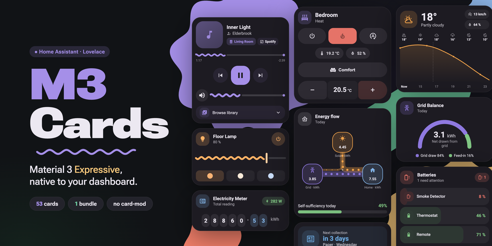

> **⚠️ Beta:** This project is new and under active development.
> Configuration options may still change between versions — please file an
> issue if you run into something.

Material 3–inspired, native Lovelace cards for Home Assistant — built with
TypeScript + [Lit](https://lit.dev), **without** any dependency on
`button-card`, `card-mod`, `mod-card`, or `stack-in-card`. A single bundle
(`m3-cards.js`) registers **55 cards**, all sharing one design language.

<p align="center">
  <a href="https://github.com/j0sp0r/m3-cards/releases/tag/v2.7.0">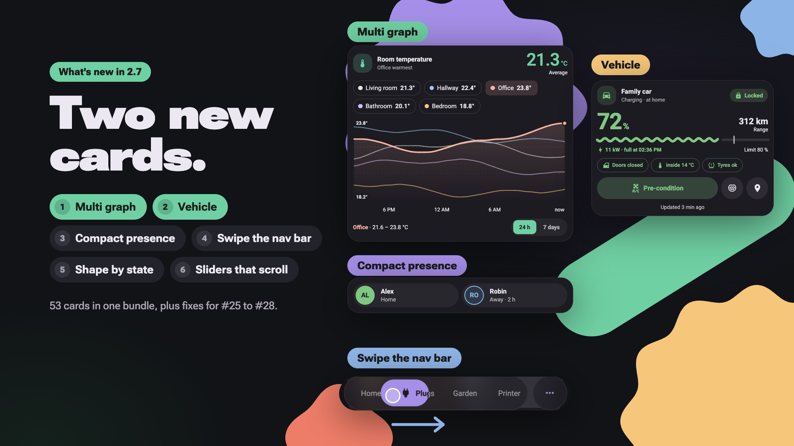</a>
</p>

<p align="center"><sub>
  What's new in 2.7: <a href="https://github.com/j0sp0r/m3-cards/releases/tag/v2.7.0">the release notes</a> ·
  2.6 as a video: <a href="https://github.com/j0sp0r/m3-cards/releases/download/v2.6.0/m3-cards-2.6.mp4">landscape</a> ·
  <a href="https://github.com/j0sp0r/m3-cards/releases/download/v2.6.0/m3-cards-2.6-phone.mp4">phone</a>
</sub></p>

New here? Start with the category that matches what you want to show — every
card links to its full documentation further down.

### 🔌 Energy & power

| Card | Type | What it does |
| --- | --- | --- |
| [Energy](#m3-energy-card) | `m3-energy-card` | Bar chart per day/hour/month, or a solar day timeline with forecast |
| [Cost](#m3-cost-card) | `m3-cost-card` | Cost breakdown with projection, comparison chip and daily bars |
| [Gauge](#m3-gauge-card) | `m3-gauge-card` | Semicircular gauge for the ratio of two quantities |
| [Energy Flow](#m3-energy-flow-card) | `m3-energy-flow-card` | Node diagram of today's solar/grid/home flows |
| [Power Summary](#m3-power-summary-card) | `m3-power-summary-card` | Grid balance, consumption, generation and self-sufficiency |
| [Power List](#m3-power-list-card) | `m3-power-list-card` | Sorted list of power sensors with threshold filter and share bar |
| [Top Consumers](#m3-top-consumers-card) | `m3-top-consumers-card` | Ranking of the largest consumers, by kWh or cost |
| [Counter](#m3-counter-card) | `m3-counter-card` | A meter reading as a rolling digit display |
| [Solar Battery](#m3-solar-battery-card) | `m3-solar-battery-card` | A balcony solar battery with its own inverter: charge, forecast, solar → battery → house and the solar inputs |

### 🌡️ Climate & weather

| Card | Type | What it does |
| --- | --- | --- |
| [Climate](#m3-climate-card) | `m3-climate-card` | Full control for a `climate` entity (AC / thermostat) |
| [Climate Mini](#m3-climate-card-mini) | `m3-climate-card-mini` | Compact climate variant for narrow layouts |
| [Climate Overview](#m3-climate-overview-card) | `m3-climate-overview-card` | Room-by-room temperature/humidity, grouped by area |
| [Weather](#m3-weather-card) | `m3-weather-card` | Temperature curve, precipitation bars, sun markers |
| [Multi Graph](#m3-multi-graph-card) | `m3-multi-graph-card` | Several sensors of one kind as one graph — temperature, humidity, CO₂, power … — one in focus, the rest faint behind it, with a timeline you can scrub |

### 💡 Light, media & control

| Card | Type | What it does |
| --- | --- | --- |
| [Light](#m3-light-card) | `m3-light-card` | Light control with a wavy brightness slider, color temp and color wheel |
| [Media](#m3-media-card) | `m3-media-card` | Media player with artwork colors, wave sliders and a library browser |
| [Button](#m3-button-card) | `m3-button-card` | Generic button/entity card for any domain |
| [Cover](#m3-cover-card) | `m3-cover-card` | Blinds/shutters that adapt to the device's capabilities, plus a group mode |
| [Lights Overview](#m3-lights-overview-card) | `m3-lights-overview-card` | Every light grouped by area, with separate display and toggle filters |
| [Chip Buttons](#m3-chip-buttons-card) | `m3-chip-buttons-card` | A row of compact entity pills, each with its own actions |

### 🚪 Presence & safety

| Card | Type | What it does |
| --- | --- | --- |
| [Presence](#m3-presence-card) | `m3-presence-card` | Who's home — avatar grid for `person`/`device_tracker` |
| [Occupancy](#m3-occupancy-card) | `m3-occupancy-card` | Room-by-room presence with an activity timeline |
| [Leak](#m3-leak-card) | `m3-leak-card` | Water-sensor overview with a quiet OK state and a loud alarm + shut-off |
| [Check-in](#m3-check-in-card) | `m3-checkin-card` | Checked in or out — one element that shows the state and switches it |
| [Openings](#m3-openings-card) | `m3-openings-card` | Windows and doors — what is open, for how long, and a warning when it is cold outside |
| [Alarm](#m3-alarm-card) | `m3-alarm-card` | An alarm panel with mode buttons, keypad and entry-delay countdown, in the theme's own colours |

### 🧺 Household & planning

| Card | Type | What it does |
| --- | --- | --- |
| [Progress](#m3-progress-card) | `m3-progress-card` | Appliance progress with a Material 3 wavy indicator |
| [Supply](#m3-supply-card) | `m3-supply-card` | Consumables: amount left, range estimate, one-tap refill |
| [Todo](#m3-todo-card) | `m3-todo-card` | Shopping and task lists with quick-add chips |
| [Waste](#m3-waste-card) | `m3-waste-card` | Bin-collection schedule with a two-week timeline and reminder mode |
| [Time](#m3-time-card) | `m3-time-card` | Time picker for an `input_datetime` helper |
| [Clock](#m3-clock-card) | `m3-clock-card` | A clock in five styles, from rounded tiles to an organic analogue dial |
| [Status](#m3-status-card) | `m3-status-card` | Big numbers, text and yes/no states, with a rule list behind them |
| [Heading](#m3-heading-card) | `m3-heading-card` | Section headings between the cards: simple, with status, a divider, or collapsible |
| [Nav](#m3-nav-card) | `m3-nav-card` | A navigation bar for the dashboard, in five variants, with a pull-up drawer |
| [Search](#m3-search-card) | `m3-search-card` | A Material 3 search bar that opens Home Assistant's own search and Assist |
| [Group](#m3-group-card) | `m3-group-card` | Several cards on one shared surface, so they read as a single block |
| [Popup](#m3-popup-card) | `m3-popup-card` | Other cards in a bottom sheet, opened by a URL hash — in place of a Bubble Card pop-up |
| [Room](#m3-room-card) | `m3-room-card` | One card per area: every device type it finds, climate readings and presence |
| [Humidifier](#m3-humidifier-card) | `m3-humidifier-card` | Target humidity, mode, fan speed and extras — and it need not be a humidifier entity |
| [Appliance](#m3-appliance-card) | `m3-appliance-card` | Any appliance: status, progress, sliders, programme pills, action buttons and chips |
| [Calendar](#m3-calendar-card) | `m3-calendar-card` | Agenda and month grid for any number of calendars |
| [Vacuum](#m3-vacuum-card) | `m3-vacuum-card` | A robot vacuum: state, battery, start/pause and suction, with every companion entity found on the device |
| [Vacuum maintenance](#m3-vacuum-maintenance-card) | `m3-vacuum-maintenance-card` | What is wearing out on a robot vacuum, what its dock can be told to do, and what it has done so far |
| [3D printer](#m3-printer-card) | `m3-printer-card` | A 3D printer as one card instead of sixteen tiles — state, job and controls, with the layout following what the machine is doing |
| [Remote](#m3-remote-card) | `m3-remote-card` | A remote control for a TV or streaming box — a directional ring instead of a 3×3 grid, with per-brand key profiles |
| [Vehicle](#m3-vehicle-card) | `m3-vehicle-card` | One car — charge or tank, range, lock, location, alerts and actions — for any integration, electric, combustion or hybrid |

### 🛠️ System & maintenance

| Card | Type | What it does |
| --- | --- | --- |
| [Battery](#m3-battery-card) | `m3-battery-card` | Battery levels across all `device_class: battery` sensors |
| [Updates](#m3-updates-card) | `m3-updates-card` | Every available update (core, OS, add-ons, HACS, firmware) |
| [NAS](#m3-nas-card--m3-system-card) | `m3-nas-card` | NAS volumes, CPU, RAM, network via Glances or Synology DSM + Syncthing |
| [System](#m3-nas-card--m3-system-card) | `m3-system-card` | The same, fed by the System Monitor integration |
| [Router](#m3-router-card) | `m3-router-card` | An LTE/5G router's connection, signal quality, throughput and monthly data — graded, not just printed |
| [Router diagnostics](#m3-router-diagnostics-card) | `m3-router-diagnostics-card` | Modem temperatures, throttling, cell and band detail, reachability checks and a restart button that asks first |
| [Detail](#m3-detail-card) | `m3-detail-card` | One entity large: its history as a smoothed curve or a timeline, its device's other entities — and the sheet that can replace more-info |

### 🐠 Special

| Card | Type | What it does |
| --- | --- | --- |
| [Aquarium](#m3-aquarium-card) | `m3-aquarium-card` | Per-aquarium devices, lighting arc, camera and maintenance |

*All cards at a glance:*


<sub>Taken on a real Home Assistant instance. The washing machine, floor lamp,
speaker, air conditioner and the updates show simulated states so the active
renderings (wave indicator, version jump, running installation) are visible in
the image — everything else is live data.</sub>

## Features

- Frosted glass card look (can be turned off for solid themes), shared
  design language across all cards
- Mode pills with shape-morph animation (round → rounded rectangle)
- Temperature stepper with step size/limits taken from the entity
- Optional external temperature/humidity sensors, window and battery chips
- Preset support (tap to cycle, as its own row or as a pill in the mode
  row)
- Configurable card height + full height matching in
  `horizontal-stack`/grid layouts for tiles of exactly equal height
- Full graphical editor (no YAML required) — modeled after the native tile
  card editor, with a unified appearance panel (corner-radius presets,
  per-corner overrides) across every card
- `unavailable` handling without crashing: values shown as "–", controls
  dimmed
- Localized in German/English (follows `hass.locale.language`); any other
  language, or your own wording, through [your own translations](#your-own-translations)
- Accessible: every interactive element is keyboard-reachable
  (Tab/Enter/Space) with a visible focus ring and `aria-label`
- Respects `prefers-reduced-motion` throughout, additionally overridable
  per card via `animation: auto | on | off`
- A short vibration in the companion app when a control on a card is tapped,
  as Home Assistant's own toggles do; `haptics: false` turns it off per card,
  and Home Assistant's "Vibrate" profile setting turns it off for the device
- Old configs (e.g. `animations: true/false`) are migrated to the current
  schema automatically on load — no manual dashboard edits needed
- [Jinja2 templates](#templates) in every card's own string fields, live over
  the websocket — no template-sensor helper per card

## Installation

### HACS (recommended)

[](https://my.home-assistant.io/redirect/hacs_repository/?owner=j0sp0r&repository=m3-cards&category=plugin)

M3 Cards is in the **default HACS store**, so there is nothing to add first:

1. Open HACS in Home Assistant
2. Search for **M3 Cards**
3. Open it and press *Download*
4. Reload Home Assistant

The button above does the same thing without the search — it opens the
repository straight in your own Home Assistant.

<details>
<summary>Not showing up in the search yet?</summary>

HACS refreshes its copy of the store list periodically rather than on every
open, so a recently added repository can take a few hours to appear. Until it
does, it can still be added by hand:

1. HACS → menu (⋮) in the top right → *Custom repositories*
2. Enter the repository URL, pick type **Dashboard**, then *Add*
   (**not** *Integration* — this is a Lovelace card, not an integration)
3. Search for "M3 Cards", open it and press *Download*
4. Reload Home Assistant

Adding it this way is harmless once it does appear: HACS treats it as the same
repository either way.

</details>

### Manual

1. Download the latest `m3-cards.js` from the
   [Releases](../../releases)
2. Copy it to `config/www/m3-cards.js`
3. Add the resource in Home Assistant:
   *Settings → Dashboards → Resources → Add resource*
   - URL: `/local/m3-cards.js`
   - Type: JavaScript module

## Templates

Every card accepts Jinja2 in **its own string fields** — name, icon, colour,
unit, whatever that card reads out of its config. A field is treated as a
template as soon as it contains `{{` or `{%`; everything else is left alone.

```yaml
type: custom:m3-button-card
entity: light.kitchen
name: "{{ states('sensor.kitchen_temperature') | round(1) }} °C"
icon: >-
  {{ 'mdi:lightbulb-on' if is_state('light.kitchen', 'on') else 'mdi:lightbulb' }}
```

Before, a field could only be a fixed string or one entity's raw state. A
composed label meant a template-sensor helper in `configuration.yaml` for every
card that wanted one — and an icon that depends on an entity had no way to be
expressed at all:

```yaml
# configuration.yaml — one of these per card, no longer needed
template:
  - sensor:
      - name: Kitchen label
        state: "{{ states('sensor.kitchen_temperature') | round(1) }} °C"
```

Values are **pushed**, not polled: the card subscribes to the template over
Home Assistant's websocket, and Home Assistant re-renders it whenever anything
the template reads changes. One subscription per distinct template — two fields
sharing the same string share one — and they are all closed when the card
leaves the page.

A card that uses no templates behaves exactly as it always has and pays nothing
for the feature: nothing is walked, subscribed or copied.

### Nested cards are left alone

Card configs can contain other cards: `cards:` on the group and room cards, the
content of a popup action, a mushroom card dropped into a slot. **Templates
inside those are not rendered here** — they are passed through untouched to the
card they belong to.

```yaml
type: custom:m3-room-card
area: kitchen
name: "{{ states('sensor.kitchen_temperature') | round(1) }} °C"   # rendered here
cards:
  - type: custom:mushroom-template-card
    primary: "{{ states('sensor.kitchen_humidity') }} %"           # left for mushroom
```

The reason is that the inner card renders its own templates, and it renders
them *live*. Resolving `primary` above would hand mushroom the one string it
happened to say at the moment the room card was configured — the field would
freeze at that value and never follow the sensor again. The rule is mechanical:
the walk stops at any nested object that carries its own `type`, which is what
a card config looks like whatever card it is for.

The nav card is the exception in the other direction: its entries had templates
before this existed, with `hidden` / `disabled` read as booleans, and they work
as documented under [M3 Nav Card](#m3-nav-card).

## Your own translations

The cards ship in German and English; every other language gets English.
To change that, give the cards your own strings from a small file of your
own — any language, as many or as few strings as you like. Whatever the file
leaves out falls back to the built-in language, then to English.

1. Create `config/www/m3-cards-nl.js` (any name works):

   ```js
   // Only the keys listed here change; everything else stays as shipped.
   window.m3CardsTranslations = {
     ...window.m3CardsTranslations,
     nl: {
       energy_weekday_today: "Vandaag",
       energy_subtitle_days: "Afgelopen {days} dagen",
       multigraph_summary_mean: "Gemiddeld",
       openings_all_closed: "Alles dicht",
     },
   };
   window.dispatchEvent(new Event("m3-cards-translations-loaded"));
   ```

2. Add it as a resource next to `m3-cards.js`:
   *Settings → Dashboards → Resources → Add resource*
   - URL: `/local/m3-cards-nl.js`
   - Type: JavaScript module

The language is the one in your Home Assistant profile. A map is looked up by
the full tag first and then by its base language, so `nl` covers `nl-BE`
too, and an `nl-BE` map can override just the words that differ. A `de` or
`en` map works the same way, for when you only want to reword a few of the
built-in strings.

**Finding the keys.** Every string the cards show is in
[`src/localize.ts`](src/localize.ts); the `en` block is the complete list.
Keys starting with `editor_` belong to the visual editor. Keep placeholders
such as `{days}` or `{n}` exactly as they are — the card fills them in.

The last line of the file lets cards that were already on screen pick up the
new strings straight away: resources load in parallel, so the cards may draw
before your file has run. Leave it out and those cards switch on their next
update instead. Browsers cache resources hard; after editing the file, add
`?v=2` (and so on) to the resource URL or reload with the cache cleared.

## M3 Climate Card

Add the card via the dashboard editor (search for "M3 Climate Card") or via
YAML:


<details>
<summary>Configuration, examples & options</summary>

```yaml
type: custom:m3-climate-card
entity: climate.living_room
name: Living Room
style: tiles # tiles | expressive
show_presets: true
preset_style: chip # chip | pill
show_sensors: true
temperature_chip_placement: info_row # info_row | header
temperature_sensor: sensor.living_room_temperature
humidity_sensor: sensor.living_room_humidity
window_sensor: binary_sensor.living_room_window
battery_sensor: sensor.thermostat_battery
battery_threshold: 20
glass_background: true
hidden_modes: []
height: 380
mode_colors:
  heat: "#e57368"
  cool: "#6ba7dc"
```

### Auto (heat/cool): a band, not one number

A thermostat in `heat_cool` — "Auto" on an Ecobee, and on most American
systems — does not hold one setpoint. It holds two: `target_temp_low`, the
temperature it heats up to, and `target_temp_high`, the one it starts cooling
above. In that mode there is no `temperature` attribute at all.

The card therefore reads the attributes, not the mode, and draws what is
actually there. A single setpoint gets the one stepper row it always had. A
band gets two of the same row stacked at the bottom of the card, labelled
"Heat to" and "Cool above", each with its own minus and plus. Nothing needs
to be configured — an entity that switches between `heat` and `heat_cool`
switches control with it.

Each row's reading is printed in the colour of the end it is: "Heat to" in the
heat colour, "Cool above" in the cool one. They are the same two colours the
mode row uses, so overriding `heat` or `cool` in `mode_colors` retunes the band
as well — there is no second pair of options for it. The low bound being the
warm one reads backwards as a scale and correctly as a control: it is the
number the heating obeys.

Two rows rather than one slider with two handles: the card's target has
always been a large reading with a minus and a plus either side of it, and a
drag track would be a second idiom for the same job. On a six-column tile two
handles also sit close enough together to fight each other's touch targets.

The two bounds can neither cross nor meet — a thermostat asked to heat to 21
and cool above 21 is being asked to do both at once — so each one stops one
step short of the other. Every adjustment sends **both** bounds to
`climate.set_temperature`, even the one that did not move: several
integrations treat an omitted bound as "no opinion" and reset it to whatever
they had. If the entity reports only one of the two, both rows go inert
rather than guess at the other.

Earlier versions fell back to `target_temp_high` and presented it as if it
were a single setpoint — worse than showing nothing, because the plus and
minus then moved only the cooling bound while the label claimed it was the
target temperature (issue #22).

**A single setpoint carries no caption.** The number sits under the thermostat
it belongs to, so "target temperature" written beneath it was the card
repeating itself — and on a narrow card it was the first thing to be cut off.
A *band* keeps its captions: "Heat to" and "Cool above" are the only thing
naming which of the two rows is which, alongside their colours. `expressive`
has always drawn it this way; `tiles` now matches it.

### The `expressive` style

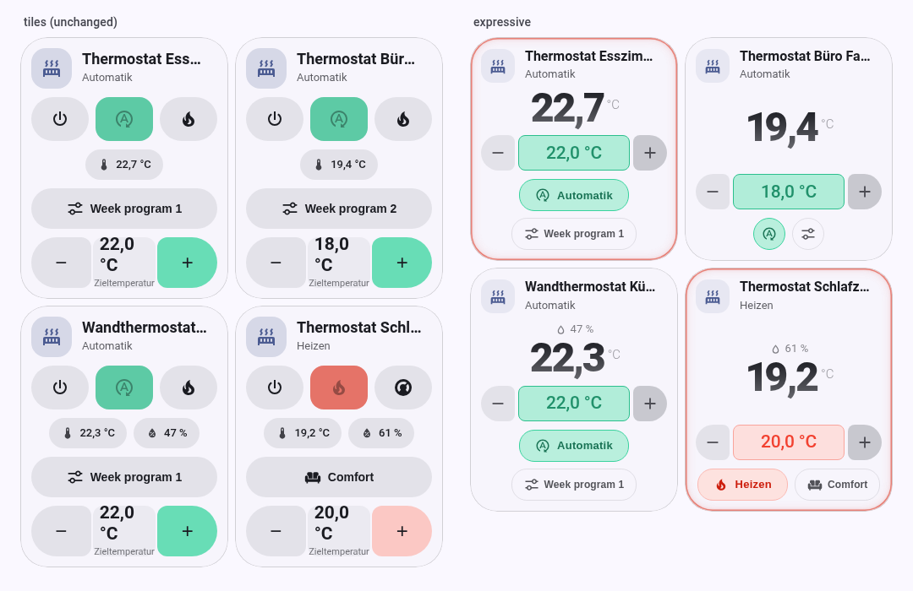
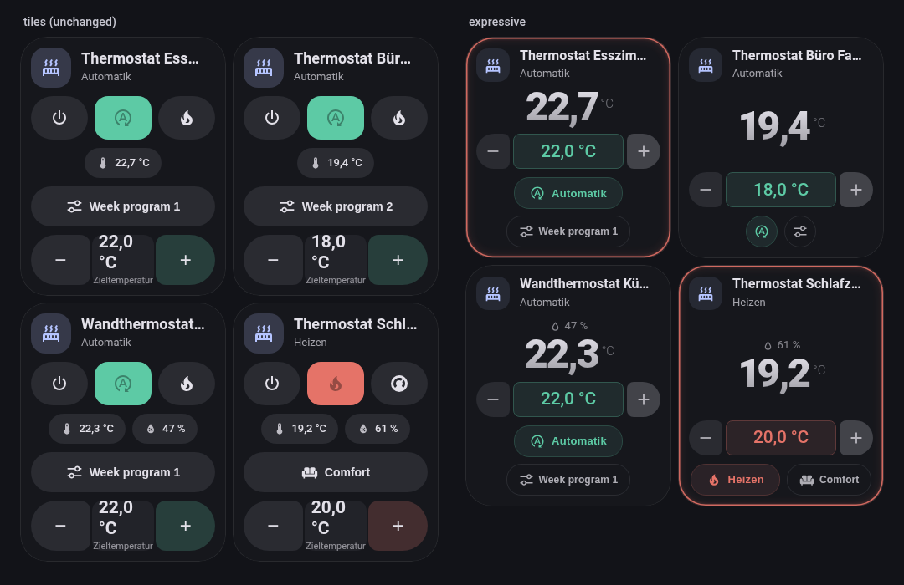

`style: expressive` re-draws the same card around Material 3 Expressive:
instead of a row of mode pills over a sensor row and a stepper, the
**current** temperature becomes one dominant, heavy figure, the setpoint is a
single connected control, and the mode/preset controls morph their shape by
state.

```yaml
type: custom:m3-climate-card
entity: climate.living_room
style: expressive
```

What changes:

- **The current temperature is the card.** One large, heavy, tightly tracked
  figure with the humidity beside it. It stays theme ink and never takes the
  mode colour — the card says "it is 21.4°" first and "it is set to heat"
  second.
- **The setpoint becomes one connected control** — round on the outside,
  square on the inside — instead of a floating pill between two circular
  buttons: a single segmented row where the value takes the full width
  between the ± buttons. A band thermostat (`heat_cool`) gets two of these
  stacked, the same way the `tiles` style stacks its two stepper rows.
- **The mode row collapses into one mode button** that opens the shared
  dropdown menu. With only two modes left (say `off` and `auto`, or after
  `hidden_modes`) a tap just flips straight to the other one, since a menu for
  a binary switch is ceremony. The preset button moves up beside it into one
  control row, and both buttons morph their corner radius on press or while
  their dropdown is open — shape carrying state, the Expressive move this
  style leans on most.
- **A heat/cool frame around the card** reports the equipment, at two
  strengths — see below.

Everything else behaves the same: the same entity, the same sensors, the same
`mode_colors`, the same corner radius and glass background options.

#### The heat/cool frame

The frame has two strengths rather than one. Full while the entity's
`hvac_action` reports `heating`/`cooling`; dimmed while heat or cool is the
selected mode but the equipment is idle.

The second level is not cosmetic. Many integrations derive `hvac_action` from
the physical valve, so a Homematic eTRV reports `idle` for an entire summer
even with the mode set to heat — a frame that only ever lit on `heating` was
invisible on that hardware. Entities that expose no `hvac_action` at all keep
the full frame from their mode alone, so they do not sit permanently dimmed on
no evidence.

Set `show_action_glow: false` to turn the frame off entirely.

### Folding a room away

`collapsible: true` puts a chevron in the header and folds the card down to
that header when it is tapped. The subtitle stays — "occupied · 3 devices on"
is exactly what a folded room still needs to say, and a fold that hid it would
turn the card into a label.

The state persists per browser, or across devices in an `input_boolean` via
`collapse_state_entity` — which also lets an automation fold the guest room
away while nobody is in it.

```yaml
type: custom:m3-room-card
area: guest_room
collapsible: true
default_collapsed: true
```

Setting a header `tap_action` hands the header to that action and hides the
chevron, since the header no longer folds anything — see "Tapping the header".

### Configuration options

| Option | Type | Default | Description |
|---|---|---|---|
| `entity` | string | **Required** | `climate.*` entity |
| `style` | `tiles` \| `expressive` | `tiles` | Visual language: `tiles` is the mode-pill row over a sensor row and stepper; `expressive` makes the current temperature the card's dominant figure with a single connected setpoint control, a single mode button and a heat/cool frame. See [The `expressive` style](#the-expressive-style) |
| `name` | string | entity `friendly_name` | Displayed name |
| `icon` | string | `mdi:radiator` (heating only) / `mdi:air-conditioner` | Header icon |
| `show_header_status` | boolean | `true` | Show the mode line under the card name in the header |
| `show_control_labels` | boolean | `true` | `style: expressive` only — text labels on the mode and preset buttons; `false` leaves both as icon-only circles |
| `show_action_glow` | boolean | `true` | `style: expressive` only — the heat/cool frame around the card |
| `show_presets` | boolean | `true` | Show preset selector (if the entity supports `preset_modes`) |
| `preset_style` | `chip` \| `pill` | `chip` | Preset as its own wide row (`chip`) or as an extra pill in the mode row (`pill`) |
| `show_sensors` | boolean | `true` | Show sensor chips (temperature/humidity) |
| `temperature_chip_placement` | `info_row` \| `header` | `info_row` | Current temperature in the sensor row or as a chip top-right in the header |
| `temperature_sensor` | string | – | External temperature sensor, overrides `current_temperature` |
| `humidity_sensor` | string | – | External humidity sensor, overrides `current_humidity` |
| `window_sensor` | string | – | `binary_sensor`, shows an "Open" chip when `state: "on"` |
| `battery_sensor` | string | – | Sensor for battery level |
| `battery_threshold` | number | `20` | Threshold (%) below which the battery chip appears |
| `hidden_modes` | string[] | `[]` | HVAC modes that are hidden as a pill despite entity support |
| `glass_background` | boolean | `true` | Frosted glass background (off for solid themes) |
| `animations` | boolean | `true` | Shape-morph/press animations; `false` disables all transitions |
| `unavailable_style` | `dimmed` \| `normal` \| `hidden` | `dimmed` | Display when the entity is `unavailable`/`unknown`: `dimmed` (greyed out, not tappable, as before), `normal` (normal display, mode pills/stepper stay tappable), or `hidden` (card is fully hidden) |
| `height` | number (px) | – (automatic) | Fixed minimum card height. See [Equal-height tiles](#equal-height-tiles) |
| `radius` | number (px) | `32` | Card corner radius (editor offers Square/Slightly rounded/Round/Custom) |
| `corners` | object | – | Optional per-corner override: `top_left`, `top_right`, `bottom_right`, `bottom_left` (px) — for asymmetric Material 3 Expressive shapes, only overrides `radius` for the given corners |
| `mode_colors` | object | see below | Color override per HVAC mode. The editor shows a text field + color swatch; accepts hex/CSS **or** HA color names, same as the button card's `color` |
| `icon_active_color` | string | `var(--primary-color)` | Header icon color when active (not "off") |
| `icon_inactive_color` | string | `var(--primary-color)` | Header icon color in the "off" state |
| `plus_active_color` | string | current mode's color | Plus button color when active |
| `plus_inactive_color` | string | `mode_colors.off` | Plus button color in the "off" state |
| `minus_active_color` | string | `var(--primary-text-color)` | Minus button color when active |
| `minus_inactive_color` | string | `var(--primary-text-color)` | Minus button color in the "off" state |

Without any explicit setting, the icon stays in the theme accent color
(`--primary-color`) as before; minus stays neutral. `icon_active_color` /
`icon_inactive_color` / `plus_active_color` / `plus_inactive_color` /
`minus_active_color` / `minus_inactive_color` allow a fully independent
color per element and state ("off" vs. active).

#### Default mode colors

| Mode | Color |
|---|---|
| `off` | `#9e9e9e` |
| `heat` | `#e57368` |
| `cool` | `#6ba7dc` |
| `dry` | `#5dcaa5` |
| `auto` | `#5dcaa5` |
| `fan_only` | `#b8c4c9` |
| `heat_cool` | `#e5a768` |

### Equal-height tiles

HA's native masonry dashboard does **not** automatically equalize the
height of cards next to each other — every column grows independently
based on its own content. Two options:

1. **Use `horizontal-stack`** (recommended, no manual value needed): cards
   in a `horizontal-stack` are automatically stretched by Home Assistant
   via flexbox to the height of the tallest card — the M3 cards fill that
   height completely (including the stepper, which docks to the bottom):
   ```yaml
   type: horizontal-stack
   cards:
     - type: custom:m3-climate-card
       entity: climate.ac
     - type: custom:m3-climate-card
       entity: climate.living_room
   ```
2. **Set `height` manually**: if no `horizontal-stack` is used, a fixed
   pixel value (`height: 380`) can be set per card.

</details>

## M3 Climate Card Mini

A compact companion card to the full climate card: icon tile + on/off
button on top, name + "current temperature · mode" below that, a
minus/target-temperature/plus stepper at the bottom (two numbers instead of
one when the thermostat holds a heat/cool band). No preset, sensor, or
mode-row support — in exchange, two tiles comfortably fit side by side on a
phone screen.


<details>
<summary>Configuration, examples & options</summary>

```yaml
type: custom:m3-climate-card-mini
entity: climate.bedroom
name: Bedroom
glass_background: true
mode_colors:
  heat: "#e57368"
  cool: "#6ba7dc"
```

### The humidity is off until you ask for it

The status line reads `21,2 °C · Aus`, and with a humidity it reads
`21,2 °C · 59 % · Aus` — the readings first, the mode last, however many
readings there turn out to be.

It stays off until you turn it on, and the switch is in the card's own editor
rather than YAML-only. A card that silently grew a third reading would be a
change to every dashboard using it that nobody asked for.

Where it comes from depends on the thermostat. Most report no
`current_humidity` at all, so point `humidity_sensor` at the room's own sensor
— naming one is itself the request to show it, no second switch needed. For a
thermostat that does report its own humidity, `show_humidity: true` alone is
enough. An unavailable sensor drops the segment rather than printing a dash.

## Configuration options

| Option | Type | Default | Description |
|---|---|---|---|
| `entity` | string | **Required** | `climate.*` entity |
| `name` | string | entity `friendly_name` | Displayed name |
| `icon` | string | `mdi:radiator` (heating only) / `mdi:air-conditioner` | Icon in the icon tile |
| `show_humidity` | boolean | `false` | Add the humidity to the status line, next to the temperature |
| `humidity_sensor` | string | – | Where that humidity comes from. Most thermostats report none of their own, so this is usually the room's sensor. Setting it turns the reading on by itself |
| `glass_background` | boolean | `true` | Frosted glass background (off for solid themes) |
| `animations` | boolean | `true` | Transitions for icon tile/on-off button/stepper; `false` disables them |
| `unavailable_style` | `dimmed` \| `normal` \| `hidden` | `dimmed` | Display when the entity is `unavailable`/`unknown` |
| `radius` | number (px) | `28` | Card corner radius (editor offers Square/Slightly rounded/Round/Custom) |
| `corners` | object | – | Optional per-corner override: `top_left`, `top_right`, `bottom_right`, `bottom_left` (px) |
| `mode_colors` | object | see [default mode colors](#default-mode-colors) | Color override per HVAC mode |
| `icon_active_color` | string | current mode's color | Icon color when heating/cooling is active (not "off") |
| `icon_inactive_color` | string | `mode_colors.off` | Icon color in the "off" state |
| `power_active_color` | string | current mode's color | On/off button color when active |
| `power_inactive_color` | string | `mode_colors.off` | On/off button color in the "off" state |
| `plus_active_color` | string | current mode's color | Plus button color when active |
| `plus_inactive_color` | string | `mode_colors.off` | Plus button color in the "off" state |
| `minus_active_color` | string | `var(--primary-text-color)` | Minus button color when active |
| `minus_inactive_color` | string | `var(--primary-text-color)` | Minus button color in the "off" state |

Icon, on/off button, and plus color follow `mode_colors` by default
(including "off"), so they can already be adjusted just via
`mode_colors.off`; minus stays neutral by default. `icon_active_color` /
`icon_inactive_color` / `power_active_color` / `power_inactive_color` /
`plus_active_color` / `plus_inactive_color` / `minus_active_color` /
`minus_inactive_color` additionally allow a fully independent color per
element and state.

### Auto (heat/cool): two setpoints

A thermostat in heat/cool mode has no single target temperature. It holds a
band — `target_temp_low` and `target_temp_high`, and no `temperature` at all —
so a card that reads `temperature` finds nothing and shows a dash. The card
reads the attributes rather than the mode: whichever a thermostat reports is
what it gets, which also keeps it right for the vendors that leave a band
attribute lying around in a single-setpoint mode.

When there is a band, both numbers are printed side by side where the single
target normally sits: heat-to on the left in the heat colour, cool-above on the
right in the cool one. There is no room for a label at this size, so the colour
is what says which end each number is — and it comes from the same
`mode_colors` as the mode row, so an override there reaches the band too.
Tapping one lights it and aims the minus/plus buttons at it: the lit bound sits
in a filled well of its own colour, the other stays coloured text at the same
size. The fill says which number the buttons move, the colour says which end it
is. One pair of buttons is all a tile this size has room for — a second pair
would halve both numbers, and this card exists to stay readable two-up on a
phone. There is nothing to configure: the band appears because the thermostat
reports one.

The two bounds can neither meet nor cross. Each stops one step short of the
other, since a thermostat told to heat to 21 and cool above 21 is being asked
to do both at once. Every adjustment sends both bounds together, because
`climate.set_temperature` treats an omitted bound as "no opinion" and several
integrations then reset it. A bound the thermostat has not reported, or an
unavailable entity, shows `–` and disables the buttons — exactly as a missing
single setpoint does.

The on/off button calls `homeassistant.toggle` on the entity. Tapping the
icon tile, the name/status, or the target-temperature display opens the
more-info dialog. With a band the two numbers select instead of opening it;
the icon tile and the name/status still do.

</details>

## M3 Button Card

A generic card for entities outside of `climate` (buttons, switches,
lights, scenes, door sensors, ...) in the same design. Can also embed its
own row of [chip buttons](#m3-chip-buttons-card) — see `chip_buttons` below.


<details>
<summary>Configuration, examples & options</summary>

```yaml
type: custom:m3-button-card
entity: button.front_door_open
name: Open front door
icon: mdi:door
color: dark-grey
state_colors:
  open: red
  locked: green
show_state: false
show_icon_background: true
show_slider: false
vertical: false
radius: 28
glass_background: true
tap_action:
  action: toggle
hold_action:
  action: more-info
```

### Configuration options

| Option | Type | Default | Description |
|---|---|---|---|
| `entity` | string | – (optional) | Any entity — including `automation.*`, `script.*`, `scene.*`. Can be left empty for a pure action button without an entity state (see below) |
| `name` | string | entity `friendly_name` | Displayed name |
| `name_wrap` | boolean | `false` | A long name takes two lines instead of being cut off with "…" after one |
| `icon` | string | entity icon, otherwise HA's default icon for the domain/`device_class` | Icon. Without an explicit value, the same default icon HA computes for the native tile card is used (e.g. a thermometer for `device_class: temperature`), not just an icon explicitly set on the entity |
| `color` | string | `primary` (uses HA's theme accent color) | HA color name (`red`, `dark-grey`, `deep-orange`, ...) **or** any CSS color (`#hex`, `rgb(...)`) for the icon/background in the **on/active** state |
| `inactive_color` | string | – (default theme grey) | Color for the icon/background in the **off/inactive** state, same format as `color`. Also used when `static_color: true` is set |
| `invert_colors` | boolean | `false` | Swaps `color` and `inactive_color` (or their defaults) without needing custom colors — e.g. to quickly flip "light in the off state, accent color in the on state" into "accent color in the off state, light in the on state" |
| `state_colors` | object | – | Color override per entity state (e.g. `open`, `locked`), overrides `color` only for that state. The editor offers the most common states as fields; any state name is possible via YAML |
| `static_color` | boolean | `false` | Always show the icon/background in `inactive_color` (or the default grey), regardless of entity state — e.g. for devices that are permanently on and shouldn't be visually highlighted as "active". Freely stylable via `inactive_color` |
| `unavailable_style` | `dimmed` \| `normal` \| `hidden` | `dimmed` | Display when the entity is `unavailable`: `dimmed` (greyed out, not tappable, as before), `normal` (normal display, stays tappable — e.g. so `hold_action: more-info` remains usable for diagnostics), or `hidden` (card is fully hidden) |
| `show_state` | boolean | `true` | Show the status line under the name |
| `state_content` | `state` \| `last_changed` \| `last_updated` | `state` | Content of the status line: the entity state itself, or a relative time since the last state change / last update (e.g. "3 hours ago") |
| `show_icon_background` | boolean | `true` | Colored circle behind the icon |
| `icon_size` | number (px) | – (automatic, scales with card height) | Fixed icon size independent of card height, so buttons of different height (e.g. `rows: 1` vs. `rows: 2`) have visually equal-sized icons |
| `align_icons` | boolean | `false` | Align icons at the same distance from the left edge regardless of card height — useful together with `icon_size` so stacked cards of different heights line up visually. Vertical centering is unaffected |
| `show_slider` | boolean | `false` | Show a slider under the icon/text — only effective for `light` (brightness), `cover` (position), `fan` (speed), `input_number`/`number` (value) |
| `vertical` | boolean | `false` | Icon above the text instead of next to it |
| `shape_by_state` | `false` | Lets the outline follow the entity: a capsule while off, the configured corner radius while on, with the icon well going from circle to rounded square. Animated |
| `icon_off` | – | Icon while the entity is off, for symbols that have a struck-through twin (`mdi:power-plug` / `mdi:power-plug-off`). Falls back to `icon` |
| `icon_fill` | `tint` | `tint` is a pale wash carrying a coloured glyph; `solid` fills the well with the accent and darkens the glyph, the louder pairing a phone's quick settings use |
| `radius` | number (px) | `28` | Card corner radius. In the editor as a preset ("Square" 8px / "Slightly rounded" 16px / "Round" 28px) or freely chosen |
| `corners` | object | – | Optional per-corner override: `top_left`, `top_right`, `bottom_right`, `bottom_left` (px) — for asymmetric Material 3 Expressive shapes, e.g. a button with only one rounded side |
| `glass_background` | boolean | `true` | Frosted glass background |
| `animations` | boolean | `true` | Press animation (slight sink-in on tap); `false` disables all transitions |
| `tap_action` | Action | domain-dependent | Chosen sensibly by default: `automation.trigger`/`script.turn_on`/`scene.turn_on`/`button.press` for the respective domain, `toggle` for light/switch/etc., otherwise `more-info`. `action: sidebar` opens Home Assistant's sidebar |
| `hold_action` | Action | `more-info` | Action on long-press (on the whole tile) — same as the native tile card |
| `double_tap_action` | Action | `none` | Action on double-tap (on the whole tile) |
| `icon_tap_action` | Action | `more-info` | Its own tap action for just the icon/icon circle, independent of `tap_action` — same as the native tile card |
| `icon_hold_action` | Action | `none` | Action on long-press on the icon |
| `icon_double_tap_action` | Action | `none` | Action on double-tap on the icon |
| `chip_buttons` | list | `[]` | An embedded row of [chip buttons](#m3-chip-buttons-card) — same fields as the Chip Buttons Card's `buttons[]` (`entity`, `name`, `icon`, `color`, `inactive_color`, `show_state`, `static_color`, `interactive`, `tap_action`, `hold_action`, `double_tap_action`) |
| `chip_buttons_justify` | `start` \| `center` \| `end` | `end` | Alignment of the chip row — only takes effect once the card is resized taller than a normal row (see below); at normal height the chips are always right-aligned |
| `chip_buttons_layout` | `wrap` \| `scroll` | `wrap` | What a chip row that is wider than the card does: `wrap` breaks it onto a second line, `scroll` keeps it on one line and scrolls it horizontally, fading the edge that still hides chips |

Active states (`on`, `open`, `home`, `playing`, ...) color the icon and
icon background in the configured `color` (or the matching
`state_colors` override); entities without a persistent state (`button`,
`script`, `scene`) are always colored.

Triggering automations/scripts/scenes works like any other entity —
`entity: automation.good_morning` is enough, a tap triggers the automation
directly thanks to the domain-dependent default `tap_action` (no manual
`call-service` needed unless you want something different).

#### Pure action button (without an entity)

`entity` can be omitted entirely if the card should only trigger an action
(e.g. start a script/automation) without showing an entity state. Without
`entity`, no status text is shown and the icon is always colored (like
`button`/`script`):

```yaml
type: custom:m3-button-card
name: Feed the cat
icon: mdi:cat
color: dark-grey
tap_action:
  action: perform-action
  perform_action: script.feed_10g
  target: {}
```

#### Embedded chip buttons

`chip_buttons` adds a row of tappable chips to the button itself — e.g. a
quick shortcut to the room's media player right on its light button. At
normal card height they sit right-aligned next to the icon/text; resize the
card taller (e.g. `rows: 2` in the sections view) and they move to a
bottom bar whose alignment is set via `chip_buttons_justify`.

More chips than fit on one line wrap onto a second one. Set
`chip_buttons_layout: scroll` to keep them on a single line instead — the row
then scrolls horizontally, with the same edge fade the Chip Buttons Card uses
to show that there is more on the side you cannot see.

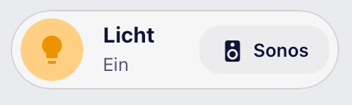

```yaml
type: custom:m3-button-card
entity: light.living_room
name: Licht
chip_buttons:
  - icon: mdi:speaker
    name: Sonos
    interactive: false
chip_buttons_justify: end
chip_buttons_layout: wrap
```

</details>

## M3 Progress Card

A progress card for household appliances with status/percentage/remaining-
time sensors (washing machine, dryer, dishwasher, 3D printer, ...). The
progress bar is a Material 3 Expressive "wavy" indicator: a wave-shaped,
animated active part, a gap, a flat track, and an end-point dot.


<details>
<summary>Configuration, examples & options</summary>

```yaml
type: custom:m3-progress-card
entity: sensor.washing_machine_status
percentage_entity: sensor.washing_machine_progress_percent
remaining_entity: sensor.washing_machine_remaining_minutes
name: Washing Machine
icon: mdi:washing-machine
glass_background: true
```

### Status logic

The status sensor is matched (case-insensitively) to one of four
categories, each with its own status text:

| Category | Default status values | Default status text | Bar |
|---|---|---|---|
| Running | `wash`, `spin`, `rinse`, `run` (and their German names) | "{remaining} min. remaining" | animated wave |
| Preparing | `detecting_load` | "Detecting load…" | animated wave (even without a percentage value: an "indeterminate" segment sweeps across the track) |
| Done | `end`, `finish`, `finished`, `beenden` | "Done! Laundry is clean." | bar at 100%, wave settles into a straight line |
| Ready (all other values) | – | "Ready" | hidden, card collapses to header height |

The status-value lists are freely configurable via `running_states` /
`preparing_states` / `done_states`; `{remaining}` in the status text is
replaced with the value of `remaining_entity` (if the sensor is missing,
only the minutes part is dropped, no crash). `percentage_entity`/
`remaining_entity` are optional — without `percentage_entity`, the bar runs
as an indeterminate animation in the "preparing" state.

The defaults cover Samsung SmartThings (`wash`, `finish`) and Home Connect
(`run`, `finished`), whose remaining time arrives as a completion timestamp. A
run at 100 % with under a minute left counts as done even while the state still
reads `run`, which is how a Bosch dryer reports its anti-crease phase.

### Configuration options

| Option | Type | Default | Description |
|---|---|---|---|
| `entity` | string | **Required** | Status sensor |
| `percentage_entity` | string | – | Sensor with progress in percent (0–100) |
| `remaining_entity` | string | – | Remaining time: minutes, seconds, `1:24:00`, or a completion timestamp, which the card counts down by itself |
| `name` | string | entity `friendly_name` | Displayed name |
| `icon` | string | `mdi:washing-machine` | Icon in the icon tile |
| `status_text_running` / `_preparing` / `_done` / `_ready` | string | see table above | Status text per category; `{remaining}` as a placeholder in `status_text_running` |
| `running_states` / `preparing_states` / `done_states` | string[] | see table above | Status values per category (case-insensitive) |
| `animation` | `auto` \| `on` \| `off` | `auto` | `auto`/`on` respect the system's `prefers-reduced-motion` (then a static line); `off` always disables the animation |
| `wave_style` | `wavy` \| `flat` | `wavy` | Only with `animation: off` — frozen wave or straight line; both still show fill level/gap/dot |
| `hide_when_ready` | boolean | `false` | Hide the whole card in the "ready" state (instead of just the bar) |
| `glass_background` | boolean | `true` | Frosted glass background (off for solid themes) |
| `radius` | number (px) | `28` | Card corner radius |
| `corners` | object | – | Optional per-corner override: `top_left`, `top_right`, `bottom_right`, `bottom_left` (px) |

#### Colors

All colors are optional; unset fields follow the theme. Internally stored
as CSS custom properties (`--m3p-accent`, `--m3p-track`, `--m3p-dot`, …) on
the card — so they can also be overridden via `card-mod` or a theme if
needed.

| Option | Default | Description |
|---|---|---|
| `accent_color` | `#85b7eb`; `primary` on a card added from the card picker | Wave, percentage, icon |
| `track_color` | 12% `--primary-text-color` | Flat track |
| `dot_color` | 70% `--primary-text-color` | End-point dot |
| `icon_color` | accent color | Icon color |
| `icon_background` | 18% icon color | Icon tile background |
| `text_color` | `--primary-text-color` | Name |
| `secondary_text_color` | `--primary-text-color` | Status line |
| `card_background` | glass/solid background | Card background |
| `state_colors.running` / `.preparing` / `.done` | – | Overrides `accent_color` only for that category (e.g. green when "done") |

```yaml
type: custom:m3-progress-card
entity: sensor.washing_machine_status
percentage_entity: sensor.washing_machine_progress_percent
remaining_entity: sensor.washing_machine_remaining_minutes
state_colors:
  done: green
```

</details>

## M3 Energy Card

A bar chart for energy values (solar generation, consumption, ...). `mode`
provides two fundamentally different views:


- **`mode: consumption`** (default) — bars per day or per hour for a
  single entity, see `period` below.
- **`mode: solar`** — the day's solar generation timeline including a
  forecast, see its own section further below.

`mode: consumption` isn't limited to electricity — unit and icon are taken
from the entity (icon automatically based on `device_class`: `gas` →
flame, `water` → water drop, otherwise lightning bolt, unless explicitly
set via `icon`), so the mode works just as well for gas or water meters.

<details>
<summary>Configuration, examples & options</summary>

### `mode: consumption` — time ranges via `period`

- **`period: day`** (default) — the last N days as bars plus today's value
  prominently in the header, live from the current entity state.
- **`period: hour`** — the last N hours of today plus the running hour,
  with a value row above the bars.
- **`period: month`** — the last N months (rolling, including the current
  month) with a projection, average line, and comparison chips, see its
  own section further below.

```yaml
type: custom:m3-energy-card
entity: sensor.solar_energy_total_daily
name: Solar Generation
icon: mdi:solar-power
accent_color: "#66bb6a"
period: day
days: 7
```

```yaml
type: custom:m3-energy-card
entity: sensor.grid_consumption_hourly
name: Consumption per Hour
icon: mdi:lightning-bolt
period: hour
hours: 6
```

### Data retrieval

Past days/hours/months are loaded primarily via HA's long-term statistics
(`recorder/statistics_during_period`, configurable via `statistic_type`):

- `state` (default for `period: day`/`hour`) — the last raw value of the
  period, suitable for meter sensors that periodically reset (e.g.
  `*_daily`/`*_hourly` sensors like Shelly's). Equivalent to what a
  `mini-graph-card` would show with `aggregate_func: max`.
- `change` — the difference within the period, suitable for a never-reset
  cumulative counter. **Default for `period: month`**: even a daily-
  resetting counter needs `change` here, because its `state` at month
  granularity only returns the value of the last day of the month (a few
  kWh), not the monthly sum — `change` correctly accumulates across all
  daily resets instead.

If the entity has no long-term statistics, a History API fallback kicks in
automatically for `period: day`/`hour` (values aggregated by maximum per
day/hour). For `period: month` there is no fallback (a month-scale History
query would be impractically large) — instead the card shows a clear
message. Whether an entity has long-term statistics can be checked under
**Developer tools → Statistics** — the editor also shows a hint for
`period: day`/`hour` if it doesn't. The current day/hour/month is always
computed live (or, for `change`, via a short-term statistics sum since the
period start), not from long-term statistics, since that period isn't
complete yet. Data refreshes every 15 minutes in day mode, every 5 minutes
in hour mode, and hourly in month mode.

Windows and doors get a chip of their own: any `binary_sensor` in the area with
device class `window`, `door`, `garage_door` or `opening`. It shows whenever
such a sensor exists, closed included — "all shut" is the half of the answer
you go looking for on the way out of the house — and turns amber with a count
when something is open. `window_entities` overrides the discovery, which is
worth knowing about: window sensors are often left unassigned to an area, and
nothing can discover what is not filed anywhere.

### Interaction

Tapping a bar briefly shows a value bubble with the amount (with a slight
morph: corner radius 9→6px, brightening); tapping the header opens the
entity's more-info view. On first render, bars grow in with a stagger
(30ms per bar) to their target height — respects the `animation` option
and `prefers-reduced-motion`. In hour mode, with more than 12 bars (e.g.
`hours: 24`) the value row is automatically hidden and only every other
hour label is shown, so it doesn't get too cramped.

### `period: month` — projection, comparison, average

```yaml
type: custom:m3-energy-card
entity: sensor.grid_consumption_daily
name: Consumption per Month
icon: mdi:calendar-month
period: month
months: 12
```

- **Projection**: the current month is shown as a filled actual bar plus a
  dashed outline — the outline shows where the month would land at the
  current daily average (`actual value ÷ days elapsed × days in month`).
  Can be disabled via `show_projection: false`.
- **Average line**: a dashed horizontal line at the level of the average
  of completed months. Can be disabled via `show_average: false`.
- **Comparison chips** below the header (can be disabled via
  `show_comparison: false`):
  - Chip 1 compares the projection (or the actual value, if
    `show_projection: false`) to the previous month in percent — green
    for less consumed, red for more. For generation values (e.g.
    `mode: solar` or your own meters), flip this logic with
    `higher_is_better: true` so "more" is green.
  - Chip 2 shows the average of the completed months ("avg X kWh").
- With `months > 12`, only every other month is labeled, so the axis
  doesn't get too cramped (same threshold as in hour mode).

### `mode: solar` — day timeline with forecast

Shows today's solar generation timeline as bars plus, if available, a
forecast overlay (dashed outline):

```yaml
type: custom:m3-energy-card
mode: solar
source: energy
name: Solar Generation
glass_background: true
```

- **`source: energy`** (default) — automatically sums all solar sources
  from the HA Energy dashboard (**Settings → Dashboards → Energy**),
  without needing to specify an entity manually.
- **`source: entity`** — uses a single, freely chosen `entity` instead.
- **Forecast**: loaded automatically via `energy/solar_forecast` if a
  forecast integration (Forecast.Solar, Solcast, …) is configured in the
  Energy dashboard. Alternatively, `forecast_entity` provides your own
  forecast entity (expects a `wh_hours` attribute, timestamp → Wh — the
  format used by Forecast.Solar/Solcast sensors). If no forecast is
  available, the card works normally, just without the outline bars and
  without "of X kWh expected" in the header.
- **Bars**: past/running hours filled (running hour full accent color,
  past hours as a 30% tint); future hours only as a dashed outline (pure
  forecast); if the running hour is still below the forecast, the
  difference is stacked as a dashed outline on top of the filled bar.
- **Time range**: automatically trimmed to the first through last hour
  with generation or forecast > 0 (not 0–24h, otherwise there would be
  empty bars in the morning/at night); `full_day: true` forces the full
  0–24h range.
- **Statistic type**: solar sensors from the Energy dashboard are almost
  always lifetime counters (never reset), so the default here is `change`
  instead of `state` (see Data retrieval above).
- **Comparison/average chips** (like `period: month`, see above): one chip
  shows today's (generation + forecast) value in % over/under yesterday, a
  second shows the average of the last 7 days. Controlled via
  `show_comparison`/`show_average` (both on by default).

### Configuration options

| Option | Type | Default | Description |
|---|---|---|---|
| `mode` | `consumption` \| `solar` | `consumption` | Bars per day/hour or a solar day timeline with forecast |
| `entity` | string | **Required** except for `mode: solar` + `source: energy` | Energy sensor |
| `statistic_type` | `state` \| `change` | `state` (`change` for `mode: solar` or `period: month`) | Statistic type for the bar values |
| `period` | `day` \| `hour` \| `month` | `day` | Bars per day, hour, or month — only for `mode: consumption` |
| `days` | number | `7` | Number of past days (3–14), only for `period: day` |
| `hours` | number | `6` | Number of past hours (3–24), only for `period: hour` |
| `months` | number | `12` | Number of months including the current one (3–24), only for `period: month` |
| `source` | `entity` \| `energy` | `entity` | Only for `mode: solar`: single entity or all Energy-dashboard solar sources |
| `forecast_entity` | string | — | Only for `mode: solar`: your own forecast entity (optional, fallback when no Energy-dashboard forecast is configured) |
| `full_day` | boolean | `false` | Only for `mode: solar`: always show 0–24h instead of trimming |
| `show_values` | boolean | `false` | Show the value row above the bars in day mode too (it's on by default in hour mode; not available for `mode: solar`/`period: month`) |
| `show_legend` | boolean | `true` | Only for `mode: solar`: "Generated"/"Forecast" legend below the bars (only visible if a forecast is present) |
| `show_projection` | boolean | `true` | Only for `period: month`: show the current month's projection as a dashed outline |
| `show_average` | boolean | `true` | Only for `period: month`: show the dashed average line |
| `show_comparison` | boolean | `true` | Only for `period: month`: show comparison chips (previous month, average) below the header |
| `higher_is_better` | boolean | `false` | Only for `period: month`: flip the comparison chip's color logic (for generation instead of consumption values) |
| `comparison_better_color` | string | `#81c784` | Only for `period: month`: comparison chip color for "better" |
| `comparison_worse_color` | string | `#e57368` | Only for `period: month`: comparison chip color for "worse" |
| `name` | string | entity `friendly_name` | Displayed name |
| `icon` | string | `mdi:solar-power` (`mdi:solar-power-variant` for `mode: solar`) | Icon in the icon tile |
| `subtitle` | string | "Last {days} days" / "Today · last {hours} hours" / "Per month · {months} months" / "Today · day timeline" | Subtitle override |
| `accent_color` | string | `#81c784`; `primary` on a card added from the card picker | Accent color (current bar, current value, icon, outline forecast/projection) |
| `bar_tint_color` | string | 28% accent color (30% for `mode: solar`) | Color of past bars |
| `text_color` / `secondary_text_color` | string | theme default | Name / axis labels |
| `card_background` | string | glass/solid background | Card background |
| `animation` | `auto` \| `on` \| `off` | `auto` | Affects the tap-morph + grow-in effect; `auto`/`on` respect `prefers-reduced-motion` |
| `glass_background` | boolean | `true` | Frosted glass background |
| `radius` / `corners` | number / object | `28` | Corner radius, optional per corner |

</details>

## M3 Gauge Card

Replaces an `energy-grid-neutrality-gauge` tile: shows the ratio of two
quantities (e.g. grid import vs. export) as a semicircular arc with the net
value in the middle. Two segments with a small gap at the transition point
— the gap itself is the "pointer", not a separate needle.


<details>
<summary>Configuration, examples & options</summary>

```yaml
type: custom:m3-gauge-card
name: Grid Balance
```

### Data sources

- **`source: energy`** (default, no further configuration needed if the HA
  Energy dashboard is set up): reads the configured grid import/export
  statistic IDs from `energy/get_prefs` (multiple meters/tariffs are
  summed automatically) and loads their daily values.
- **`source: entities`**: two freely chosen sensors (`value_a_entity` =
  import, `value_b_entity` = export), the time reference then lies with
  the sensors themselves. Not limited to electricity — the unit is taken
  from the configured entities, e.g. for comparing two gas or water
  meters.

If both values are 0, the arc shows only the track color ("No data today"
or "No Energy dashboard configured"); if only one value is 0, the whole
arc fills continuously in one color without a gap.

### Animation

The segments grow from 0 to their target angle on first render and ease
smoothly on later value changes — respects the `animation` option and
`prefers-reduced-motion` like the other cards.

### Configuration options

| Option | Type | Default | Description |
|---|---|---|---|
| `source` | `energy` \| `entities` | `energy` | Data source |
| `value_a_entity` / `value_b_entity` | string | – | Only for `source: entities` — import / export sensor |
| `name` | string | `Grid Balance` | Displayed name |
| `icon` | string | `mdi:transmission-tower` | Icon in the icon tile |
| `subtitle` | string | "Today" | Subtitle override |
| `label_positive` / `label_negative` | string | "Net drawn from grid" / "Net fed into grid" | Text below the net value, depending on sign |
| `label_a` / `label_b` | string | "Grid import" / "Export" | Legend labels |
| `segment_a_color` / `segment_b_color` | string | `#8f79e0` / `#81c784` | Segment colors |
| `track_color` | string | 12% `--primary-text-color` | Arc color with no data |
| `text_color` / `secondary_text_color` | string | theme default | Net value / name & legend |
| `card_background` | string | glass/solid background | Card background |
| `animation` | `auto` \| `on` \| `off` | `auto` | Segment animation; `auto`/`on` respect `prefers-reduced-motion` |
| `glass_background` | boolean | `true` | Frosted glass background |
| `radius` / `corners` | number / object | `28` | Corner radius, optional per corner |

</details>

## M3 Energy Flow Card

A node diagram of today's energy flows between solar, grid, battery, and
home, with animated flow dots along the connection lines and a
self-sufficiency bar below.


<details>
<summary>Configuration, examples & options</summary>

```yaml
type: custom:m3-energy-flow-card
source: energy
```

### Data sources

- **`source: energy`** (default): reads solar, grid import/export, and
  battery statistics directly from the HA Energy dashboard.
- **`source: entities`**: `solar_entity`, `grid_import_entity`,
  `grid_export_entity`, `battery_entity` are freely chosen — useful when
  no full Energy dashboard is set up or individual sources need to be
  replaced. The values update as the sensors change.

### Energy or power

With your own sensors the card follows their unit. Energy sensors (Wh,
kWh, MWh) show the day: "Today", `· kWh`, "Self-sufficiency today". If
every sensor reports **power** (W or kW), the card shows the flow right
now instead: "Now", `· W` (`· kW` from 1000 W) and "Self-sufficiency now".

Names, unit and subtitle can be set yourself:

```yaml
type: custom:m3-energy-flow-card
source: entities
solar_entity: sensor.pv_power
grid_import_entity: sensor.grid_import_power
grid_export_entity: sensor.grid_export_power
pv_name: Roof
grid_name: Grid
home_name: Flat
subtitle: Live
unit: W              # W, kW, Wh, kWh, MWh convert the numbers; other text is a label
```

The battery node automatically appears only if a battery source is
configured (`show_battery: auto`, default) — `always`/`never` force its
visibility regardless.

### Animation

The flow dots run via a CSS animation along the lines
(`flow_speed: slow | normal | fast`) and are omitted entirely (not just
paused) when `animation: "off"` or `prefers-reduced-motion` is active.

### Configuration options

| Option | Type | Default | Description |
|---|---|---|---|
| `source` | `energy` \| `entities` | `energy` | Data source |
| `solar_entity` / `grid_import_entity` / `grid_export_entity` / `battery_entity` | string | – | Only for `source: entities` |
| `name` | string | "Energy Flow" | Displayed name |
| `subtitle` | string | "Today", or "Now" for power sensors | Line under the name |
| `pv_name` / `grid_name` / `home_name` / `battery_name` | string | Solar / Grid / Home / Battery | Node names |
| `unit` | string | kWh, or W/kW for power sensors | Unit under the nodes; W, kW, Wh, kWh and MWh also convert the numbers |
| `icon` | string | `mdi:transmission-tower` | Icon in the icon tile |
| `show_self_sufficiency` | boolean | `true` | Show the self-sufficiency bar |
| `show_battery` | `auto` \| `always` \| `never` | `auto` | Battery node visibility |
| `flow_speed` | `slow` \| `normal` \| `fast` | `normal` | Flow dot speed |
| `pv_color` / `grid_color` / `home_color` / `battery_color` | string | theme default | Node colors |
| `self_sufficiency_color` | string | `#81c784` | Self-sufficiency bar color |
| `text_color` / `secondary_text_color` | string | theme default | Name / node labels |
| `card_background` | string | glass/solid background | Card background |
| `animation` | `auto` \| `on` \| `off` | `auto` | Flow-dot animation; `auto`/`on` respect `prefers-reduced-motion` |
| `glass_background` | boolean | `true` | Frosted glass background |
| `radius` / `corners` | number / object | `28` | Corner radius, optional per corner |

</details>

## M3 Counter Card

Replaces a `tile` card for meter readings: shows a cumulative sensor value
as an odometer-style digit display, each digit in its own cell. Integer and
decimal digits are colored separately (decimals in the accent color). Only
the digits that actually changed on the last update roll animated — the
rest stay put. Not limited to electricity: unit and decimal places come
from the entity, `power_entity` (power chip) is entirely optional — just as
suitable for gas or water meters (m³) as for electricity meters (kWh).


<details>
<summary>Configuration, examples & options</summary>

```yaml
type: custom:m3-counter-card
entity: sensor.virtual_electricity_meter
power_entity: sensor.total_power_consumption
name: Electricity Meter
```

### Digit display

- The number of integer digits (`digits`) grows automatically with the
  value (default: at least 5) and never shrinks back within a session,
  even if the value briefly drops — prevents the card width from
  "jumping". Alternatively, a fixed number can be configured; it too grows
  as needed to never truncate the value.
- The decimal separator and number format follow `hass.locale` (e.g. comma
  instead of period in German).
- If the card is narrower than 340px, the digit cells shrink automatically —
  measured on the card itself, so it works in a narrow column too.
- `unavailable`: cells show a dimmed "–", the power chip is hidden.

### Power chip and ticker

- `power_entity` (optional) shows a chip with a lightning-bolt icon and
  the current power in the header — default color green, switchable via
  `power_thresholds` (e.g. orange above 2000 W, red above 3500 W).
- `show_ticker` + `daily_entity` (both optional) show a thin "+X today"
  line below the digit display, fed from a separate daily sensor.

### Configuration options

| Option | Type | Default | Description |
|---|---|---|---|
| `entity` | string | – | Meter-reading sensor (required) |
| `power_entity` | string | – | Optional power sensor for the header chip |
| `power_entities` | list | – | Power sensors added together, for a room whose consumption is the sum of its plugs. Wins over `power_entity` and over discovery, both of which can only name one |
| `daily_entity` | string | – | Optional daily sensor for the ticker line |
| `name` | string | entity name | Displayed name |
| `icon` | string | `mdi:counter` | Icon in the icon tile |
| `subtitle` | string | "Total reading" | Subtitle override |
| `decimals` | number | `2` | Number of decimal places |
| `digits` | `auto` \| number | `auto` | Integer digits — automatic (min. 5, never shrinks back) or fixed |
| `show_ticker` | boolean | `false` | Show the "+X today" line (needs `daily_entity`) |
| `adjustable` | boolean | `false` | Offers a pencil for correcting the reading. See below — it needs somewhere to write |
| `adjust_entity` | string | `entity` | Where the correction goes when the displayed entity cannot take it |
| `accent_color` | string | `#85b7eb`; `primary` on a card added from the card picker | Color of the decimal-digit cells |
| `cell_background` | string | 8% `--primary-text-color` | Background of the integer-digit cells |
| `power_chip_color` | string | `#81c784` | Default power-chip color |
| `power_thresholds` | `{ above, color }[]` | – | Chip color change above the given power |
| `text_color` / `secondary_text_color` | string | theme default | Name / subtitle & ticker |
| `card_background` | string | glass/solid background | Card background |
| `animation` | `auto` \| `on` \| `off` | `auto` | Roll animation; `auto`/`on` respect `prefers-reduced-motion` |
| `glass_background` | boolean | `true` | Frosted glass background |
| `radius` / `corners` | number / object | `28` | Corner radius, optional per corner |

## Correcting the reading

A meter drifts, or a run gets counted twice, and the number on the wall stops
matching the number on the card. `adjustable: true` offers a pencil beside the
power chip for putting it right — deliberately small, because a correction is a
rare and deliberate act.

It needs somewhere to write, and there are three cases:

| The card shows | What the pencil does |
| --- | --- |
| an `input_number` or `number` | writes the value straight into it |
| a **`utility_meter`** | calls `utility_meter.calibrate`, behind a confirmation |
| anything else, with `adjust_entity` naming a helper | moves that helper by the difference, so a template sensor built as *sources + offset* lands on the wanted figure |

**A plain `sensor` with no `adjust_entity` can't be corrected at all** — there
is no service to write it with. The pencil is then drawn greyed with the reason
on it rather than left out, because `adjustable: true` that silently does
nothing is worse than no option.

**Never point `adjust_entity` at the source of a utility_meter.** The meter
reads a falling source as a meter change and adds the whole new value on the
next rise; measured once here as 18,899 → 40,793 in one five-minute row. That
is why the card checks the platform before the domain: a meter gets calibrated,
never shifted from below.

And calibrating is not free either. The statistics engine reads a downward step
as a meter change too, and adds the old reading to the running sum. Measured on
a throwaway meter: calibrated from 85 to 40, the state was right immediately and
the hourly `sum` went to **125** — the phantom consumption stays in the energy
dashboard until it is corrected.

Correcting it is **Developer tools → Statistics → "Adjust sum"**, with the
adjustment being the old reading negated (here −85) on the hour the calibration
happened. Note that `recorder.adjust_sum_statistics` is a *websocket command*,
not a service: calling it from an automation or from Developer tools → Actions
answers "Service recorder.adjust_sum_statistics not found". The confirmation the
card shows says where to go instead.

</details>

## M3 Power List Card

Replaces an `entities` card for smart-plug/power overviews: shows power
sensors as a sorted list with share bars, hiding inactive devices behind a
collapsible section by default.


<details>
<summary>Configuration, examples & options</summary>

```yaml
type: custom:m3-power-list-card
auto_discover: true
name: Smart Plugs
```

### Entity source

- **Manual list** (`entities`): an array with `entity` (required) and
  optionally `name`, `icon`, `type` (`consumer` | `producer`, default
  `consumer`) per entry. The editor manages the list as a simple sensor
  picker; per-entry name/icon/type overrides can be fine-tuned directly in
  the card's YAML editor.
- **`auto_discover: true`**: automatically picks up every `sensor` entity
  with `device_class: power`, optionally restricted to `include_area` /
  `include_label`, plus `exclude_entities` to exclude specific ones.

### Sorting, threshold, producers

- `threshold` (default `1` W) determines when a device counts as "active"
  — prevents sensor noise (e.g. 0.2 W) from showing up as active.
- `sort` sorts the active consumer rows: `power_desc` (default),
  `power_asc`, `name`, or `config` (order as configured).
- Entries with `type: producer` (e.g. a balcony solar unit) appear in
  their own, visually distinct section above the consumer list and don't
  count toward the consumers' sorting or total.
- `max_visible` (default `0` = all active) limits the visible consumer
  rows; the rest move into the collapsible section for inactive devices.
- The list smoothly reorders when crossing the threshold (respects the
  `animation` option and `prefers-reduced-motion`).

### Configuration options

| Option | Type | Default | Description |
|---|---|---|---|
| `entities` | list | – | Manual sensor list (ignored if `auto_discover: true`) |
| `auto_discover` | boolean | `false` | Automatically pick up all sensors with `device_class: power` |
| `include_area` / `include_label` | string[] | – | Only for `auto_discover` — restrict to areas/labels |
| `exclude_entities` | string[] | – | Only for `auto_discover` — exclude specific entities |
| `threshold` | number | `1` | Threshold in W above which a device counts as "active" |
| `sort` | `power_desc` \| `power_asc` \| `name` \| `config` | `power_desc` | Sorting of active consumers |
| `max_visible` | number | `0` | Max. visible active rows (`0` = all) |
| `show_idle_toggle` | boolean | `true` | Show the collapsible section for inactive/overflow devices |
| `name` | string | "Smart Plugs" | Displayed name |
| `icon` | string | `mdi:power-socket-de` | Icon in the icon tile |
| `subtitle` | string | "{active} of {total} active" | Subtitle override |
| `accent_color` | string | `#85b7eb`; `primary` on a card added from the card picker | Color of consumer icons/values |
| `producer_color` | string | `#f0a24a` | Producer-section color |
| `bar_tint_color` | string | accent color | Share-bar color |
| `text_color` / `secondary_text_color` | string | theme default | Name / subtitle & total |
| `card_background` | string | glass/solid background | Card background |
| `animation` | `auto` \| `on` \| `off` | `auto` | Reorder animation; `auto`/`on` respect `prefers-reduced-motion` |
| `glass_background` | boolean | `true` | Frosted glass background |
| `radius` / `corners` | number / object | `28` | Corner radius, optional per corner |

</details>

## M3 Power Summary Card

Replaces a set of individual tile cards for instantaneous power: combines
grid balance, consumption, generation, and optional sub-totals into one
card with a clear hierarchy. Pure live values from `hass.states`, no
statistics queries needed.


<details>
<summary>Configuration, examples & options</summary>

```yaml
type: custom:m3-power-summary-card
grid_entity: sensor.grid_power
consumption_entity: sensor.total_power_consumption_pre_solar
solar_entity: sensor.balcony_solar_power
metrics:
  - entity: sensor.total_power_consumption_pre_solar
    name: Consumption
    icon: mdi:home-lightning-bolt
  - entity: sensor.balcony_solar_power
    name: Balcony Solar
    icon: mdi:solar-power-variant
    type: producer
  - entity: sensor.total_power_consumption
    name: Smart Plugs
    icon: mdi:power-socket-de
```

### Sign convention

Instantaneous power sensors at the grid connection encode export/import
differently. `grid_sign` sets the card to the respective convention:

- **`negative_is_export`** (default): negative value = export, positive
  value = import — the most common convention (e.g. Shelly 3EM, many
  inverter integrations).
- **`positive_is_export`**: the reverse.

The displayed value is always a positive amount — icon and label show the
direction. If the amount is within `zero_threshold` (default 10 W) of 0,
the card shows a neutral "Balanced" state instead of export/import.

### Share bar and self-sufficiency

- If `solar_entity` is set and generation is > 0, a two-part bar shows how
  current consumption is covered: self-consumption from solar vs. surplus
  (when exporting) or vs. grid share (when importing). Can be disabled via
  `show_split_bar`.
- The self-sufficiency chip (`show_self_sufficiency`, on by default) is
  computed as `(consumption − grid import) / consumption × 100`, clamped
  to 0–100%.
- If `consumption_entity` isn't set, consumption is computed as
  `grid import + solar generation`.

### Compact

`layout: compact` makes the card one tile one row tall, for a half-width
slot: the main value in the suite's header, and the other values on one line
beneath it, each behind a small icon — consumption or grid (whichever is not
the main one), solar, self-sufficiency and the metrics. A value that does not
fit is left out whole rather than cut in half. `main_value` picks the large
one: `grid` (default) or `consumption`.

```yaml
type: custom:m3-power-summary-card
layout: compact
main_value: consumption
grid_entity: sensor.grid_power
consumption_entity: sensor.house_power
solar_entity: sensor.pv_power
metrics:
  - entity: sensor.battery_level
tap_action:
  action: navigate
  navigation_path: /lovelace/energy
```

### Configuration options

| Option | Type | Default | Description |
|---|---|---|---|
| `grid_entity` | string | – | Instantaneous power at the grid connection, in W (required) |
| `layout` | `full` \| `compact` | `full` | `compact`: one row, main value plus one line of the others |
| `main_value` | `grid` \| `consumption` | `grid` | The large value in compact layout |
| `tap_action` | action | `more-info` | Tap on the main icon (full) or the tile (compact); more-info opens the main value's entity |
| `grid_sign` | `negative_is_export` \| `positive_is_export` | `negative_is_export` | Sign convention of the grid sensor |
| `consumption_entity` | string | – | Home consumption in W (empty = computed from grid import + solar) |
| `solar_entity` | string / string[] | – | Generation sensor(s) in W, summed |
| `metrics` | list | – | Additional metric fields (`entity`, `name`, `icon`, `color`, `type`) |
| `label_export` / `label_import` | string | "Export to grid" / "Import from grid" | Main row label per direction |
| `show_self_sufficiency` | boolean | `true` | Show the self-sufficiency chip |
| `show_split_bar` | boolean | `true` | Show the share bar (only with `solar_entity` configured) |
| `zero_threshold` | number | `10` | Threshold in W for the neutral "balanced" state |
| `kw_threshold` | number | `1000` | Above this value in W, formatted as "X.X kW" instead of "X W" |
| `export_color` / `import_color` | string | `#81c784` / `#8f79e0` | Colors for export / import |
| `producer_color` | string | `#f0a24a` | Color for producer metrics and the solar share |
| `accent_color` | string | `#81c784` | Self-sufficiency chip color |
| `text_color` / `secondary_text_color` | string | theme default | Values / labels |
| `card_background` | string | glass/solid background | Card background |
| `animation` | `auto` \| `on` \| `off` | `auto` | Smooth value interpolation (300ms); `auto`/`on` respect `prefers-reduced-motion` |
| `glass_background` | boolean | `true` | Frosted glass background |
| `radius` / `corners` | number / object | `28` | Corner radius, optional per corner |

</details>

## M3 Top Consumers Card

Replaces the native `energy-devices-graph` card: shows the biggest
individual consumers for a time range as a ranking, by default fed from
the devices section of the HA Energy dashboard.


<details>
<summary>Configuration, examples & options</summary>

```yaml
type: custom:m3-top-consumers-card
source: energy
period: today
top_count: 7
```

### Data source and time range

- **`source: energy`** (default): reads the configured device statistic
  IDs from `energy/get_prefs` and loads their consumption for the chosen
  `period` (`today`, `yesterday`, `week`, `month`) via
  `recorder/statistics_during_period`. The header total is the sum of the
  MEASURED devices, not necessarily the entire home consumption.
- **`source: entities`**: a manual list of energy sensors (kWh) via
  `entities`, for when no Energy dashboard is set up or a custom selection
  is desired.
- Refreshes every 15 minutes. Devices with 0 kWh in the period are omitted
  entirely.

### Ranking, overflow row, name cleanup

- Sorted descending by consumption. `top_count` (default 7) devices are
  shown as full rows with share bars.
- All remaining devices land, depending on `rest_mode`, in a collapsible
  overflow row (`collapse`, default), are omitted entirely (`hide`), or
  are also shown as full rows (`show_all`).
- `name_strip` removes regex/text patterns from entity names (default:
  `^Plug \d+ - ` and ` Energy$`); overridable per device via `name` in
  `entities` (an override disables cleanup for that device).
- Device colors are assigned cyclically from `palette` (default: 8 tones
  from the project's color system), fixed per device via `color`.
- Reordering on data refresh is smoothly animated (respects
  `animation`/`prefers-reduced-motion`).

### `unit_mode: cost` — rank by cost instead of kWh

```yaml
type: custom:m3-top-consumers-card
source: energy
unit_mode: cost
price_source: energy_dashboard
```

Ranks devices by cost instead of consumption (value per device = kWh ×
price). The price source (`price_source`) works identically to the M3 Cost
Card further below — see there for details on
`energy_dashboard`/`input_number`/`fixed`. Since HA doesn't keep a separate
cost statistic per device (only for total grid import), with
`price_source: energy_dashboard` an effective price is derived from total
cost ÷ total grid-import consumption for the chosen period. The row
subtitle becomes two-part ("{kWh} kWh · {x}% of cost"), header total and
overflow row appear in `currency`.

### Configuration options

| Option | Type | Default | Description |
|---|---|---|---|
| `source` | `energy` \| `entities` | `energy` | Data source |
| `entities` | list | – | Only for `source: entities` — `entity`, optionally `name`/`icon`/`color` |
| `period` | `today` \| `yesterday` \| `week` \| `month` | `today` | Time range |
| `top_count` | number | `7` | Number of full rows before the overflow row |
| `rest_mode` | `collapse` \| `hide` \| `show_all` | `collapse` | Behavior for devices beyond `top_count` |
| `name_strip` | string[] | see above | Regex/text patterns removed from entity names |
| `unit_mode` | `energy` \| `cost` | `energy` | Rank by kWh or by cost |
| `price_source` / `price_entity` / `price` / `price_unit` / `currency` | see M3 Cost Card | `energy_dashboard` | Only for `unit_mode: cost` |
| `name` | string | "Top Consumers" | Displayed name |
| `icon` | string | `mdi:trophy-outline` | Icon in the icon tile |
| `subtitle` | string | "{period} · {n} devices" | Subtitle override |
| `accent_color` | string | `#85b7eb`; `primary` on a card added from the card picker | Color of the header total |
| `palette` | string[] | see above | Cyclically assigned device colors |
| `text_color` / `secondary_text_color` | string | theme default | Name / subtitle & percentage row |
| `card_background` | string | glass/solid background | Card background |
| `animation` | `auto` \| `on` \| `off` | `auto` | Reorder animation; `auto`/`on` respect `prefers-reduced-motion` |
| `glass_background` | boolean | `true` | Frosted glass background |
| `radius` / `corners` | number / object | `28` | Corner radius, optional per corner |

</details>

## M3 Cost Card

A cost breakdown for a time range (default: current month) with
projection, comparison to the previous period, daily bars, and time-range
navigation to browse past months. Not limited to electricity — `entity`
can be any cumulative energy sensor (with `price_source: energy_dashboard`
the grid-import cost statistic is used automatically).


<details>
<summary>Configuration, examples & options</summary>

```yaml
type: custom:m3-cost-card
price_source: energy_dashboard
period: month
```

### Price source (`price_source`)

- **`energy_dashboard`** (default): reads the cost statistic HA already
  computes for grid import (`stat_cost` from `energy/get_prefs`) — the
  card doesn't compute anything itself here. Requirement: a price is set
  for grid import in the Energy dashboard (fixed price or
  `entity_energy_price`), AND the recorder has processed at least one
  statistics run since the price was set — `stat_cost` can therefore still
  be `null` for a while even with a price already configured. Without an
  available cost statistic, the card shows a hint with a link to
  `/config/energy` instead of a made-up number.
- **`input_number`**: `price_entity` points to an `input_number` helper
  (unit price in €/kWh or ct/kWh, detected via `price_unit` or the
  helper's unit). Cost = consumption (`entity`, kWh) × price. The tariff
  row shows the current price; tapping it opens the helper in the
  more-info dialog to adjust (no dedicated stepper — the price rarely
  changes in practice, so a permanently visible slider isn't worth it).
- **`fixed`**: a fixed `price` in the card config, no tariff interaction.

`base_fee` (€/month) is added to the cost total pro-rated per day already
elapsed, for `period: month`.

### Time-range navigation

Below the daily bars (or directly below the chips for `period: day`) sits
a navigation row with ‹/› arrows that flips to the previous/next period —
handy for comparing completed months. For already-completed periods, the
projection is automatically dropped (the period is fully over); the
comparison chip then compares the actual total to the period before it.
The "next" arrow is disabled once the current (running) period is reached.

### Projection, comparison, budget

- Projection chip (`show_projection`, on by default): projected to the end
  of the period (amount ÷ days elapsed × total days). Too unreliable on
  the first day of the period — shows "Projection from tomorrow" instead.
  Only for the current period, not when browsing past months.
- Comparison chip (`show_comparison`, on by default): projection (or, when
  browsing: the actual total) vs. the previous period in percent, green
  for less, red for more.
- Budget chip (optional `budget`): "X% of budget", color changes above
  100%.
- If feed-in compensation exceeds the cost (a negative total), the card
  shows the amount in green with the label "Credit".

### Configuration options

| Option | Type | Default | Description |
|---|---|---|---|
| `price_source` | `energy_dashboard` \| `input_number` \| `fixed` | `energy_dashboard` | Price source, see above |
| `price_entity` | string | – | Only for `input_number` — the price helper |
| `price` | number | – | Only for `fixed` — price per kWh |
| `price_unit` | `eur_per_kwh` \| `ct_per_kwh` | detected from the helper / `eur_per_kwh` | Unit of the price |
| `base_fee` | number | – | Base fee €/month, pro-rated for `period: month` |
| `currency` | string | `EUR` | ISO currency code for formatting |
| `entity` | string | – | Energy sensor (kWh); not needed with `price_source: energy_dashboard` |
| `period` | `day` \| `month` \| `year` | `month` | Time range |
| `show_projection` | boolean | `true` | Show the projection chip |
| `show_comparison` | boolean | `true` | Show the comparison chip |
| `budget` | number | – | Optional budget for the budget chip |
| `name` | string | "Cost" | Displayed name |
| `icon` | string | `mdi:cash-multiple` | Icon in the icon tile |
| `subtitle` | string | "Cost in {month}" (period-dependent) | Subtitle override |
| `accent_color` | string | `#f0a24a`; `primary` on a card added from the card picker | Accent color |
| `text_color` / `secondary_text_color` | string | theme default | Amount / label & footer |
| `card_background` | string | glass/solid background | Card background |
| `animation` | `auto` \| `on` \| `off` | `auto` | Bar/value animation; `auto`/`on` respect `prefers-reduced-motion` |
| `glass_background` | boolean | `true` | Frosted glass background |
| `radius` / `corners` | number / object | `28` | Corner radius, optional per corner |

</details>

## M3 Light Card

Light control with a header (icon, name, power button) and a wave slider
for brightness — drag with mouse or finger, tap to jump, arrow keys for
±5% (Shift for ±1%). On a phone a swipe that starts on the slider decides by
its direction: sideways sets the brightness, up or down scrolls the page and
leaves the light alone. A tap sets the value when the finger lifts. Every
slider in the suite works this way.


<details>
<summary>Configuration, examples & options</summary>

```yaml
type: custom:m3-light-card
entity: light.living_room
```

Brightness changes are throttled (~200ms) and sent as `light.turn_on` with
`brightness_pct`, and applied optimistically in the UI so dragging stays
smooth even on a slow network connection. Entities without `brightness`
support (e.g. simple on/off lamps) show only the header and power button,
no slider.

A light that reports `color_temp` also gets a color temperature row —
three presets, or a continuous slider with `color_temp_style: slider`.
`show_color_temp: false` leaves it out entirely, which keeps the card
short on views that hold many lights and only ever change brightness.

### Compact

`compact: true` drops the power button and makes the header icon the toggle
instead — the split the native tile card makes, where the icon is the control
and the rest of the header opens more-info.

```yaml
type: custom:m3-light-card
entity: light.living_room
compact: true
```

The point is horizontal room. The power button and the icon are two lit-up
things at opposite ends of a header that is already carrying a name and a
subtitle, and in a two-column grid that is the width the name loses first.
The swatch already tints with the light's state, so it reads as the on/off
control it has become without anything else being added.

Everything else is unchanged: the brightness slider, the colour rows and the
member list all still render, and the header still opens more-info.

The other way round — tap the tile to toggle, tap the icon for more-info —
is two actions:

```yaml
type: custom:m3-light-card
entity: light.living_room
compact: true
tap_action:
  action: toggle
icon_tap_action:
  action: more-info
```

### Configuration options

| Option | Type | Default | Description |
|---|---|---|---|
| `entity` | string | – | `light` entity (required) |
| `name` | string | entity name | Displayed name |
| `icon` | string | entity icon | Icon in the icon tile |
| `transition` | number | – | Transition duration (seconds) for `light.turn_on` calls |
| `compact` | boolean | `false` | Drop the power button and make the header icon the toggle instead |
| `tap_action` | action | `more-info` | Tap on the header. `toggle` switches the light with the card's `transition` |
| `icon_tap_action` | action | `toggle` in compact mode, none otherwise | Tap on the icon. Swap it with `tap_action` for a tile that toggles on tap and opens more-info from the icon |
| `hold_action` | action | none | Long press on the header |
| `shape_by_state` | boolean | `false` | The header icon is a circle while the light is off and a rounded square while it is on, as on the button card |
| `wave_style` | `wavy` \| `flat` | `wavy` | Slider wave shape |
| `show_color_temp` | boolean | `true` | Show the color temperature row; `false` hides it even on a light that supports it |
| `use_light_color` | boolean | `true` | While the light is on, the slider, icon and power button take the colour it shines in (colour or colour temperature); `false`, or a light without colour, uses `accent_color` |
| `accent_color` / `track_color` / `handle_color` | string | theme default | Slider colors |
| `text_color` / `secondary_text_color` | string | theme default | Name / subtitle |
| `card_background` | string | glass/solid background | Card background |
| `animation` | `auto` \| `on` \| `off` | `auto` | Wave/power-button animation; `auto`/`on` respect `prefers-reduced-motion` |
| `glass_background` | boolean | `true` | Frosted glass background |
| `radius` / `corners` | number / object | `28` | Corner radius, optional per corner |

</details>

## M3 Battery Card

An overview of all battery-level sensors as a sorted list with threshold-
based coloring (critical/low/medium/ok), each row filled to its charge, and a collapsible
section for the remaining devices.


<details>
<summary>Configuration, examples & options</summary>

```yaml
type: custom:m3-battery-card
auto_discover: true
```

### Entity source

- **`auto_discover: true`** (default): automatically finds every entity
  with `device_class: battery`, optionally filtered via `include_area` /
  `include_label` / `exclude_entities`. Entries in `entities` act as a
  name/icon override per entity in this mode (not a full replacement of
  the automatic list).
- **`auto_discover: false`**: only the selection explicitly listed in
  `entities`.

`name_strip` removes configurable suffixes from the displayed name
(default: " Battery Level", " Batteriestand", " Battery", " Batterie") —
so the entity name "Bedroom Battery Level" becomes "Bedroom".

### Sorting, thresholds, display

Rows are always `unavailable` first, then sorted ascending by charge level
— so the devices most likely to need attention appear at the top.
`thresholds` (critical/low/medium) determine fill and text color;
`max_visible` + `show_healthy_toggle` hide healthy devices behind a "show
N more" button, similar to the Power List Card.

### Low-battery notification

The card only warns while you're looking at it, so the editor's
**Benachrichtigung** section can create a Home Assistant automation that
notifies you regardless. Pick one or more notify targets (built from your
own `notify.*` services), a threshold (`notify_threshold`, default 1 %) and
a rhythm, then press "Benachrichtigung einrichten":

- **`daily`** / **`weekly`** — one digest at `notify_time` listing every
  weak battery ("5 Batterien schwach: …"), so a dozen low devices don't
  become a dozen pushes. `weekly` additionally fires only on
  `notify_weekday`.
- **`on_change`** — fires the moment a battery crosses below the threshold,
  one message per device. Re-arms by itself once the battery is back above.

The automation watches exactly the devices the card lists — the manual
`entities` list, or auto-discovery including any area/label filters. That
set is resolved when you press the button and written into the automation,
so **press it again after adding new devices** to cover them too.
`notify_exclude_entities` mutes individual devices without removing them
from the card — useful for sensors permanently reporting 1 %.

### Configuration options

| Option | Type | Default | Description |
|---|---|---|---|
| `auto_discover` | boolean | `true` | Automatic discovery of all battery sensors |
| `entities` | list | – | Manual selection, or overrides when `auto_discover: true` |
| `include_area` / `include_label` | list\<string\> | – | Filter for auto-discovery |
| `exclude_entities` | list\<string\> | – | Entities excluded from auto-discovery |
| `name_strip` | list\<string\> | see above | Name suffixes to remove |
| `thresholds` | object (`critical`/`low`/`medium`) | `10`/`20`/`50` | Percentage thresholds for coloring |
| `max_visible` | number | – | Number of directly visible rows, rest behind "show more" |
| `show_healthy_toggle` | boolean | `true` | Collapsible section for devices above the `medium` threshold |
| `notify_service` | list\<string\> | – | Notify targets for the low-battery reminder (without the `notify.` prefix) |
| `notify_threshold` | number | `1` | Percentage at or below which a battery counts as weak |
| `notify_mode` | `daily` \| `weekly` \| `on_change` | `daily` | Digest at a fixed time, weekly, or immediately on crossing |
| `notify_time` | string | `18:00:00` | Time of the digest (`daily`/`weekly` only) |
| `notify_weekday` | string | `mon` | Weekday of the digest (`weekly` only) |
| `notify_exclude_entities` | list\<string\> | – | Devices that never trigger a notification |
| `name` / `icon` | string | "Batteries" / `mdi:battery` | Header |
| `critical_color` / `low_color` / `medium_color` / `ok_color` / `unavailable_color` | string | theme default | Threshold colors |
| `text_color` / `secondary_text_color` | string | theme default | Name / values |
| `card_background` | string | glass/solid background | Card background |
| `animation` | `auto` \| `on` \| `off` | `auto` | Expand/collapse animation; `auto`/`on` respect `prefers-reduced-motion` |
| `glass_background` | boolean | `true` | Frosted glass background |
| `radius` / `corners` | number / object | `28` | Corner radius, optional per corner |

</details>

## M3 Weather Card

A weather card with a header (icon/temperature/condition/chips), a smoothed
temperature curve with gradient fill, hourly precipitation bars, sunrise/
sunset markers on the curve, and an optional daily overview.


<details>
<summary>Configuration, examples & options</summary>

```yaml
type: custom:m3-weather-card
entity: weather.forecast_home
```

### Setting up weather data

The card needs some `weather.*` entity — it doesn't generate its own
weather data. If you don't have a `weather` integration set up yet (the
editor shows a matching hint in that case), Home Assistant's built-in
**Met.no** integration works for most locations: free, no API key needed,
automatically uses your Home zone's coordinates.

**Settings → Devices & Services → Add Integration → search for "Met.no" →
confirm the location.** A new `weather.*` entity is then available to pick.

Other weather integrations (OpenWeatherMap, AccuWeather, Pirate Weather,
...) work the same way, but usually require a free API key from the
provider.

The hourly forecast is always loaded; the daily overview only if `days` is
set above 0. Both are fetched via the `weather.get_forecasts` service and
refreshed every 15 minutes. If the weather entity briefly goes
`unavailable` (e.g. a DNS/network hiccup in the integration), the card
keeps showing the last known reading with a "Last known reading · X min
ago" hint instead of going blank — "Unavailable" only appears if no data
was ever received. How many days are actually available depends on the
weather integration (Met.no delivers 6 days max); from 4 days on, the
daily list collapses by default and expands via a button.

Each day's bar runs from its low to its high and is coloured by the
temperature itself, on a fixed outdoor scale: blue up to 0 °C, cyan around
10 °C, green around 17 °C, yellow around 24 °C and red from 30 °C, blended
in between. A cold week stays blue and a hot one turns red, rather than every
week running from blue to red.

### Your own sensors

A weather entity does not always carry everything: many have no feels-like
temperature or UV index, while a weather station next door has a sensor for
each. `sensors` takes them instead. `temperature` is the large current
temperature; every other key is the chip of the same name. The forecast still
comes from the weather entity, and a sensor that is unavailable falls back to
the weather entity's value.

```yaml
type: custom:m3-weather-card
entity: weather.home
chips: [apparent_temperature, uv_index, humidity]
sensors:
  temperature: sensor.station_temperature
  apparent_temperature: sensor.station_feels_like
  uv_index: sensor.station_uv
tap_action:
  action: navigate
  navigation_path: /lovelace/weather
```

### Configuration options

| Option | Type | Default | Description |
|---|---|---|---|
| `entity` | string | – (required) | `weather` entity |
| `name` | string | entity's friendly name | Header title |
| `hours` | number | `12` | Number of hours in the curve |
| `days` | number | `0` | Number of days in the daily overview (`0` = hidden) |
| `show_days_toggle` | boolean | `true` | Collapsible from 4 days on with a "Show N more" button; `false` = always show all configured days directly |
| `sensors` | object | – | Own sensors: `temperature` and any chip key (`apparent_temperature`, `wind_speed`, `humidity`, `pressure`, `uv_index`, `visibility`). Each replaces the weather entity's value and brings its own unit |
| `tap_action` | action | `more-info` | Tap on the current conditions |
| `chips` | list (`apparent_temperature`\|`wind_speed`\|`humidity`\|`pressure`\|`uv_index`\|`visibility`) | apparent temp, wind, humidity | Header chips shown |
| `show_sun` | boolean | `true` | Sunrise/sunset markers on the curve (from `sun.sun`) |
| `show_current` | boolean | `true` | The header row: icon, temperature, condition and chips |
| `show_chart` | boolean | `true` | The temperature curve with its precipitation bars |
| `show_hourly_icons` | boolean | `true` | Condition icon per shown hour |
| `show_hourly_temperatures` | boolean | `true` | Temperature per shown hour |
| `show_hour_labels` | boolean | `true` | The hour under each column. Without it the temperatures say nothing about when they apply |
| `show_temp_axis` | boolean | `false` | Min/mid/max temperature marks along the curve |
| `accent_color` | string | solar yellow; `primary` on a card added from the card picker | Curve color |
| `precipitation_color` | string | `#6ba7dc` | Precipitation bar color |
| `gradient_color` | string | same as `accent_color` | Gradient fill under the curve |
| `text_color` / `secondary_text_color` | string | theme default | Temperature/title vs. chips/secondary values |
| `card_background` | string | glass/solid background | Card background |
| `animation` | `auto` \| `on` \| `off` | `auto` | Curve draw-in animation; `auto`/`on` respect `prefers-reduced-motion` |
| `glass_background` | boolean | `true` | Frosted glass background |
| `radius` / `corners` | number / object | `28` | Corner radius, optional per corner |

Icons, temperatures and hours share one rhythm: the card measures its own
width, decides how many columns fit, and then draws every 2nd, 3rd or 4th
hour — never a crowded row. A regular rhythm and a strip that ends flush at
both edges only both hold when that step divides the row evenly, so the row
is cut back to where it does. Ask for twelve hours in a narrow card and
eleven are drawn; the curve, the rain bars and the sun markers are cut to
the same length so nothing drifts apart.

</details>

## M3 Presence Card

A presence overview as an avatar grid for `person` and `device_tracker`
entities, with a status ring (home/away/zone/unknown), an initials avatar,
a relative time label ("since 5 min"), and an optional embedded map
(`hui-map-card`).


<details>
<summary>Configuration, examples & options</summary>

```yaml
type: custom:m3-presence-card
auto_discover: true
```

### Compact layout

`layout: compact` drops the header and the avatar grid for one tile per
person, built like a button card one row tall: the avatar in a 44px well, the
name, and one status line — the zone or "away", then how long, else the
distance. The well says the status: filled solid in the person's colour at
home, a tint with a coloured ring elsewhere, the way a button's icon well says
"on". The tiles share the row and wrap when the card is narrow, so two people
fit on one 80px card. With `shape_by_state: true` a tile and its well square
off while the person is home.

```yaml
type: custom:m3-presence-card
layout: compact
```

Actions, popups, sorting, colours and `show_map` work as in the grid; `name`
and `icon` have no header to go in.

`frameless: true` drops the card around the tiles — no background, border or
padding — so they sit straight in the dashboard grid instead of a frame
inside a frame.

### Entity source

- **`auto_discover: true`** (default): automatically finds every `person`
  entity, optionally filtered via `include_area` / `include_label` /
  `exclude_entities`.
- **`auto_discover: false`**: only the selection explicitly listed in
  `entities` (`person.*` or `device_tracker.*`).

### Interaction

Tapping a person opens their more-info dialog; a long press (500ms)
optionally triggers `hold_action` (e.g. navigating to a dashboard view).

`tap_action` replaces the more-info on a tap with any standard Home Assistant
action — `navigate`, `url`, `perform-action`, `toggle`, `more-info`, or `none`.
Like `hold_action` it is card-level, one setting for the whole grid, and the
person actually tapped is the target: `more-info`, `toggle` and a service call
that names no target of its own all land on that person's `entity_id`.

```yaml
type: custom:m3-presence-card
tap_action:
  action: navigate
  navigation_path: /lovelace/people
hold_action:
  action: more-info
```

Leaving `tap_action` unset keeps the more-info dialog a tap has always opened.

A service that takes no `entity_id` needs an empty `target` to say so —
otherwise the tapped person is passed along and the service call fails:

```yaml
hold_action:
  action: perform-action
  perform_action: persistent_notification.create
  target: {}
  data:
    message: Someone held a tile
```

### Per-person popups

`tap_action` is one setting for the whole grid, so it cannot give two people
two different destinations. `person_popups` can: it maps an `entity_id` to a
popup holding any Lovelace card, and a person listed there opens it on tap.

```yaml
type: custom:m3-presence-card
person_popups:
  person.jane:
    title: Jane            # optional; the person's name is used otherwise
    size: wide             # normal (default) | wide | fullscreen
    content:
      type: vertical-stack
      cards:
        - type: custom:m3-battery-card
          entity: sensor.jane_phone_battery
        - type: map
          entities: [person.jane]
```

It is keyed by entity rather than configured per entry because `entities` is a
plain list of ids — and is not written at all under `auto_discover` — so there
is no per-person object to hang a popup off.

Only the people listed get one. Everyone else keeps the more-info a tap has
always opened, so adding a popup for one person changes nothing for the rest,
and no `tap_action` is needed to switch it on. An explicit `tap_action` still
wins over the default, which is how the popup goes on the long press instead:

```yaml
tap_action:
  action: more-info
hold_action:
  action: popup
```

`[[entity_id]]` and `[[name]]` anywhere in `content` are replaced with the
tapped person's — the same placeholder syntax the other cards' popups use, and
deliberately distinct from card-mod's `[[[ ]]]` and Jinja's `{{ }}` so the
three do not collide. That means the same body can be repeated for everyone
without rewriting the entity into it each time:

```yaml
person_popups:
  person.jane:
    content:
      type: markdown
      content: "[[name]] is {{ states('[[entity_id]]') }}"
```

A person named in `person_popups` who is not on the card is simply never
tapped, and an `action: popup` on someone with no popup configured falls back
to their more-info rather than opening an empty dialog.

### Per-person actions

For a plain navigation per person, `person_actions` gives each person a
`tap_action` and `hold_action` of their own. It wins over the card-level
actions for that person only; everyone else keeps the card's.

```yaml
type: custom:m3-presence-card
layout: compact
frameless: true
person_actions:
  person.alex:
    tap_action:
      action: navigate
      navigation_path: /lovelace/alex
  person.sam:
    tap_action:
      action: navigate
      navigation_path: /lovelace/sam
```


### Configuration options

| Option | Type | Default | Description |
|---|---|---|---|
| `auto_discover` | boolean | `true` | Automatic discovery of all `person` entities |
| `entities` | list\<string\> | – | Manual selection when `auto_discover: false` |
| `include_area` / `include_label` | list\<string\> | – | Filter for auto-discovery |
| `exclude_entities` | list\<string\> | – | Entities excluded from auto-discovery |
| `name` / `icon` | string | "Presence" / `mdi:account-group` | Header |
| `show_distance` | boolean | `false` | Distance to the home zone (if available) |
| `show_since` | boolean | `true` | Relative time since the last state change |
| `show_map` | boolean | `false` | Embedded map below the avatar grid |
| `layout` | `grid` \| `compact` | `grid` | `grid`: header and avatar grid. `compact`: one pill per person, no header |
| `shape_by_state` | boolean | `false` | The shape says who is home, as on the button card: at home the avatar is a rounded square (and the pill squarer in `compact`), away it is round. Animated |
| `sort` | `home_first` \| `name` | `home_first` | Sort order: home first or alphabetical |
| `home_color` / `not_home_color` / `zone_color` / `unknown_color` | string | green/blue/purple/gray | Status ring colors |
| `zone_colors` | object (zone name → color) | – | Override per named zone |
| `tap_action` | action object | more-info | Action on a tap on an avatar, targeting that person. Unset, a tap opens their more-info — or their `person_popups` entry, if they have one. Adds a `popup` action kind |
| `hold_action` | action object | – | Action on a long press (500ms) on an avatar, targeting that person |
| `person_actions` | object (`entity_id` → `tap_action` / `hold_action`) | – | Actions of a person's own, winning over the card-level ones for that person |
| `frameless` | boolean | `false` | No card around the people: no background, border or padding |
| `person_popups` | object (`entity_id` → popup) | – | Per-person popup: `title`, `size` (`normal`/`wide`/`fullscreen`) and a `content` card. Listed people open theirs on tap |
| `text_color` / `secondary_text_color` | string | theme default | Names vs. status line |
| `card_background` | string | glass/solid background | Card background |
| `animation` | `auto` \| `on` \| `off` | `auto` | Status-change animation; `auto`/`on` respect `prefers-reduced-motion` |
| `glass_background` | boolean | `true` | Frosted glass background |
| `radius` / `corners` | number / object | `28` | Corner radius, optional per corner |

</details>

## M3 Media Card

A media player card with a compact view (off/idle) and a full playback
view: artwork with color extraction for the accent, a locally interpolated
progress wave slider, transport controls (shown/hidden per feature),
a volume wave slider, source selection, and a browser for the player's
media library and queue.


<details>
<summary>Configuration, examples & options</summary>

```yaml
type: custom:m3-media-card
entity: media_player.living_room
```

The playback position is interpolated client-side from `media_position` +
`media_position_updated_at`, so progress keeps advancing smoothly between the
player's own state updates. The wave flattens to a straight line when playback
is paused, so the bar carries the play state; a stream with no duration shows a
travelling wave segment and a **Live** chip instead of a remaining time.

Transport buttons, shuffle/repeat, seeking and the library all appear only when
the entity reports the matching `supported_features`. This matters more than it
sounds: a Chromecast playing a single local file reports neither
`PREVIOUS_TRACK` nor `NEXT_TRACK`, so those buttons are legitimately absent —
the card will not offer an action the player would reject. The same player over
Spotify does report them, and they appear.

Players that report no metadata at all (a Chromecast on the Default Media
Receiver, for instance) fall back to the file path behind `media_content_id`:
`…/<Artist>/<Album>/<Track>.mp3` becomes artist, album and title. Real metadata
always wins over this.

### Library and queue

Where the player supports `BROWSE_MEDIA`, a row at the bottom of the card opens
Home Assistant's own media browser: breadcrumb navigation, a thumbnail or a
`media_class` icon per row, folders to drill into and playable entries that
start on tap. Where the integration also exposes a queue, a second tab lists
what is coming up and the collapsed row reads "Up next: …" instead of "Browse
library"; integrations without one (Cast and Spotify among them) simply do not
get that tab rather than showing an empty one.

A level with thousands of entries is capped at 100 rows with a note pointing
further in — one real library here returns 2147 artist folders in a single
level, and rendering them all locks the frame.

### Compact playing layouts

For a home view where the full player is too tall, `playing_layout` shrinks
what is playing to a row:

- `compact` — cover, title (up to two lines) and artist, with previous,
  play/pause and next beside them, over the progress wave with its times; the
  music picker's button sits at the end of the wave. About 130 px tall.
- `mini` — the row alone, about 80 px: the progress is a thin bar under the
  title, and the buttons default to the music picker, play/pause and next.

`compact_buttons` picks the buttons (`previous`, `play`, `next`, `browse`);
each still appears only when the player supports it. Tapping the cover or the
title opens the player's detail. The queue and library open in a sheet from
below instead of growing the card; picking a track plays it and closes the
sheet. Volume, chips and source selection belong to the full layout.

```yaml
type: custom:m3-media-card
entity: media_player.living_room
playing_layout: compact
```

### Configuration options

| Option | Type | Default | Description |
|---|---|---|---|
| `entity` | string | – (required) | `media_player` entity |
| `name` | string | entity's friendly name | Title in the compact view |
| `playing_layout` | `full` \| `compact` \| `mini` | `full` | How the card shows what is playing; see *Compact playing layouts* |
| `compact_buttons` | list | `[previous, play, next, browse]`; `[browse, play, next]` for `mini` | The buttons of the compact layouts |
| `show_source_select` | boolean | `false` | Source-select pills (if supported by the entity) |
| `show_shuffle_repeat` | boolean | `false` | Shuffle/repeat buttons (if supported); repeat cycles off → all → one |
| `strip_track_number` | boolean | `true` | Drop a leading track number from the title (`07 - Enjoy the Silence` → `Enjoy the Silence`). Bounded to one or two digits, so `1979` and `365 Dreams` survive |
| `time_display` | `remaining` \| `total` | `remaining` | Right-hand time: remaining with a minus sign, or the total length |
| `show_device_chip` / `show_source_chip` | boolean | `true` | The chip naming the player and the one naming its source or app, each hideable |
| `meta_chips` | list | `[]` | Extra chips beside device and source: `track`, `year`, `bitrate`. Each is rendered only when the player actually reports the attribute — note that HA has no standard bitrate attribute, so most integrations never fill that one |
| `show_volume` | boolean | `true` | The volume row |
| `volume_down_action` / `volume_up_action` | action | – | Replace the slider with two step buttons running these actions, e.g. scripts sending IR codes to a soundbar. A player that can only step its volume gets the buttons without them, calling `volume_down` / `volume_up` |
| `show_browser` | boolean | `true` | The library/queue section (only ever shown for players reporting `BROWSE_MEDIA`) |
| `default_tab` | `queue` \| `library` | `library` | Which tab opens first, where both exist |
| `browse_height` | number | `190` | Max height of the browse list in px |
| `use_artwork_color` | boolean | `true` | Extract the accent color from the artwork instead of `accent_color` |
| `accent_color` | string | purple (media palette); `primary` on a card added from the card picker | Progress/volume color when `use_artwork_color: false` |
| `text_color` / `secondary_text_color` | string | theme default | Title vs. artist/album |
| `card_background` | string | glass/solid background | Card background |
| `animation` | `auto` \| `on` \| `off` | `auto` | Progress/volume animation; `auto`/`on` respect `prefers-reduced-motion` |
| `glass_background` | boolean | `true` | Frosted glass background |
| `radius` / `corners` | number / object | `28` | Corner radius, optional per corner |

</details>

## M3 Climate Overview Card

A compact overview of every temperature/humidity sensor, grouped by room:
one tile per room (temperature + humidity merged), a horizontal comparison
scale with a dot per room, and a header chip pointing out whichever room
deviates furthest from the comfortable range.


<details>
<summary>Configuration, examples & options</summary>

```yaml
type: custom:m3-climate-overview-card
auto_discover: true
```

### Entity source and room grouping

- **`auto_discover: true`** (default): finds every `sensor` entity with
  `device_class: temperature` or `humidity`, plus every `climate` entity —
  which ones actually make a tile depends on `mode`. Sensors assigned to a
  Home Assistant **area** are grouped into that area's tile (using the area's
  own name/icon); sensors without an area but sharing a **device** (e.g. a
  combo temp+humidity sensor) are grouped by device instead; anything left
  over becomes its own tile, named from its (cleaned-up) entity name.
  Rooms without a temperature sensor or thermostat are skipped — humidity
  alone doesn't make a room. Filter with `include_area` / `exclude_area` /
  `include_entities` / `exclude_entities` / `include_labels` /
  `exclude_labels` / `include_state` / `exclude_state`.
- **`mode`**: which entities `auto_discover` reports on and reads from.
  `temperature` (default) is today's behaviour — dedicated sensors only,
  rooms with none are skipped. `thermostat` reads a room's thermostat when it
  has no dedicated sensor (or when the thermostat is a "group" tier device —
  see below — fronting several real ones), falling back to the sensor
  otherwise. `thermostat_only` keeps only rooms that have a thermostat at
  all, always reading from it. A thermostat found this way is also what
  `tile_tap_action: thermostat` and `popup`'s default tap open — set per-room
  with `climate_entity` under `rooms`, or discovered automatically as the
  first `climate` entity in the room's own area (see below).
- **`rooms`**: a manual list (`name`, `icon`, `temperature_entity`,
  `humidity_entity`, `climate_entity`) instead of auto-discovery — set this
  to build the overview by hand.

`name_strip` cleans up names picked up from a device/entity rather than an
area (default strips "Temperature"/"Temperatur" suffixes and
"Thermometer N - "/"Thermostat " prefixes) — e.g. "Thermometer 6 -
Arbeitszimmer" becomes "Arbeitszimmer". Since most real setups have areas
only partially configured, this frequently produces more tiles than
distinct rooms (one per un-grouped device) — narrow it down with
`exclude_entities` or switch to a manual `rooms` list for a clean result.

### Color stages, comparison scale, outlier chip

Each tile's temperature is colored by `temp_thresholds` (four boundaries →
five stages: cold/cool/comfortable/warm/hot); humidity turns the warning
color outside `humidity_range`. The comparison scale (`show_scale`) plots
every room's temperature as a dot along the same color gradient, with
room-name labels alternating above/below (dots-only with a tooltip above 8
rooms); it hides itself with fewer than 2 rooms. The outlier chip
(`show_outlier_chip`) highlights whichever single room sits furthest
outside the comfortable band — coldest on the cold side, warmest on the
hot side — and disappears once every room is comfortable.

`show_trend` adds a small arrow when a room's temperature changed by more
than 0.5 K in the last hour (fetched via the History API, refreshed every
15 minutes). `show_mold_warning` adds a warning icon on tiles above 65%
humidity **and** below 18°C.

### Opening the thermostat instead of the graph

A tap on a room opens that sensor's own dialog, which is its history graph.
`tile_tap_action: thermostat` opens the room's thermostat instead — the suite's
own `m3-climate-card-mini`, floating over the card, adjustable there and then.

```yaml
type: custom:m3-climate-overview-card
tile_tap_action: thermostat
```

The thermostat is found by looking for a `climate` entity in the same Home
Assistant area as the room. Rooms are usually derived from an area, so that is
right far more often than not — but a room grouped by *device* has no area to
look in, and there `climate_entity` names it outright:

```yaml
rooms:
  - name: Living room
    temperature_entity: sensor.living_room_temperature
    climate_entity: climate.living_room
```

A room with no thermostat keeps the old behaviour and opens the graph. A tap
that opens nothing would be worse than one that opens the wrong thing.

### Tap, hold and the popup

`tap_action` (default `more-info`) / `hold_action` (default `popup`) /
`double_tap_action` (default `none`) replace `tile_tap_action` with the same
general action system every other card uses, and add a `popup` action kind.
`tile_tap_action: thermostat` still works as the narrower, older knob for the
default tap specifically — an explicit `tap_action` overrides it.

### The humidity taps on its own

A room tile shows two numbers from two sensors, so it has two tap targets. The
humidity strip along the bottom opens **its own** entity — the history the
percentage came from — while the name and the temperature above it keep doing
whatever `tap_action` says. Before, the whole tile tapped as one and the
humidity reading was the only number on the card you could not get at.

The strip is the full width of the tile and everything below the temperature,
not the 10px line of text: a target you can hit on a phone.

`humidity_tap_action` (default `more-info`) takes it over, and
`{ action: "none" }` gives the strip back to the tile, so the whole tile taps
as one again the way it used to. A hold anywhere on the tile, humidity strip
included, still runs `hold_action` — only the tap differs between the two
zones.

It applies where the humidity has an entity of its own. Where the number comes
from a thermostat's `current_humidity` attribute there is no humidity entity to
open, so the strip stays plain text and the tile owns it.

`popup.mode` chooses what the `popup` action opens: **`default-grid`**
(default) — this same card again, scoped to the tapped room's area (or its
entities, for a manually configured room); **`default-detail`** — HA's own
more-info dialog for the tapped entity, no card of ours involved; or
**`custom`** — an arbitrary Lovelace card built from `popup.card`, with
`[[area_id]]`, `[[device_id]]`, `[[entity_id]]`, `[[name]]`,
`[[temperature_entity]]`, `[[humidity_entity]]` placeholders resolved against
the tapped room before the card is built. `popup.inherit_filters` (default
`true`) narrows the card's own filter with the popup's rather than replacing
it outright.

### Configuration options

| Option | Type | Default | Description |
|---|---|---|---|
| `auto_discover` | boolean | `true` | Automatic discovery of temperature/humidity sensors |
| `mode` | `temperature` \| `thermostat` \| `thermostat_only` | `temperature` | Which entities auto-discovery reports on — see above |
| `include_area` / `exclude_area` | list\<string\> | – | Area filter for auto-discovery |
| `include_entities` / `exclude_entities` | list\<string\> | – | Entity filter for auto-discovery |
| `include_labels` / `exclude_labels` | list\<string\> | – | Label filter for auto-discovery |
| `include_state` / `exclude_state` | list\<string\> | – | State filter (`unavailable`/`unknown`, or a custom value) |
| `rooms` | list (`name`, `icon`, `temperature_entity`, `humidity_entity`, `climate_entity`) | – | Manual room list instead of auto-discovery |
| `name_strip` | list\<string\> | see above | Name suffixes/prefixes to remove from auto-discovered names |
| `name` / `icon` | string | "Climate" / `mdi:thermometer` | Header |
| `show_header` | boolean | `true` | Card header |
| `tile_tap_action` | `history` \| `thermostat` | `history` | Narrower legacy knob for the default tap — an explicit `tap_action` overrides it |
| `tap_action` / `hold_action` / `double_tap_action` | action config | more-info / popup / none | Tap/hold/double-tap actions; adds a `popup` action kind |
| `humidity_tap_action` | action config | `more-info` | What a tap on a tile's humidity strip does, on the humidity's own entity. `none` gives the strip back to the tile. Ignored where the humidity is a thermostat attribute |
| `popup` | object (`mode`, `title`, `inherit_filters`, `sort`, `show_header`, `card`, filter fields) | – | Popup shown by the `popup` action — see above |
| `sort` | `area` \| `temp_desc` \| `temp_asc` \| `name` | `area` | Tile order |
| `show_scale` | boolean | `true` | Comparison scale below the tile grid |
| `show_outlier_chip` | boolean | `true` | Header chip for the most conspicuous room |
| `show_trend` | boolean | `false` | Arrow for a >0.5 K change in the last hour |
| `show_mold_warning` | boolean | `false` | Warning icon above 65% humidity and below 18°C |
| `temp_thresholds` | object (`cold`/`cool`/`comfortable`/`warm`) | `19`/`20.5`/`23.5`/`25` | Boundaries between the five color stages |
| `humidity_range` | `[number, number]` | `[35, 65]` | Comfort band; outside it uses the warning color |
| `scale_min` / `scale_max` | number | automatic from the readings | Fixed comparison-scale range |
| `cold_color` / `cool_color` / `comfortable_color` / `warm_color` / `hot_color` | string | blue/teal/green/amber/red | Temperature stage colors |
| `humidity_warn_color` | string | amber | Humidity color outside `humidity_range` |
| `accent_color` | string | theme default | Header icon accent |
| `text_color` / `secondary_text_color` | string | theme default | Room names/values vs. secondary text |
| `card_background` | string | glass/solid background | Card background |
| `animation` | `auto` \| `on` \| `off` | `auto` | Comparison-scale dot animation; `auto`/`on` respect `prefers-reduced-motion` |
| `glass_background` | boolean | `true` | Frosted glass background |
| `radius` / `corners` | number / object | `28` | Corner radius, optional per corner |

</details>

## M3 Aquarium Card

A per-aquarium overview: water temperature against a target range, a fixed
device grid (daylight, night light, pump, heater, CO2), a day-arc lighting
schedule, an optional camera, and status chips for anything that needs
attention.


<details>
<summary>Configuration, examples & options</summary>

```yaml
type: custom:m3-aquarium-card
water_temperature_entity: sensor.aquarium_water_temperature
light_day:
  entity: switch.aquarium_light_day
pump:
  entity: switch.aquarium_pump
heater:
  entity: switch.aquarium_heater
```

### Device grid

Five fixed slots (`light_day`, `light_night`, `pump`, `heater`, `co2`), each
an `entity` + optional `name`/`icon`/`color` — omit a slot's `entity` to
hide that tile. `extra_devices` adds any number of further tiles (same
shape) for anything else worth a toggle (UV sterilizer, dosing pump, ...).
Tapping a tile toggles `light`/`switch` entities via
`homeassistant.toggle`; momentary domains (`button`, `input_button`,
`scene`, `script`) fire their respective "activate" service instead, and
`input_datetime` entities are stamped with the current date/time (used by
the maintenance chip, see below). `heater_power_entity` (a power sensor)
shows live wattage under the heater tile and feeds the "heater has no
power" warning chip.

### Day-arc lighting schedule

`show_schedule` (default on) draws a 24h arc under the device grid, colored
by phase, with a marker for the current time and a status line ("Day phase
· 3h left" / "Night · lights on at 08:00"). Feed it either way:

- **`schedule`**: a manual list of `{ device: "day" | "night", start,
  end, color? }` entries (`start`/`end` as `"HH:MM"`) — the simple,
  recommended option for a fixed daily cycle.
- **`schedule_entity`**: a `schedule` domain helper — reads today's
  `[{from, to}]` ranges as a single generic "on" phase (less granular than
  a manual list, but stays in sync with an existing HA schedule helper
  automatically).

A manual `schedule` takes priority over `schedule_entity` when both are set.

### Camera

`camera_entity` + `camera_style` picks how the card shows the tank
camera: `none` (default), `thumbnail` (small corner thumbnail, tap to
expand), `banner` (full-width image header), or `live` (embeds
`<ha-camera-stream>` for an actual video feed — falls back to a still
image automatically if the camera integration doesn't support streaming).
`camera_refresh` (seconds, `0` = off) controls how often the still-image
variants re-fetch a frame; `camera_live_on_tap` (default on) opens the
live stream dialog on tap for the non-`live` styles.

### Chips, maintenance, and colors

Status chips appear in a fixed priority order and only when relevant:
temperature deviation from `target_range`, heater switched on but drawing
no power (needs `heater_power_entity`), maintenance due (see below),
water level (from a `binary_sensor`, "on" = low), pH/TDS out of range, and
current power draw. Up to `AQUARIUM_CHIP_MAX` chips show directly, the
rest collapse into a "+N" overflow chip.

`cleaning_entity` (an `input_datetime` helper) + `cleaning_interval` (days)
power the maintenance chip: tapping the "Aquarium säubern"-style tile
stamps the helper with now, and the chip counts up from that timestamp
("Reinigung fällig", "vor 3 T.", ...) — no Telegram/notification detour
needed, just a plain helper you can also see in the entity's history.

### Cleaning reminder

The chip only appears while you're looking at the dashboard, so the editor's
**Wartung → Erinnerung** section can create a real Home Assistant automation
that notifies you even when nothing is open. Pick one or more notify targets
(the dropdown is built from your own `notify.*` services) and a daily check
time, then press "Erinnerung einrichten". The card then:

- creates an `input_number` interval helper if `cleaning_interval_entity`
  isn't set yet, seeded with the current `cleaning_interval`, and writes it
  back into the card config;
- creates (or updates) an automation that fires daily at the chosen time and
  notifies each selected target when more days have passed since
  `cleaning_entity` than the interval helper allows.

The automation id is derived from `cleaning_entity`, so pressing the button
again updates the same automation instead of creating duplicates. It's a
completely normal automation — visible and editable under Settings →
Automations. Because both the chip and the automation read the same
`cleaning_interval_entity` helper, changing the interval there updates both
at once.

### Feeding

`feeding_entity` (an `input_datetime` helper with date and time, or an
`input_button`) answers one question for the day: have the fish been fed?
A **Feed** tile stamps the helper with now and lights up for the rest of the
day; a chip reads "Fed at 08:12", or "Not fed yet" — as a warning once the
day passes `feeding_due_time`. "Today" is the calendar day, not the last 24
hours. Anything else that stamps the helper counts too, such as a Zigbee
button in an automation.

The editor's **Maintenance → Feeding** section creates the reminder, as it
does for cleaning: at `feeding_due_time` it notifies the chosen targets if
the fish have not been fed today. The notification carries a **Fed ✓**
button that stamps the helper, and any feeding — tile, button or
notification — clears the notification from the phones again.

`accent_color` (header icon) and the temperature-derived tile colors both
have a paired `_opacity` option (`accent_opacity`, `tile_tint_opacity`,
0–100) controlling how strongly that color tints its background — the
same "color strength" sliders every card's color picker now exposes (see
Changelog).

### Configuration options

| Option | Type | Default | Description |
|---|---|---|---|
| `name` / `icon` | string | entity name / `mdi:fishbowl-outline` | Header |
| `water_temperature_entity` | string | – | `sensor` with `device_class: temperature` |
| `target_range` | `[number, number]` | `[24, 26]` | Comfortable water-temperature band |
| `light_day` / `light_night` / `pump` / `heater` / `co2` | object (`entity`, `name`, `icon`, `color`) | – | Fixed device slots; omit `entity` to hide |
| `extra_devices` | list of the same shape | – | Additional device tiles |
| `heater_power_entity` | string | – | Power sensor shown under the heater tile |
| `ph_entity` / `tds_entity` / `power_entity` | string | – | Optional water-quality/power sensors for their chips |
| `water_level_entity` | string | – | `binary_sensor`, "on" = low water level |
| `cleaning_entity` | string | – | `input_datetime` helper stamped on tap |
| `cleaning_interval` | number | `14` | Days before the maintenance chip warns |
| `cleaning_interval_entity` | string | – | `input_number` helper; takes priority over `cleaning_interval` and is shared with the reminder automation |
| `cleaning_notify_service` | list\<string\> | – | Notify targets for the reminder (without the `notify.` prefix) |
| `cleaning_notify_time` | string | `18:00:00` | Daily time at which the reminder checks whether cleaning is due |
| `feeding_entity` | string | – | `input_datetime` (date and time) or `input_button` holding the last feeding; adds the Feed tile and chip |
| `feeding_due_time` | string | `19:00:00` | Not fed by then counts as overdue; also when the feeding reminder goes out |
| `feeding_notify_service` | list\<string\> | – | Notify targets for the feeding reminder (without the `notify.` prefix) |
| `camera_entity` | string | – | `camera` entity |
| `camera_style` | `none` \| `thumbnail` \| `banner` \| `live` | `none` | How the camera is shown |
| `camera_refresh` | number | `10` | Still-image refresh interval in seconds (`0` = off) |
| `camera_live_on_tap` | boolean | `true` | Tap opens the live-stream dialog |
| `schedule` | list of `{device, start, end, color?}` | – | Manual lighting phases |
| `schedule_entity` | string | – | `schedule` domain helper as fallback source |
| `show_schedule` | boolean | `true` | Day-arc schedule bar |
| `accent_color` / `accent_opacity` | string / number | theme default / `12` | Header icon color + tint strength |
| `tile_tint_opacity` | number | `12` | Tint strength for device/room tile backgrounds |
| `text_color` / `secondary_text_color` | string | theme default | Name/value vs. secondary text |
| `card_background` | string | glass/solid background | Card background |
| `animation` | `auto` \| `on` \| `off` | `auto` | Schedule-marker/tile animations |
| `glass_background` | boolean | `true` | Frosted glass background |
| `radius` / `corners` | number / object | `20` | Corner radius, optional per corner |

</details>

## M3 Updates Card

Every available update in one tile: the status in the header, dedicated boxes
for core/operating system/supervisor with the version jump and an install button,
rows for add-ons, HACS and firmware, plus an expander for everything that is
already up to date.


<sub>Screenshot with simulated update data, so the core boxes, the MAJOR badge
and a running installation are visible at the same time.</sub>

<details>
<summary>Configuration, examples & options</summary>

```yaml
type: custom:m3-updates-card
auto_discover: true
max_visible: 5
```

### Entity source and grouping

- **`auto_discover: true`** (default): picks up every entity in the `update`
  domain; `exclude_entities` hides individual ones.
- **`auto_discover: false`**: only what is listed in `entities`.

Grouping goes by the **integration** from the entity registry rather than the
`entity_id` name. That matters as soon as a second HA instance is connected:
it mirrors entities under near-identical names
(`home_assistant_core_update_2`), and a name-based rule would turn those into
two indistinguishable core boxes. The second instance therefore gets its own
group ("Second instance"). `type_patterns` overrides the mapping per
`entity_id` fragment if the automatic assignment gets something wrong.

Entities Home Assistant could not reach on startup (`restored`/`unavailable`)
do not count as "up to date" — otherwise the card would claim coverage it does
not have. They sit behind their own expander below the reachable components,
labelled with their group instead of a version, so it is obvious at a glance
*why* something is missing (e.g. "52 × second instance" = that connection is
delivering nothing right now).

`include_types` limits the display to certain groups (empty = all), and
`group_order` sets the order and therefore which updates stay visible when
`max_visible` truncates the list. The editor lets you reorder the groups with
per-row arrows.

### Core updates and installing

Core, operating system and supervisor get their own boxes with
`{installed} → {latest}` and a **MAJOR** badge on a big jump. Detection
handles both version schemes: for Home Assistant calendar versions
(`2026.8.1`) a change of year or month counts, for SemVer (`5.8.0`) the first
number does.

The install button calls `update.install`. With `require_confirm: true`
(default) it asks once ("Update" → "Sure?") and disarms itself after five
seconds — a stray tap must not leave a button on a wall tablet that restarts
Home Assistant on the next touch. While installing, the button shows the
progress and the box gets a bar along its bottom edge.

`no_install_types` lists groups read-only, without a button (default:
`firmware`, because a failed Zigbee firmware flash can brick hardware — that
belongs on the device page deliberately). Entities with `auto_update` get an
autorenew icon instead of a button: Home Assistant installs those itself.

The remaining rows open the more-info dialog with the changelog and HA's own
install button; `inline_install: true` puts a small button in the row instead.

### Backup chip, skipped updates, expander

`backup_entity` (a timestamp sensor, e.g.
`sensor.backup_last_successful_automatic_backup`) shows the age of the last
backup in the banner — green up to `backup_warn_days` (default 7), orange
beyond that, red with "No backup" when there is no usable timestamp.

Updates dismissed via `skip` sit dimmed at the end of the list with their own
button to bring them back (`update.clear_skipped`). They do not count as "up
to date" — otherwise the card would claim more current components than there
are.

`show_uptodate` (on by default) collapses everything current behind an
expander, shown as compact rows with the installed version.

### Notification for new updates

The **Notification** section in the editor creates a Home Assistant
automation:

- **`on_change`** (default) — reports as soon as an update appears, one
  message per component.
- **`daily`** / **`weekly`** — one digest at `notify_time` listing every
  pending update, so an add-on wave doesn't become fifteen pushes.

It watches the same selection the card displays;
`notify_exclude_entities` mutes individual entities without removing them
from the card. Title and message can be overridden freely, placeholders:
`{anzahl}`, `{liste}`, `{komponente}`, `{version}`, `{aktuell}`.

### Running update and connection loss

A core update restarts Home Assistant, so the websocket drops mid-install.
Rather than sitting on a frozen banner, the card then shows "Disconnected —
{name} is running" with a note that Home Assistant is about to restart.

### Configuration options

| Option | Type | Default | Description |
|---|---|---|---|
| `auto_discover` | boolean | `true` | Pick up every `update.*` entity automatically |
| `entities` | list\<string\> | – | Manual selection when `auto_discover: false` |
| `exclude_entities` | list\<string\> | – | Entities excluded from the display |
| `include_types` | list\<string\> | – | Show only these groups (empty = all) |
| `group_order` | list\<string\> | see above | Group order, and therefore priority |
| `type_patterns` | object | – | `entity_id` fragment → group, overrides the automatic mapping |
| `no_install_types` | list\<string\> | `["firmware"]` | Groups without an install button |
| `max_visible` | number | `5` | Rows shown directly, rest behind "show more" (`0` = all) |
| `require_confirm` | boolean | `true` | Install button asks once |
| `inline_install` | boolean | `false` | Small install button inside the row |
| `show_uptodate` | boolean | `true` | Expander for components that are already current |
| `show_skipped` | boolean | `true` | Show skipped updates dimmed at the end |
| `show_release_notes` | boolean | `true` | Tapping the version line opens more-info |
| `backup_entity` | string | – | Timestamp sensor of the last backup |
| `backup_warn_days` | number | `7` | Age at which the backup chip turns orange |
| `notify_service` | list\<string\> | – | Notification targets (without the `notify.` prefix) |
| `notify_mode` | `on_change` \| `daily` \| `weekly` | `on_change` | Immediately, or a digest at a fixed time |
| `notify_time` | string | `18:00:00` | Time of the digest (`daily`/`weekly` only) |
| `notify_weekday` | string | `mon` | Weekday of the digest (`weekly` only) |
| `notify_exclude_entities` | list\<string\> | – | Entities that never trigger a notification |
| `notify_title` / `notify_message` | string | – | Custom title/message, empty = built-in text |
| `name` / `icon` | string | "Updates" / `mdi:package-up` | Header |
| `ok_color` / `update_color` | string | `#81c784` / `#85b7eb` | Status colors |
| `addon_color` / `hacs_color` / `firmware_color` / `remote_color` | string | see above | Row type colors |
| `accent_opacity` | number | `14` | Banner tint strength in percent |
| `text_color` / `secondary_text_color` | string | theme default | Name / secondary text |
| `card_background` | string | glass/solid background | Card background |
| `animation` | `auto` \| `on` \| `off` | `auto` | Expander and progress animations |
| `glass_background` | boolean | `true` | Frosted glass background |
| `radius` / `corners` | number / object | `28` | Corner radius, optional per corner |

</details>

## M3 NAS Card / M3 System Card

Two tiles sharing one implementation: per-volume usage, with CPU, RAM,
temperature and network as compact status tiles below, and optionally the
state of your Syncthing folders. The NAS Card reads the **Glances** or the
**Synology DSM** integration, the System Card the **System Monitor**
integration — otherwise they are identical.


<sub>The NAS Card on top with two volumes and the Syncthing folders, the
System Card for your own instance below. Drive names come from `mount_names` —
Glances otherwise reports paths like `/rootfs/srv/dev-disk-by-uuid-…`.</sub>

<details>
<summary>Configuration, examples & options</summary>

```yaml
type: custom:m3-nas-card
name: NAS

# or, for a Synology NAS:
type: custom:m3-nas-card
name: NAS
source: synology_dsm

# or, for your own HA instance:
type: custom:m3-system-card
name: Home Assistant
```

### Setting up the data source

The System Card only needs the built-in **System Monitor** integration.

For a **Synology** NAS, `source: synology_dsm` reads Home Assistant's built-in
**Synology DSM** integration — nothing has to be installed on the NAS itself.
Add it under *Settings → Devices & services* (it is usually discovered over
SSDP), and the card lights up from the entities it creates. See
[Synology](#synology) below for what maps onto what.

The NAS Card needs **Glances** with its REST API running on the NAS; then add
the Glances integration in HA with the host and port `61208`. In a container a
host bind is required, otherwise Glances only reports the container's own
filesystems instead of the real volumes:

```yaml
services:
  glances:
    image: nicolargo/glances:latest-full
    network_mode: host
    pid: host
    restart: unless-stopped
    environment:
      - GLANCES_OPT=-w --disable-webui
    volumes:
      - /:/rootfs:ro
```

`--disable-webui` serves only the API HA needs, without also exposing an
unauthenticated web UI on the network.

### Detection

Entities are matched by their `translation_key` from the entity registry,
**not** by display name — Home Assistant localises those, so a name-based rule
would only work in one language. The label (mount point, sensor name,
interface) comes from the `unique_id`.

When no percentage sensor is enabled — System Monitor ships `disk_use_percent`
disabled by default — the card derives usage from "used" and "free" rather
than dropping the volume.

Mount paths are shortened for display (`/rootfs` stripped, UUID volumes become
"Volume a1b2c3d4"). `mount_names` overrides this per path, `exclude_mounts`
hides individual ones.

### Synology

With `source: synology_dsm` the card reads the same sections from the Synology
DSM integration. The matching works exactly as above — by `translation_key`,
not by display name:

| Synology `translation_key` | Card section |
|---|---|
| `volume_percentage_used` | Volume row, the percentage and the bar |
| `volume_size_used` | Volume row, the "used / total" line |
| `volume_size_total` | Volume row, the "used / total" line |
| `volume_status` | Volume row colour when the volume is unhealthy |
| `cpu_total_load` | CPU tile |
| `memory_real_usage` | RAM tile |
| `disk_temp` (per drive) | Temperature tile |
| `temperature` (chassis) | Temperature tile, when no drive sensor exists |
| `network_down` / `network_up` | Network tile |
| *uptime* (no `translation_key`) | Uptime in the subtitle |

**Volumes are named, not mounted.** Glances reports a mount path; Synology has
none and reports a DSM volume id instead. `exclude_mounts`, `mount_names` and
`disks[].mount` therefore take that id — `volume_1`, `volume_2` — and the card
shows it as "Volume 1" unless `mount_names` says otherwise:

```yaml
type: custom:m3-nas-card
source: synology_dsm
mount_names:
  volume_1: Media
exclude_mounts:
  - volume_2
```

Everything else behaves as it does for the other sources: `auto_discover`,
`config_entry_id` (for more than one NAS), `max_visible`, the `show_*` toggles,
the thresholds and the notifications all work unchanged.

Some sensors Synology needs are **disabled by default** in Home Assistant.
`volume_size_total` is one of them — without it the volume row shows the
percentage but no "used / total" line — and so is the uptime sensor. Enable
them under *Settings → Devices & services → Synology DSM → entities* if you
want those. A section the NAS does not report simply does not render; nothing
falls back to a zero.

A volume whose `volume_status` is `crashed`, `degraded` or `attention` takes
the critical/warning colour on its own row whatever its fill level says. The
per-drive SMART sensors and the security-status binary sensor are **not** shown:
DSM does not expose which drives make up which volume, so there is no row to
attach them to without adding a section the card does not have.

### Temperature

Glances reports drive and SoC sensors in one list, and the SoC always runs
hotter. The card therefore prefers drive sensors whenever any exist —
otherwise it would read 49 °C while the disks sit at 32 °C.
`temperature_labels` pins the selection explicitly.

The same preference covers Synology: `disk_temp` is labelled with the drive
(`sda`), the chassis `temperature` sensor is not, so the drives win and the
chassis reading is only used when a model exposes no per-drive sensor. The
per-volume `volume_disk_temp_avg` / `_max` sensors are deliberately ignored —
they average the very drives already being read.

### Synchronisation

With the **Syncthing** integration set up, the card lists every folder with
its state and size; while a transfer runs, the progress replaces the size.
Without the integration the section simply stays empty.

### Notifications

The **Notification** section creates an automation with up to three triggers:

- **Sync errors** — a folder goes to `error`, or `errors` / `pull_errors`
  rises above 0. The latter matters: Syncthing accumulates pull errors while
  the folder state still reads `idle`. **Paused folders never trigger** —
  that is a setting, not a fault.
- **Volume full** — usage above `notify_disk_threshold`.
- **Unreachable** — the sensors report `unavailable`; off by default, because
  it fires on every restart.

Messages use the names the card displays. The raw entity names would be
unusable ("Syncthing (http://…) ABCDEFG HA Share HA Share"), so the mapping is
written into the automation during setup.

### Configuration options

| Option | Type | Default | Description |
|---|---|---|---|
| `source` | `glances` \| `systemmonitor` \| `synology_dsm` | per card type | Data source |
| `config_entry_id` | string | – | Restrict to one instance when several exist |
| `exclude_mounts` | list\<string\> | – | Mount points to hide; DSM volume ids (`volume_1`) with `synology_dsm` |
| `mount_names` | object | – | Mount path → display name; keyed by DSM volume id with `synology_dsm` |
| `disks` | list | – | Explicit volume order and naming; `mount:` is the DSM volume id with `synology_dsm` |
| `disk_warn` / `disk_critical` | number | `80` / `90` | Percent thresholds for the row colour |
| `temp_warn` / `temp_critical` | number | `55` / `65` | Temperature thresholds in °C |
| `temperature_labels` | list\<string\> | – | Temperature sensors to consider |
| `max_visible` | number | `4` | Drives shown directly, rest behind "show more" |
| `show_cpu` / `show_memory` / `show_temperature` / `show_network` | boolean | `true` | Status tiles |
| `show_uptime` | boolean | `true` | Uptime in the subtitle |
| `show_sync` | boolean | `true` | Syncthing section |
| `sync_entities` | list\<string\> | – | Specific Syncthing folders instead of all |
| `notify_service` | list\<string\> | – | Notification targets (without the `notify.` prefix) |
| `notify_sync_errors` | boolean | `true` | Notify on sync errors |
| `notify_disk_full` | boolean | `true` | Notify when a volume fills up |
| `notify_disk_threshold` | number | `90` | Threshold for that |
| `notify_offline` | boolean | `false` | Notify when the source goes silent |
| `notify_offline_minutes` | number | `10` | Grace period before it does |
| `notify_title` / `notify_message` | string | – | Custom title/message, empty = built-in text |
| `name` / `icon` | string | "NAS" / `mdi:nas` | Header |
| `ok_color` / `warn_color` / `critical_color` / `offline_color` | string | see above | Status colours |
| `accent_opacity` | number | `18` | Header tint strength |
| `text_color` / `secondary_text_color` | string | theme default | Name / secondary text |
| `card_background` | string | glass/solid background | Card background |
| `animation` | `auto` \| `on` \| `off` | `auto` | Expander animation |
| `glass_background` | boolean | `true` | Frosted glass background |
| `radius` / `corners` | number / object | `28` | Corner radius, optional per corner |

</details>

## M3 Supply Card

Consumables — detergent pods, dishwasher tabs, filters, pet food — with the
amount left, an estimated range and one-tap refilling. One supply leads as
the hero with a dot per remaining unit; the rest follow as compact rows, and
tapping one promotes it to the hero.


<details>
<summary>Configuration, examples & options</summary>

```yaml
type: custom:m3-supply-card
items:
  - entity: counter.waschmittel_pods
    name: Detergent pods
    icon: mdi:washing-machine
    unit: pods
  - entity: counter.spulmaschinentabs
    name: Dishwasher tabs
    icon: mdi:dishwasher
```

### Setting up the counter

Each supply needs a helper holding the remaining count: **Settings → Devices
& services → Helpers → Create helper → Counter**. Set *Maximum* to the size
of one pack — Home Assistant refuses to store anything above it, so a 60-tab
box needs a maximum of 60. `pack_size` in the card is capped at that maximum
for exactly this reason.

The card works with nothing else: count down with the − button and press
*Pack refilled* when you open a new one.

### Counting down automatically

To let the counter follow your appliance instead, add an automation that
decrements it whenever a cycle finishes:

```yaml
alias: Detergent pods — count down
triggers:
  - trigger: state
    entity_id: sensor.waschmaschine_status
    to: "end"
actions:
  - action: counter.decrement
    target:
      entity_id: counter.waschmittel_pods
mode: single
```

Replace the trigger with whatever marks a finished run on your machine — a
status sensor turning `end`/`finished`, power dropping below a threshold, or
a `binary_sensor` going `off`.

### Range estimation

The subtitle shows how long a supply will last, derived from its own history:
a decrease of one or two counts as consumption; refills are ignored, and so
is a larger drop, which is someone correcting the count by hand rather than a
pack used up in a minute. Two conditions
must hold before an estimate appears — at least 3 decreases, and at least 2
days of observation. A handful of taps while setting the card up would
otherwise extrapolate to hundreds per day.

The rate divides by the period the history actually covers, not by
`rate_window`. Home Assistant's recorder keeps 10 days by default, so a
30-day window usually returns a third of that; dividing by the window would
promise triple the range. To extend it, raise `purge_keep_days` in your
recorder configuration.

For a supply used a few times a year — an aquarium filter, say — history will
never hold enough. Set `usage_per_week` instead and the card uses that
figure directly.

> Long-term statistics are **not** used: they only exist for `sensor`
> entities with a `state_class`, and counter/input_number helpers never
> appear there.

### Notifications

The card can create a Home Assistant automation that reminds you when a
supply runs out — daily in the evening, weekly, or the moment it drops. The
evening digest sends one message listing everything at once rather than one
push per item. Pick the targets, choose whether "empty", "critical" or "low"
counts as worth reporting, and press the button; the automation appears
under *Settings → Automations*. Title and message accept `{anzahl}` and
`{liste}` (digest) or `{vorrat}` and `{rest}` (immediate).

By default every supply on the card is covered. `notify_items` narrows it
to a selection — useful when only the detergent is worth a push and the
spare filters are not.

### Shopping list

With `todo_entity` set, a critical supply shows an *Add to shopping list*
chip in the hero. `auto_add_to_list` puts it there without asking as part of
the notification automation — it reads the list first and skips what is
already on it, so a daily reminder does not pile up duplicates. You need a
to-do list first: **Settings → Devices & services → Add integration → Local
to-do**.

| Option | Type | Default | Description |
|---|---|---|---|
| `items` | list | – | The supplies; see below |
| `hero` | number \| string | shortest range | Index or entity shown large |
| `layout` | `hero_and_list` \| `list_only` \| `hero_only` | `hero_and_list` | Layout |
| `refill_mode` | `set` \| `add` | `set` | Refill sets to, or adds, one pack |
| `list_tap_action` | `hero` \| `more-info` | `hero` | What tapping a row does |
| `rate_window` | number | `30` | Days of history for the rate |
| `usage_per_week` | number | – | Fixed rate, skips the calculation |
| `todo_entity` | string | – | To-do list for the shopping entries |
| `notify_items` | list | all | Limit the notification to certain supplies |
| `auto_add_to_list` | boolean | `false` | Add automatically when critical |
| `notify_*` | – | – | See Notifications above |
| `ok_color` / `low_color` / `critical_color` / `unavailable_color` | string | see above | State colours |
| `accent_opacity` | number | `18` | Tint strength |
| `text_color` / `secondary_text_color` | string | theme default | Name / secondary text |
| `card_background` | string | glass/solid background | Card background |
| `animation` | `auto` \| `on` \| `off` | `auto` | Hero swap animation |
| `glass_background` | boolean | `true` | Frosted glass background |
| `radius` / `corners` | number / object | `28` | Corner radius, optional per corner |

Per item:

| Option | Type | Default | Description |
|---|---|---|---|
| `entity` | string | – | `counter.*` or `input_number.*` helper |
| `name` / `icon` / `color` | string | entity's own | Name, icon, colour while well stocked |
| `pack_size` | number | helper maximum | Units in one pack, capped at that maximum |
| `unit` | string | – | Plural noun under the value, e.g. "pods" |
| `low_threshold` | number | 25 % of pack | Below this: "low" |
| `critical_threshold` | number | 10 % of pack, min. 1 | Below this: "critical" |
| `shopping_item` | string | the name | Text written to the to-do list |
| `usage_per_week` | number | – | Fixed rate for this item |

</details>

## M3 Todo Card

Shopping and task lists in the project's design system, as a replacement for
Home Assistant's built-in `todo-list` card. Add with one line, tick items off
with a tap, and keep completed entries tucked away behind a collapsible
block.


<details>
<summary>Configuration, examples & options</summary>

```yaml
type: custom:m3-todo-card
entity: todo.shopping_list
name: Shopping list
quick_add_mode: supplies
```

You need a to-do list first: **Settings → Devices & services → Add
integration → Local to-do**. Any todo integration works — the card reads
whatever `todo.*` entity you point it at.

### Quick-add chips

Optional one-tap buttons above the list, filled from one of three sources via
`quick_add_mode`:

| Mode | Chips show |
|---|---|
| `none` (default) | nothing |
| `fixed` | the entries you list in `quick_add` |
| `recent` | entries you completed before |
| `supplies` | the shopping texts from the M3 Supply Cards on this dashboard |

`supplies` is the bridge between the two cards: whatever you set as
`shopping_item` on a supply becomes a chip here, ranked so the supply closest
to running out comes first. Anything already on the list is left out — it
would only trigger the duplicate warning.

### Editing

Tapping a row ticks it off. **Long-press** a row to rename it or delete it.
With `reorderable: true` each row grows a drag handle; dragging reorders the
list through Home Assistant's own ordering, on backends that support it.

`group_by_category: true` groups entries written as `Category: item` under a
small heading, and drops the redundant prefix from the row itself — an entry
stored as "Fruit: apples" reads as "apples" beneath a "Fruit" heading.

| Option | Type | Default | Description |
|---|---|---|---|
| `entity` | string | – | The `todo.*` list (required) |
| `name` / `icon` | string | entity's own | Header name and icon |
| `add_position` | `top` \| `bottom` | `top` | Where new entries land |
| `prevent_duplicates` | boolean | `true` | Pulse the existing entry instead of adding twice |
| `quick_add_mode` | `none` \| `fixed` \| `recent` \| `supplies` | `none` | Source of the chips |
| `quick_add` | list | – | Chip entries for `fixed` |
| `max_quick_add` | number | `4` | Maximum number of chips |
| `show_completed` | boolean | `true` | Show the completed block |
| `show_clear_completed` | boolean | `true` | Offer "clear completed" |
| `group_by_category` | boolean | `false` | Group by `Category:` prefix |
| `reorderable` | boolean | `false` | Drag handle for reordering |
| `accent_color` | string | `#5dcaa5`; `primary` on a card added from the card picker | Accent for icon, chip and checkmarks |
| `accent_opacity` | number | `18` | Tint strength |
| `text_color` / `secondary_text_color` | string | theme default | Name / secondary text |
| `card_background` | string | glass/solid background | Card background |
| `animation` | `auto` \| `on` \| `off` | `auto` | Morph animations |
| `glass_background` | boolean | `true` | Frosted glass background |
| `radius` / `corners` | number / object | `28` | Corner radius, optional per corner |

</details>

## M3 Occupancy Card

Room-by-room presence. Each row is a room; it counts as occupied when any of
its sensors is `on`. Auto-discovery groups `binary_sensor`s of
`device_class: occupancy`/`motion`/`presence` by area (falling back to device,
then to the individual sensor), and an optional activity timeline shows when
each room was busy over the last few hours.


<details>
<summary>Configuration, examples & options</summary>

```yaml
type: custom:m3-occupancy-card
auto_discover: true
# or a manual list (turn auto_discover off):
# sensors:
#   - entity: binary_sensor.living_room_presence
#     name: Living room
```

### Configuration options

| Option | Type | Default | Description |
| --- | --- | --- | --- |
| `auto_discover` | boolean | `true` | Find occupancy/motion/presence sensors automatically |
| `include_area` | list | – | Restrict discovery to these areas |
| `exclude_entities` | list | – | Sensors to skip |
| `sensors` | list | – | Manual rooms: `{ entity, name, icon }` (wins over discovery) |
| `sort` | `occupied_first` \| `name` \| `last_active` | `occupied_first` | Row order |
| `show_timeline` | boolean | `true` | Activity timeline under the rows |
| `timeline_hours` | number | `3` | Hours the timeline covers (1–24) |
| `max_visible` | number | – | Cap visible rows, rest collapsible |
| `notify_service` / `notify_enabled` | – | – | Optional per-sensor "occupancy detected" push (off by default) |

</details>

## M3 Cover Card

Control for `cover` entities that adapts to the device: it reads
`supported_features` and only renders the controls the entity actually
supports — open/stop/close buttons, a position slider with a window preview,
and tilt controls. Devices without a `cover` integration (e.g. a FingerBot on
two switches) work via `entity_type: switch_pair`. A `group` mode puts several
covers — or switch pairs — in one card with shared master controls.


<details>
<summary>Configuration, examples & options</summary>

```yaml
# Single cover
type: custom:m3-cover-card
entity: cover.living_room

# A switch pair (up/down relays, e.g. a FingerBot)
# type: custom:m3-cover-card
# entity_type: switch_pair
# up_entity: switch.blind_up
# down_entity: switch.blind_down

# Group
# type: custom:m3-cover-card
# mode: group
# entities:
#   - cover.living_room
#   - { entity_type: switch_pair, up_entity: switch.kitchen_up, down_entity: switch.kitchen_down, name: Kitchen }
```

### Configuration options

| Option | Type | Default | Description |
| --- | --- | --- | --- |
| `mode` | `single` \| `group` | `single` | One cover in detail, or a list |
| `entity` | string | – | The cover (single mode) |
| `entity_type` | `cover` \| `switch_pair` | `cover` | Use up/down/stop switches instead of a cover |
| `up_entity` / `down_entity` / `stop_entity` | string | – | Switches for `switch_pair` |
| `entities` | list | – | Group rows: a cover id or a `switch_pair` object |
| `show_preview` | boolean | `true` | Window preview with fill level |
| `slider_style` | `plain` \| `wavy` | `plain` | Position slider style |
| `invert_position` | boolean | `false` | For integrations with reversed position |
| `shape_by_state` | boolean | `false` | The header icon is a circle while closed and a rounded square while open (any position above 0); a group counts as open when one cover is |
| `tilt_step` | number | `15` | Tilt stepper size (°) |
| `travel_time` | number | `0` | Seconds end-to-end for position-less devices (optimistic feedback) |
| `show_master` | boolean | `true` | Master controls in group mode |
| `row_tap_action` | `more-info` \| `toggle` | `more-info` | Tap on a group row |

> **No cover integration?** A Home Assistant template cover can bundle two
> switches into one `cover` entity, unlocking the position/preview features.

</details>

## M3 Leak Card

Water-sensor overview with two clearly separated states: quiet when everything
is dry, unmistakable on alarm — including a direct shut-off. Auto-discovers
`binary_sensor`s of `device_class: moisture`, finds each sensor's battery
sibling, and colours the whole card red the moment one reports water.


<details>
<summary>Configuration, examples & options</summary>

```yaml
type: custom:m3-leak-card
auto_discover: true
valve_entity: valve.main_water        # optional: valve / switch / cover
# siren_entity: siren.alarm           # optional, for the acknowledge button
```

`max_visible` keeps the list short: the first few sensors are shown and the
rest sit behind a "show N more" toggle. It steps aside during an alarm —
whichever sensor is wet has to be on screen without another tap.

### Configuration options

| Option | Type | Default | Description |
| --- | --- | --- | --- |
| `auto_discover` | boolean | `true` | Find `device_class: moisture` sensors |
| `include_area` / `exclude_entities` | list | – | Narrow discovery |
| `sensors` | list | – | Manual list: `{ entity, name, icon, battery_entity, last_seen_entity }` — `last_seen_entity` is a timestamp sensor whose state is the device's last message |
| `valve_entity` | string | – | Shut-off valve (valve/switch/cover) — only then is the shut-off button shown |
| `confirm_shutoff` | boolean | `false` | Ask before shutting off |
| `siren_entity` / `ack_entity` | string | – | Silenced / acknowledged on the ack button |
| `stale_check` | `proof` / `activity` / `off` | `proof` | When a quiet sensor counts as unreachable. `proof`: only when a last-seen time proves the gap — a sensor ending in `_last_seen` with `device_class: timestamp` on the same device (Zigbee2MQTT, with `last_seen` enabled), a `last_seen_entity`, or a `last_reported` on the state. `activity`: also when nothing on the device has changed for `stale_hours` — this can flag a healthy dry sensor whose device has no frequently changing entity. `off`: only `unavailable` warns |
| `stale_hours` | number | `24` | How long a silence lasts before `stale_check` counts it |
| `battery_warn` / `battery_critical` | number | `40` / `20` | Battery chip thresholds |
| `test_interval_days` | number | `0` | Show a "test due" chip after N days (with `last_test_entity`) |
| `max_visible` | number | – | Show only this many sensors, the rest behind a toggle |
| `collapse_ok` | boolean | `false` | Collapse the list while all dry |
| `notify_service` / `notify_enabled` | – | – | Optional push on water detection (off by default) |

> The card is the **overview**, not the alarm. Pair it with an automation that
> sends a critical push (`push: sound: critical` on iOS, a high-priority
> channel on Android) so you're notified even with the dashboard closed.

</details>

## M3 Waste Card

Bin-collection schedule: a hero with the next pickup, a two-week timeline, and
a row per bin. Feed it sensors whose state is the number of days until
collection (e.g. Waste Collection Schedule with
`value_template: '{{ value.daysTo }}'`). Two modes: **info** (bins are
collected automatically — pure information) and **reminder** (you put them out
yourself — escalates near the date with a "put out" acknowledge button).


<details>
<summary>Configuration, examples & options</summary>

```yaml
type: custom:m3-waste-card
mode: info            # or: reminder
entities:
  - sensor.paper
  - sensor.bio
  - { entity: sensor.recycling, name: Recycling, color: '#f0c46e' }
```

### Configuration options

| Option | Type | Default | Description |
| --- | --- | --- | --- |
| `mode` | `info` \| `reminder` | `info` | Information only, or escalate + acknowledge |
| `entities` | list | – | Sensors (days-until-collection): id or `{ entity, name, icon, color }` |
| `calendar_entity` | string | – | A calendar with one event per collection, the event summary naming the bin. Merged with `entities`. |
| `hero_primary` | `days` \| `weekday` | `days` | Hero shows "in 3 days" or "Monday" |
| `hero_icon` | `first` \| `multi` | `first` | Single icon or overlapping bin icons |
| `show_timeline` | boolean | `true` | Two-week timeline |
| `timeline_days` | number | `14` | Timeline span (7–28) |
| `max_visible` | number | `0` | Rows shown at once, the rest behind "show more" (0 = all), as on the other list cards. `max_rows`, the old name, still works. |
| `reminder_offset` | number | `1` | Days before pickup to start reminding (reminder mode) |
| `reminder_time` | string | `18:00` | Only remind after this time the day before |
| `ack_entity` | string | – | `input_boolean`/`input_datetime` storing "put out" |
| `notify_entities` | list | all bins | Which bins the reminder watches. **One** notification is sent either way, naming every bin that is due — not one per bin |
| `notify_service` / `notify_enabled` | – | – | Optional put-out reminder push (off by default) |


### What the reminder actually sends

One notification, once, at `reminder_time` the day before — not one per bin.
Its text names whichever bins are due, so an evening where the paper and the
bio bin both go out produces a single message naming both. `notify_entities`
narrows which bins can put the card into that state; leaving it unset means
all of them, which is what the card did before the option existed.

</details>

## M3 Time Card

A compact time picker for an `input_datetime` helper, with an optional apply
button and preset chips. Three input variants (steppers, scroll wheels, or a
segmented display).


<details>
<summary>Configuration, examples & options</summary>

```yaml
type: custom:m3-time-card
entity: input_datetime.wake_up
```

</details>

## M3 Clock Card

A clock in five styles, all sharing the same design language. It reads no
entity at all — the time comes from the browser and the zone from Home
Assistant — so it works on any dashboard without setting anything up. The
optional extras below are the only parts that need entities.

The card only redraws while it is actually on screen: a clock on a wall tablet
would otherwise animate for weeks to an empty room. Styles that need no
per-frame movement drop to a timer that wakes on the minute.


<details>
<summary>Configuration, examples & options</summary>

```yaml
type: custom:m3-clock-card
style: tiles          # tiles | shapes | lockscreen | scallop | ring
show_seconds: true
show_date: true
```

### The five styles

| Style | What it looks like |
| --- | --- |
| `tiles` | Two large rounded tiles, hours tinted in the accent. The default. |
| `shapes` | Each digit inside a lobed shape — a cookie for the hours, a clover for the minutes. The two digits of a pair overlap so "14" reads as one number. |
| `lockscreen` | One line filled and heavy, the other an outline, with a decorative shape bleeding off the corner. |
| `scallop` | An analogue dial built from two counter-rotating lobed shapes, with a small flower for the second hand. |
| `ring` | Sixty segments round the time. With `show_seconds: false` it becomes the current hour filling up, one segment a minute. |

### Configuration options

| Option | Type | Default | Description |
| --- | --- | --- | --- |
| `style` | string | `tiles` | `tiles`, `shapes`, `lockscreen`, `scallop`, `ring` |
| `size` | number | `1.0` | Scales every measurement of the chosen style, 0.7–1.5 |
| `time_zone` | string | HA's own | IANA zone, e.g. `Europe/Berlin`. An unknown zone falls back to system time |
| `time_format` | `auto` \| `12` \| `24` | `auto` | Follows the Home Assistant locale by default |
| `show_date` | boolean | `true` | Date line under the clock |
| `date_format` | `auto` \| `short` \| `long` | `auto` | |
| `show_seconds` | boolean | `true` | |
| `seconds_style` | `bar` \| `dots` \| `none` | `bar` | Tiles style: how the seconds are shown |
| `show_seconds_tile` | boolean | `false` | Tiles style: a third tile for the seconds |
| `colon_blink` | boolean | `true` | Tiles style |
| `ring_animation` | `reset` \| `drain` | `reset` | Ring style: how the ring clears on the wrap |
| `shape_hours` / `shape_minutes` | string | `cookie` / `clover` | `cookie`, `clover`, `flower`, `scallop`, `squircle` |
| `digit_overlap` | number | `-12` | Shapes style: how far the digits of a pair overlap, −20…0 |
| `shape_motion` | boolean | `true` | Slow rotation of the lobed shapes |
| `shape_speed` | `slow` \| `normal` \| `fast` | `normal` | |
| `show_decor` | boolean | `true` | Lockscreen style: the decorative shape in the corner |
| `outline_target` | `minutes` \| `hours` \| `none` | `minutes` | Lockscreen style: which line is outlined |
| `layout` | `stacked` \| `inline` | `stacked` | Lockscreen style |
| `tick_style` | `dots` \| `lines` \| `none` | `dots` | Scallop style: the hour marks |
| `tile_color_mode` | `accent_hours` \| `both_accent` \| `neutral` | `accent_hours` | Tiles style |
| `alarm_entity` | string | – | Chip with the next alarm, shown only while it is within 24 hours |
| `sun_entity` | string | – | Chip with the next sunrise or sunset, e.g. `sun.sun` |
| `show_day_progress` | boolean | `false` | Bar with the day's progress and how much is left |
| `progress_range` | `day` \| `custom` | `day` | `custom` uses `progress_start` and `progress_end` |
| `progress_start` / `progress_end` | string | – | `HH:MM`, e.g. working hours |
| `secondary_zones` | list | – | `{ label, time_zone }` entries shown as a compact row |
| `accent_color` / `secondary_color` | string | – | |

Setting `animation: off`, or the system's own reduced-motion preference, stops
the shapes rather than removing them, switches digits without the pop and makes
the second hand step instead of sweep.

</details>

## M3 Status Card

Shows a value large and with meaning: a number, a piece of text, or a yes/no
state. It reads any entity — a template sensor, an `input_boolean`, an
attribute of something else — and the point of the card is the mapping in
between: a rule list turns `off` into "No" in red with a cross, or a number
below 20 into a warning colour, without a template sensor to do it.


<details>
<summary>Configuration, examples & options</summary>

```yaml
type: custom:m3-status-card
items:
  - entity: input_boolean.medication_given
    name: Medication
    preset: yes_no
    tap_action:
      action: toggle
hero_style: badge
```

### Layouts

One item gets the large "hero" treatment, several get a grid. `layout` forces
either, plus a compact row list.

| Layout | What it is |
| --- | --- |
| `auto` | Hero for one item, grid from two. The default. |
| `hero` | One value at 26–40px, with the item's colour washing the whole card |
| `grid` | Tiles, `repeat(auto-fit, minmax(96px, 1fr))`, or a fixed `columns` |
| `row` | 48px rows: icon, name, value — for a compact list |

`hero_style: badge` replaces the small header icon with a 52px status badge in
full colour, which morphs briefly whenever the value changes.

### State mapping

Each item may carry a `states` list. The first matching rule wins; anything it
does not set falls back to the item's own icon and colour. A rule matches on
exactly one of `value`, `regex`, `above` or `below` — a rule with no condition
at all is a deliberate catch-all, which is how a list ends with "and otherwise".

```yaml
items:
  - entity: sensor.battery
    states:
      - below: 20
        icon: mdi:battery-alert
        color: "#e57368"
      - below: 50
        color: "#f0c46e"
      - color: "#81c784"     # catch-all
```

`preset` supplies a ready-made rule list, in the dashboard's own language. The
item's own `states` are tried first, so a preset can be adjusted without being
replaced.

| Preset | Maps |
| --- | --- |
| `yes_no` | `on`/`true` → Yes (green, check), `off`/`false` → No (red, cross) |
| `on_off` | On / Off, the off state in grey |
| `ok_problem` | `off`/`ok` → OK, `on`/`problem` → Problem |
| `open_closed` | Open (amber) / Closed (green) |
| `traffic` | Under 33 red, under 66 amber, above that green — higher is better |

### Trend

`trend: true` compares the value against the same entity 24 hours ago (the
History API, so no long-term statistics needed) and shows a chip with the
change. Use `trend_inverted` where falling is the good direction, such as
consumption or cost — otherwise the best possible reading would be coloured
like an alarm. A change under 1% counts as unchanged.

### Configuration options

| Option | Type | Default | Description |
| --- | --- | --- | --- |
| `items` | list | – | One entry per value, see below |
| `title` | string | – | Heading above the grid or rows |
| `layout` | `auto` \| `hero` \| `grid` \| `row` | `auto` | |
| `columns` | number | auto | Fixed column count for the grid |
| `hero_style` | `inline` \| `badge` | `inline` | |
| `value_size` | number \| `auto` | `auto` | 40px for numbers, 34px for short text, 26px from 12 characters |
| `tap_action` | action | `more-info` | Card-level default for every item |
| `accent_color` / `accent_opacity` | | `primary` | Fallback colour and tint strength. Defaults to the theme's primary colour |

Per item:

| Option | Type | Description |
| --- | --- | --- |
| `entity` | string | |
| `name` / `icon` / `color` | string | |
| `attribute` | string | Show this attribute instead of the state |
| `unit` | string | Overrides the entity's own unit |
| `prefix` / `suffix` | string | |
| `decimals` | number | Defaults to the precision the state itself carries |
| `secondary` | string | A line under the value — plain text, or an entity id whose state is shown |
| `preset` | string | See the preset table |
| `states` | list | The rule list |
| `tap_action` | action | `toggle` switches the shown state over immediately, before HA confirms it |
| `trend` / `trend_hours` / `trend_inverted` | | |

An unavailable entity shows "—" in neutral grey rather than keeping its colour:
a stale sensor still glowing green would read as "all is well", which is the
opposite of what it means.

</details>

## M3 Heading Card

A section heading for the space *between* cards. It deliberately draws no card
of its own — no frame, no glass, no shadow — so it reads as a label for what
follows rather than as another tile in the grid. It replaces Home Assistant's
built-in heading, which does the job but not in this suite's design language.


<details>
<summary>Configuration, examples & options</summary>

```yaml
type: custom:m3-heading-card
style: simple          # simple | status | divider | collapsible
title: Lighting
icon: mdi:lightbulb
color: "#f0c46e"
```

### The four variants

| Variant | What it is |
| --- | --- |
| `simple` | Squircle icon and title. The default. |
| `status` | Plus a count chip and an action button on the right |
| `divider` | No icon and no title: a rule, a small-caps label, a longer rule |
| `collapsible` | Plus an arrow that folds away the cards below it |

### Status

The chip takes either fixed text, an entity whose state it shows, or
`count_entities` — then it counts how many of them are on. An entity that is
unavailable is not counted either way, because reporting it as off would be a
claim the card cannot support.

```yaml
type: custom:m3-heading-card
style: status
title: Sockets
icon: mdi:power-plug
count_entities:
  - switch.desk
  - switch.tv
  - switch.lamp
action:
  name: All off
  icon: mdi:power
  tap_action:
    action: call-service
    service: homeassistant.turn_off
    target:
      entity_id: [switch.desk, switch.tv, switch.lamp]
```

The button squashes its corners and lifts its tint for half a second after a
tap. It carries no state of its own, so that is the only confirmation that the
tap landed. Under 260px the label drops and the icon stays.

### Collapsible

The arrow folds away every card between this heading and the next one. Nothing
is written to the dashboard configuration — the cards are hidden in the
browser, so collapsing is a view state and not an edit.

Three other approaches were considered and rejected: rewriting the Lovelace
config on every tap is destructive and stores a UI state permanently; wrapping
every card in a `conditional` needs per-card configuration, which is the work
this card exists to avoid; and a container card taking its children as config
would be a stack, not a heading, and could not sit between cards in a section
grid.

The cost of hiding siblings is a dependency on Home Assistant's own DOM. Every
step is therefore a check rather than an assumption, and a layout the card does
not recognise falls back to `simple` — an arrow that visibly does nothing is
worse than no arrow. Collapsing is also skipped while the dashboard is in edit
mode, where hidden cards could not be edited.

The state survives a reload: in `localStorage` per browser, or in an
`input_boolean` via `collapse_state_entity`, which also syncs it across devices
and lets an automation collapse a section.

```yaml
type: custom:m3-heading-card
style: collapsible
title: Media
icon: mdi:speaker
default_collapsed: true
collapse_state_entity: input_boolean.media_section_collapsed
```

### Configuration options

| Option | Type | Default | Description |
| --- | --- | --- | --- |
| `style` | string | `simple` | `simple`, `status`, `divider`, `collapsible` |
| `title` | string | – | Required by every variant but `divider` |
| `label` | string | – | `divider` only: the small-caps text between the rules. Without it the rule runs unbroken |
| `icon` | string | `mdi:format-title` | |
| `color` | string | `primary` | The icon, badge, action and arrow. Default is the theme's primary colour, as on the button and nav cards. On a `divider`, only a set colour tints the rule and label |
| `show_icon` | boolean | `true` | Without it the title moves to the left edge |
| `title_size` | number | `15` | 12–22 |
| `tap_action` | action | `none` | On the whole heading. Fixed to "collapse" for `collapsible` |
| `badge` | string | – | `status` only: fixed text, or an entity id |
| `count_entities` | list | – | `status` only: the chip counts how many are on |
| `action` | object | – | `status` only: `{ name, icon, tap_action }` |
| `default_collapsed` | boolean | `false` | `collapsible` only |
| `scroll_on_expand` | `false` | Scrolls the card into view after it is unfolded. A collapsed card near the bottom of a view opens downwards, off the screen — so the thing you just asked to see is the thing you cannot see |
| `scroll_duration` | `240` | How long that scroll takes, in milliseconds. `0` jumps straight there. The browser's own smooth scroll picks a duration from the distance and is slower than a tap wants to be, so the card drives it itself |
| `collapse_memory` | `device` | Where the fold is remembered. `device` keeps it for good, so a card left open is still open next time. `session` keeps it only while the app is running: it follows you around the dashboard and is gone at the next start, so every start shows the overview again. Ignored when `collapse_state_entity` is set — the helper is then the answer |
| `collapse_state_entity` | string | – | `collapsible` only: an `input_boolean` holding the state |

</details>

## M3 Room Card

One card per room. Point it at a Home Assistant area and it works out the rest:
which kinds of device are in there, what each of them is doing, the climate
readings, and whether anyone is in the room.


<details>
<summary>Configuration, examples & options</summary>

```yaml
type: custom:m3-room-card
area: living_room
```

That is the whole minimal configuration. Everything below only overrides what
the card already found.

### What it detects

Every entity assigned to the area, directly or through its device, grouped by
domain into nine built-in categories — light, fan, humidifier, climate, media,
cover, switch, vacuum, lock — plus anything named in `extra_domains`. A tile
appears only for a category that actually has an entity in the room, so the
grid grows with the house rather than showing empty placeholders.

Three kinds of entity are left out, and the first one matters more than it
sounds: entities Home Assistant marks as configuration or diagnostic. A single
smart plug contributes a child lock, an indicator light and a power-on
behaviour, all in the `switch` domain. Measured on one real install, a living
room holds 32 switches, of which 2 are things a person would call a switch.
Hidden and disabled entities are left out too, because the user has already
said they do not want to see them.

### The badges

The badge under each tile is the point of the card. With more than one device
it counts them — `2/4`. With exactly one it says what that device is doing:

| Category | Badge |
| --- | --- |
| `fan` | Preset, or the step derived from the fan's own `percentage_step` |
| `humidifier` | The target humidity |
| `climate` | The target temperature, or the HVAC mode when it has none |
| `media_player` | The title, or the source, shortened to 16 characters |
| `cover` | Open, Closed, or the position in percent |
| `lock` | Locked / Unlocked |
| everything else | On / Off |

An unavailable entity counts as not on; a category where *every* entity is
unavailable shows `—`, dims to 40% and cannot be tapped.

### Presence

A `binary_sensor` in the area with device class `occupancy`, `motion` or
`presence` is picked up on its own. While the room is occupied a dot pulses on
the room icon, the card takes a 7% wash of the presence colour, and the
subtitle reads "occupied · 3 devices on" instead of just the count.

`presence_style: dot_only` keeps the dot and drops the wash; `none` switches
the whole thing off. The pulse respects `animation: off` and the system's
reduced-motion setting.

### Sensor chips

Temperature, humidity and power, discovered from the area. Temperature and
humidity come from Home Assistant's own area settings first when they are set
there — a deliberate choice beats anything the card could guess — and from a
matching `device_class` otherwise. The power chip only appears above
`power_threshold` (5W by default): a room drawing 0.4W is a room drawing
nothing, and a chip saying so costs a row on every card that has a plug in it.

**A chip opens its own history.** A chip states a reading, and the question it
provokes is "since when" — so tapping one opens that entity's dialog, which is
where Home Assistant keeps the graph. It works for the temperature, humidity
and extra-sensor chips, for a single power sensor, and for the window or door
chip where exactly one contact is behind it.

Two kinds stay plain on purpose, because there is no single history to show: a
power chip summed from `power_entities`, and a window or door chip covering
several contacts. Those keep their old look and answer no press, so a chip that
does nothing never looks like one that failed.

### Choosing what appears

Each category also has its own `badge` mode: `auto` counts when it holds
several devices and reports the one device's state when it holds one, `count`
and `state` force either, and `none` drops the line entirely.

Whole categories can be hidden or reordered, and individual devices can be
switched off in the editor's category list — each category shows every device
it found, with a toggle. An excluded device disappears from the tile, from its
count, and from anything the tile switches. This is where a plug's indicator
light goes when its integration does not mark it as a diagnostic entity.

The sensor chips work the same way: `temperature_entity`, `humidity_entity` and
`power_entity` override what was discovered, and `extra_sensors` adds chips in
the order given.

### Interaction

With one device behind a tile, a tap toggles it. With several, a tap opens a
picker listing each device with its own state — a room's four lights are four
decisions, not one — plus "All off" and "All on" for when it really is one
decision. Set `category_tap: toggle` to skip the picker and switch everything
at once.

Whatever the route, only devices that actually answer are switched, so the
result matches what the tile showed. A hold opens `detail_path` if one is set,
otherwise more-info for the first entity. Vacuums and locks have no meaningful
toggle, so a tap opens more-info instead of the card guessing at something a
person would rather decide.

### Tapping the header

The header is the card's title bar, and by default it either folds the card
(with `collapsible: true`) or does nothing at all. `tap_action` gives it a
normal Home Assistant action instead — most usefully `navigate`, so the room
card on an overview becomes the way into that room's own view.

```yaml
type: custom:m3-room-card
area: living_room
tap_action:
  action: navigate
  navigation_path: /lovelace/living-room
```

`navigate` and `url` work as they do everywhere, and `none` makes the header
deliberately inert. `perform-action` works as long as the action names its own
`target`.

`more-info` and `toggle` do **not** work here, and it is worth saying plainly:
a room card is an area, not an entity, so it has no implied target to hand
them, and both quietly do nothing without one. Point them at a tile's
`categories[].tap_action` instead, which does have an entity behind it.

A tap cannot both fold the card and open a view, so `tap_action` takes the
header over from the fold. The card still folds from its pill — "4 on ⌄" or
"Off ⌄", drawn as the appliance cards' pill — and the stored state is still
read and applied, so `collapse_state_entity` and an automation can fold it
too. `show_active_names: true` names what is on under the room's name —
"Kaffeemaschine, Radio" — instead of counting it, using the names the nested
cards give them.

Note this is card-level and separate from `categories[].tap_action`, which
governs a tap on one category tile inside the body, and from `detail_path`,
which opens on a hold of a tile.

### The area's picture

A picture set for the area in Home Assistant's own area settings can show on
the card. `area_picture: icon` puts it in the icon well in place of the icon —
the card stays the same height. `area_picture: banner` draws it as a band
across the top of the card, edge to edge and fading into the card at its foot,
with the header below it. Left out, or for an area without a picture, the card
is as it always was.

```yaml
type: custom:m3-room-card
area: living_room
area_picture: banner
```

### Configuration options

| Option | Type | Default | Description |
| --- | --- | --- | --- |
| `area` | string | – | The HA area id. Required |
| `mode` | `auto` \| `manual` | `auto` | `auto` discovers the area's devices and draws a tile per category; `manual` draws none of that and shows only `cards` |
| `cards` | list | – | Lovelace cards drawn inside the folding body — below the tiles in `auto`, on their own in `manual`. Written as in a view |
| `cards_columns` | number | `2` | How many of those cards sit side by side |
| `name` / `icon` | string | the area's own | The icon falls back to a guess from the room name |
| `area_picture` | `icon` \| `banner` | – | The area's picture in the icon well, or as a band across the top |
| `tap_action` | action | – | What a tap on the header does. Unset, it folds the card when `collapsible` is on. Set, it takes the header over from the fold; the pill still folds the card. |
| `detail_path` | string | – | Opened on hold |
| `extra_domains` | list | – | Domains beyond the built-in nine |
| `category_order` | list | – | Domains in the order you want them; the rest follow behind |
| `hidden_categories` | list | – | |
| `excluded_entities` | list | – | Individual devices to leave out, whatever category they fall into |
| `category_tap` | `list` \| `toggle` | `list` | What a tap does when a tile holds several devices |
| `categories` | list | – | Per category: `{ domain, name, icon, color, hidden, badge, tap_action }` |
| `show_sensors` | boolean | `true` | |
| `temperature_entity` / `humidity_entity` / `power_entity` | string | discovered | |
| `power_threshold` | number | `5` | Watts |
| `extra_sensors` | list | – | More chips, in order |
| `show_windows` | boolean | `true` | The window and door chip |
| `window_entities` | list | – | Overrides the discovery |
| `door_entities` | list | – | Contacts counted apart from the windows — a door, or something that is not a way in at all, like a blind's position contact. Home Assistant labels almost every contact sensor `door`, so which is which cannot be discovered |
| `presence_entity` | string | discovered | |
| `presence_style` | `tint` \| `dot_only` \| `none` | `tint` | |
| `collapsible` | boolean | `false` | Fold the card down to its header |
| `shape_by_state` | boolean | `false` | An idle category tile rounds out and its icon well becomes a circle; an active one keeps its corners and squircle, as on the button card |
| `default_collapsed` | boolean | `false` | |
| `collapse_state_entity` | string | – | An `input_boolean` holding the folded state |
| `strip_area_name` | boolean | `false` | Remove the room's name from a single device's name. Off because it assumes a convention |

The editor builds tiles from an entity picker — as a button, light, cover, media or compact climate card — and each row opens that card's own editor, so a nested card is as configurable as it is anywhere else. Any other Lovelace card can be added by hand and gets its own editor too.

</details>

## M3 Humidifier Card

Target humidity, mode, fan speed and a device's extras in one card. Home
Assistant's own humidifier card cannot set a fan speed, so the usual answer is a
second card beside it — this is the one card.

It also does not insist that `entity` is a `humidifier`. Plenty of dehumidifiers
are exposed as a switch plus a number plus a sensor, and those work here too;
see "Devices that are not humidifier entities" below.


<sub>The same device twice: everything, and then `layout: [slider, modes]`.</sub>

<details>
<summary>Configuration, examples & options</summary>

```yaml
type: custom:m3-humidifier-card
entity: humidifier.basement
```

That is the whole configuration for a device that reports properly: the current
and target humidity, the modes and the range all come off the entity.

### The four blocks

| Block | What it draws |
| --- | --- |
| `slider` | The target-humidity slider, with the label and value above it. Its wave only moves while the device is actually working; at idle it flattens to a bar, which is what the screenshot above shows |
| `modes` | A pill per mode, plus an off pill — turning the device off is not a mode |
| `fan` | A pill per fan step, with a three-bar icon that fills with the step |
| `chips` | Water tank, toggleable switches, read-only readings |

`layout` sets both the order and what appears at all. Leaving a block out of the
list hides it — one mechanism rather than an array plus a set of `show_*` flags
that can contradict it.

```yaml
type: custom:m3-humidifier-card
entity: humidifier.basement
layout: [slider, modes]     # no fan row, no chips
```

### Devices that are not humidifier entities

A Tuya or Zigbee dehumidifier is often a `switch` for on/off, a `number` for the
target and a `sensor` for the reading. Point the card at the switch and name the
rest:

```yaml
type: custom:m3-humidifier-card
entity: switch.basement_dehumidifier
device_kind: dehumidifier
current_entity: sensor.basement_humidity
target_entity: number.basement_target
mode_entity: select.basement_mode        # modes from a select
fan_entity: select.basement_fan_speed    # fan speed from a select
tank_entity: sensor.basement_tank
controls:
  - entity: switch.basement_ioniser
    name: Ioniser
    icon: mdi:air-filter
    color: "#8f79e0"
sensors:
  - entity: sensor.basement_filter
    label: Filter ok
    icon: mdi:air-filter
```

`humidifier`, `switch`, `fan`, `select`, `input_select`, `number` and
`input_number` are all handled; the card works out which service each one wants.

### Modes

Modes come from `available_modes`, from `mode_entity`'s options, or from an
explicit `modes` list. Each mode may carry a name, an icon and a colour, and an
unrecognised mode still gets a deliberate-looking colour from a palette rather
than a grey one.

```yaml
modes:
  - mode: sleep
    name: Night
    icon: mdi:weather-night
    color: "#8f79e0"
  - mode: turbo
    hidden: true
```

`mode_style` is `icon_label`, `icon_only`, or `dropdown`; more than five modes
switch to a dropdown on their own, and a narrow card drops the labels.

### Fan speed

The row reads whichever of the three shapes the entity has: a fan's
`preset_modes`, a fan's percentage (mapped to off / low / medium / high), or a
`select`'s options. `fan_steps` overrides all of it:

```yaml
fan_steps:
  - { name: Off }
  - { name: Quiet, preset: sleep }
  - { name: Normal, percentage: 60 }
  - { name: Max, option: turbo }
```

### Options

| Option | Default | What it does |
| --- | --- | --- |
| `entity` | — | Required. The thing the card turns on and off |
| `current_entity` | the entity's `current_humidity` | Where the reading comes from |
| `target_entity` | the entity's `humidity` | Where the target lives |
| `action_entity` | the entity's `action` | Drying / humidifying / idle |
| `device_kind` | from `device_class` | `humidifier` or `dehumidifier` — wording and icon |
| `min_humidity` / `max_humidity` | from the entity, else 30 / 80 | Slider range |
| `humidity_step` | `1` | Step for dragging and for the arrow keys |
| `mode_entity` | — | A `select` holding the mode |
| `modes` | from the entity | Explicit list, with name, icon, colour, `hidden` |
| `mode_style` | `icon_label` | `icon_label`, `icon_only`, `dropdown` |
| `fan_entity` | — | A `fan` or a `select`. Unset hides the row |
| `fan_steps` | derived | Explicit steps |
| `tank_entity` | — | A level sensor or a `binary_sensor` |
| `tank_warn` / `tank_full` | `70` / `95` | Percentages at which the chip turns amber, then red |
| `tank_style` | `chip` | `chip` or `bar` (hidden) |
| `controls` | — | Chips that toggle: switch, button, select |
| `sensors` | — | Read-only chips |
| `layout` | all four | Which blocks, in which order |

### What it does when things are missing

`action` is optional in the humidifier contract and many integrations omit it.
Without it the card infers drying or humidifying from the direction between
current and target rather than showing nothing. A device with no modes gets no
mode row. A tank sensor that is a plain `binary_sensor` shows a chip only when
it is full — "not full" is not news.

</details>

## M3 Appliance Card

One appliance, with its status and its everyday controls on the same card.


The suite already had a washing machine's progress bar
([progress](#m3-progress-card)) and a grid of readings
([status](#m3-status-card)), but neither can *do* anything: starting the
machine, picking the programme, turning the oven down. So an appliance on a
dashboard was a hand-built stack — a progress card, a couple of button cards,
an entities card for the programme select — rebuilt from scratch for the dryer,
the oven, the coffee machine and the litter robot.

The [humidifier card](#m3-humidifier-card) is the shape this wants: a header, a
labelled slider, rows of pills, a chip row. It is also locked to one kind of
device. This card is the same anatomy with nothing assumed about what is behind
it: every block is optional, and a block whose entities are not configured is
simply not drawn.

<details>
<summary>Configuration, examples & options</summary>

```yaml
type: custom:m3-appliance-card
entity: sensor.washer_machine_state
```

That is the whole configuration for a card that shows one appliance's state.
Everything else is a block you add.

### The five blocks

| Block | What it draws |
| --- | --- |
| `progress` | A bar, with the percentage beside its label. Without a percentage sensor it runs indeterminate for as long as a remaining time is known |
| `sliders` | One labelled slider per `number` / `input_number` entity, over the entity's own `min`/`max`/`step` |
| `selects` | One row of pills per `select` / `input_select` entity, from the entity's `options` |
| `buttons` | A row of action buttons — press, start, stop, toggle |
| `chips` | Small readings at the bottom: door open, power draw, filter status. Drawn with a rim and no fill, so they cannot be mistaken for the filled `buttons`; a chip with a `tap_action` is a control and is filled like one. |

`layout` sets both the order and what appears at all. Leaving a block out of
the list hides it — one mechanism rather than an array plus a set of `show_*`
flags that can contradict it.

```yaml
layout: [progress, buttons]   # no sliders, no selects, no chips
```

### Wave style

The progress bar and the sliders are drawn as an M3-Expressive sine wave, the
same one [`m3-progress-card`](#m3-progress-card) and
[`m3-light-card`](#m3-light-card) draw, from the same `shared/wave.ts`. The key
is the same on both blocks, because picking a shape per block would be a
setting nobody wants.

```yaml
wave_style: wavy   # wavy (default) | flat
```

`flat` is a look, not an animation setting: it draws straight lines whatever
`animation` says. The two are independent, and they compose —

| | `wave_style: wavy` | `wave_style: flat` |
| --- | --- | --- |
| `animation: auto` / `on` | Wave, travelling while there is progress left to make | Straight line, bar fills |
| `animation: off` | Wave, frozen | Straight line, no motion |

Under `prefers-reduced-motion` the wave keeps its shape and stops travelling —
the wave is the component's identity, its movement is the decoration.

### The status line

The line under the name is the entity's state, run through `states` — the same
rule shape the [status card](#m3-status-card) uses, and the same code behind
it. The first matching rule wins; a rule with no condition at all is the
catch-all. A matched rule may also replace the icon and set the card's accent
colour, so the whole card follows the machine.

```yaml
states:
  - { value: run, label: Washing, color: green, icon: mdi:washing-machine }
  - { value: pause, label: Paused, color: amber }
  - { regex: "finish|end", label: Done, color: blue }
  - { label: Ready, color: grey }          # everything else
```

With no rules at all the state is shown as it reads, tidied up: `heavy_duty`
becomes "Heavy duty", a number keeps its unit.

### Example: a washing machine

Status, progress and the two buttons that matter. `remaining_entity` takes
minutes, seconds, a `1:24:00` duration or an absolute completion timestamp —
integrations disagree about this, so all four are read.

```yaml
type: custom:m3-appliance-card
entity: sensor.washer_machine_state
name: Washing machine
icon: mdi:washing-machine
states:
  - { value: run, label: Washing, color: green }
  - { value: pause, label: Paused, color: amber }
  - { regex: "finish|end", label: Done, color: blue }
  - { label: Ready, color: grey }
progress:
  percentage_entity: sensor.washer_progress_percent
  remaining_entity: sensor.washer_completion_time
  label: Progress
selects:
  - entity: select.washer_cycle
    label: Programme
buttons:
  - { entity: button.washer_start, name: Start, icon: mdi:play, color: green }
  - entity: button.washer_stop
    name: Stop
    icon: mdi:stop
    color: red
    tap_action:
      action: perform-action
      perform_action: button.press
      target: { entity_id: button.washer_stop }
      confirmation:
        text: Stop the programme?
```

### Example: an oven

A slider for the setpoint and two option rows. `icons` gives an option its own
glyph; `options` narrows the row to a subset of what the entity offers, in the
order written.

```yaml
type: custom:m3-appliance-card
entity: sensor.oven_operation_state
name: Oven
icon: mdi:stove
states:
  - { value: run, label: Cooking, color: "#f0a24a" }
  - { above: 0, label: Preheating, color: amber }
  - { label: Off, color: grey }
sliders:
  - entity: number.oven_setpoint_temperature
    label: Temperature
    unit: "°C"
    icon: mdi:thermometer
selects:
  - entity: select.oven_program
    label: Programme
    options: [hot_air, top_bottom_heat, grill]
    icons:
      hot_air: mdi:fan
      grill: mdi:grill
  - entity: select.oven_duration
    label: Duration
chips:
  - { entity: binary_sensor.oven_door, name: Door, icon: mdi:door,
      states: [{ value: "on", label: Open, color: amber },
               { label: Closed, color: green }] }
  - { entity: sensor.oven_current_temperature, name: Now, icon: mdi:thermometer, color: red }
```

### Example: a fridge

Chips only. Nothing to control, so nothing is drawn but the readings — no empty
button row, no bar sitting at zero.

```yaml
type: custom:m3-appliance-card
entity: binary_sensor.fridge_door
name: Fridge
icon: mdi:fridge-outline
states:
  - { value: "on", label: Door open, color: red, icon: mdi:fridge-alert-outline }
  - { label: Closed, color: green }
layout: [chips]
chips:
  - { entity: sensor.fridge_temperature, name: Fridge, icon: mdi:fridge-outline, color: blue }
  - { entity: sensor.freezer_temperature, name: Freezer, icon: mdi:snowflake, color: cyan }
  - { entity: binary_sensor.freezer_door, name: Freezer door, icon: mdi:door }
```

### Example: an appliance on a smart plug

Most dishwashers, and plenty of washers and dryers, have no integration at all
— only a plug that measures power. The card does not mind where its status and
progress come from, so three template sensors in Home Assistant are enough to
give such a machine the same card as a connected one: a status, a progress in
percent and the minutes left.

**First, read your machine's numbers off its power history** (the plug's power
sensor, a week of it, in the history panel):

| What to look for | Typical dishwasher | Used for |
| --- | --- | --- |
| Standby draw | under 5 W | below this the machine is idle |
| Draw at the start of a run | 10–50 W | above this for 2 min, a run has started |
| Draw after the programme ends | under 1 W | the machine switching itself off is the end — see below |
| Longest pause inside a run | 3 min | a fallback only: quiet for 90 min also counts as done |
| Length of a run, per programme | 140 / 170 min | the estimate before anything better is known |
| Heater | over 1000 W | the last heating phase starts a fixed time before the end |

A dishwasher heats twice: once early, for the wash, and once late, for the
final rinse — about 50 minutes before the end on the machine below, because
the drying after it runs silently. That silence is the trap: for half an hour
the machine draws exactly what it draws in standby, while its own display
still counts down. "Quiet for 10 minutes" called it done 35 minutes early.
What marks the real end is the machine switching itself off: the draw falls
from about 3.5 W to nothing. Look for that drop in your history; a machine
that does not switch itself off needs the long quiet fallback instead.
The minutes left are therefore estimated from the programme's usual length
until the second heating starts, and counted down from that point after it —
which is what keeps the estimate honest on a programme that runs long. Two
programmes can often be told apart early by when the first heating starts; on
the machine below it is minute 9–10 for the short one and minute 13 for the
long one.

```yaml
# configuration.yaml — replace the three plug entities and the numbers
template:
  - triggers:
      - trigger: numeric_state
        entity_id: sensor.dishwasher_plug_power
        above: 8
        for: "00:02:00"
        id: active
      - trigger: numeric_state
        entity_id: sensor.dishwasher_plug_power
        above: 1000
        id: heat
      - trigger: numeric_state
        entity_id: sensor.dishwasher_plug_power
        below: 1
        for: "00:00:30"
        id: selfoff
      - trigger: numeric_state
        entity_id: sensor.dishwasher_plug_power
        below: 5
        for: "01:30:00"
        id: quiet
      - trigger: numeric_state
        entity_id: sensor.dishwasher_plug_power
        below: 5
        for: "03:00:00"
        id: emptied
      - trigger: state
        entity_id: switch.dishwasher_plug
        id: plug
      # After a restart the "for" timers are gone; this notices a run that
      # ended in the meantime.
      - trigger: time_pattern
        minutes: "/5"
        id: tick
    actions:
      - variables:
          # The state before this trigger, read by name: inside `variables`,
          # `this` belongs to none of the sensors below.
          prev: >
            
            {{ s if s in ['off', 'idle', 'run', 'finished'] else 'idle' }}
          started: "{{ state_attr('sensor.dishwasher_status', 'started') }}"
          mins: >
            {{ ((now() - as_datetime(started)).total_seconds() / 60) | round(1)
               if started else 0 }}
          power: "{{ states('sensor.dishwasher_plug_power') | float(0) }}"
          quiet_for: >
            {{ (now() - states.sensor.dishwasher_plug_power.last_changed).total_seconds() / 60
               if states.sensor.dishwasher_plug_power is not none else 0 }}
          ended: >
            {{ prev == 'run' and (trigger.id in ['selfoff', 'quiet']
               or (trigger.id == 'tick' and power < 1 and quiet_for >= 1)
               or (trigger.id == 'tick' and power < 5 and quiet_for >= 90)) }}
          begun: "{{ trigger.id == 'active' and prev != 'run' }}"
          new: >
            off
            run
            {{ 'finished' if mins >= 30 else 'idle' }}
            idle
            idle
            {{ prev }}
    sensor:
      - name: "Dishwasher status"
        unique_id: dishwasher_status
        icon: mdi:dishwasher
        state: "{{ new | trim }}"
        attributes:
          started: >
            {{ (now() - timedelta(minutes=2)).isoformat() }}
            {{ none }}
            {{ started }}
          first_heat: >
            {{ none }}
            {{ mins | round(0) | int }}
            {{ state_attr('sensor.dishwasher_status', 'first_heat') }}
          final_heat: >
            {{ none }}
            {{ now().isoformat() }}
            {{ state_attr('sensor.dishwasher_status', 'final_heat') }}

  - sensor:
      - name: "Dishwasher minutes left"
        unique_id: dishwasher_minutes_left
        icon: mdi:timer-outline
        unit_of_measurement: "min"
        state: >
          
          0
          
            
            
              {{ [50 - (now() - as_datetime(a.final_heat)).total_seconds() / 60, 1] | max | round(0) | int }}
            
              
              
              {{ [expected - mins, 20] | max | round(0) | int }}
            
          

      - name: "Dishwasher progress"
        unique_id: dishwasher_progress
        icon: mdi:progress-clock
        unit_of_measurement: "%"
        state: >
          
          
          100
          0
          
            
            
            {{ [(mins / (mins + left) * 100) if (mins + left) > 0 else 0, 99] | min | round(0) | int }}
          
```

The numbers to change are the thresholds in the triggers (8 W, 1000 W, 1 W,
5 W), the 90 minutes of quiet, and in *minutes left* the programme lengths
(142 and 170, 155 while unknown), the minute that separates them (12) and the
50 minutes after the last heating. Measure the lengths to the moment the
machine switches itself off, not to the moment it goes quiet. A machine with one programme can drop the
`first_heat` attribute and use one length. One without a heater worth the name
— most dryers heat throughout — can drop `final_heat` and live with the
estimate.

A restart of Home Assistant does not start a run: the status is restored, and
a run needs 2 minutes of real draw. The `finished` state clears itself after 3
hours of standby, or when the plug is switched off.

The card then reads these like any other appliance. `none`, `idle` and `off`
are idle states and `finished` a done state by default, so the bar, the
remaining time and the notifications work without rules for them:

```yaml
type: custom:m3-appliance-card
entity: sensor.dishwasher_status
name: Dishwasher
icon: mdi:dishwasher
chip_style: tile
collapsible: true
layout: [progress, chips]
states:
  - { value: run, label: Washing, color: "#85b7eb" }
  - { value: finished, label: Done, color: "#81c784" }
  - { value: idle, label: Ready, color: primary }
  - { value: "off", label: Plug off, color: primary }
progress:
  percentage_entity: sensor.dishwasher_progress
  remaining_entity: sensor.dishwasher_minutes_left
chips:
  - { entity: sensor.dishwasher_plug_power, name: Power, icon: mdi:flash, tap_action: { action: more-info } }
  - { entity: sensor.dishwasher_plug_energy, name: Meter, icon: mdi:counter, tap_action: { action: more-info } }
```

To count tablets down with the [supply card](#m3-supply-card), one automation
takes one off at the start of each run:

```yaml
alias: Dishwasher — one tablet per run
triggers:
  - trigger: state
    entity_id: sensor.dishwasher_status
    from: [idle, finished]
    to: run
actions:
  - action: counter.decrement
    target:
      entity_id: counter.dishwasher_tabs
mode: single
```

### Buttons

A button with no `tap_action` of its own gets the one its domain implies —
`button.press`, `script.turn_on`, `scene.turn_on`, `automation.trigger`, or a
toggle for a `switch` / `input_boolean` / `light`. A `switch` also shows its
state: the button fills with its colour while it is on.

Everything a button, a chip or the card header does runs through the same
action handler the rest of the suite uses, so the full Home Assistant action
config works — including `confirmation`, which asks before it acts.

### Chips

A chip is read-only until it is given a `tap_action`, and then it is tappable.
Each chip carries its own colour, icon and optional `states` rules, and a chip
whose entity is unavailable is left out rather than dimmed — a row of "—" says
nothing and pushes the ones that do say something off the edge.

A chip keeps its colour whatever the machine is doing. The state rules colour
the header icon, the status line and the bar; a chip uses its own `color` or
rule, else the card's `accent_color` or its default. Taking
the state's colour turned every reading grey whenever the machine stood idle.

On a card that is mostly read — the power draw, today's energy, the meter, the
water — small pills undersell the figures. `chip_style: tile` draws each chip
as a tile instead, in a grid of two columns on a phone and more on a wide
card. A tile is drawn as a button card is — same height, rim, corner and
round icon well, the name bold with the reading under it — so it sits beside
a room's buttons as one design. A switch's well is grey while off and a filled
rounded square while on — binary sensors too, so a door or a leak sensor
reads as open or wet at a glance. `appearance` pins a tile either way —
`active` for a reading that should stand out, `inactive` to keep a switch
quiet; `auto` is the default. `tile_appearance` on the card sets it for every
tile without one of its own: `active` draws the readings squared and filled
while switches and binary sensors keep following their state, `inactive`
draws them all round.

```yaml
chip_style: tile   # pill (default) | tile
```

An entry with a `heading` and no `entity` is a divider: a small label across
the full width, for a list that gathers readings from more than one device.
The editor adds one with "Add divider"; it is left out when none of the
readings under it can be read. Entries move up and down with the arrows on
each.

```yaml
chips:
  - heading: Dryer
    icon: mdi:tumble-dryer
  - entity: sensor.dryer_power
```

### Cards inside

`cards` draws other cards inside the appliance card, under its readings, one
to a row — the dishwasher's tablet supply, a button for its plug. They are
written as in a view and fold with the rest under "Details" (the `cards`
block in the layout and in "Stays visible when folded").

```yaml
cards:
  - type: custom:m3-supply-card
    layout: hero_only
    items:
      - entity: counter.dishwasher_tabs
        unit: Tabs
```

### Folding it away

`collapsible: true` gives the header a chevron that folds the blocks away. What
stays is the header — name, state and remaining time — which is the part worth
keeping in view on a page with several machines. `collapse_blocks` narrows what
disappears:

```yaml
collapsible: true
default_collapsed: true
collapse_blocks: [chips]   # the bar stays, the readings fold
```

The fold is remembered the same way as on the vacuum and printer cards: per
device by default, per session with `collapse_memory: session`, or in an
`input_boolean` via `collapse_state_entity`. The chevron is left out while
folding would hide nothing — a dryer that drops off Wi-Fi takes every chip with
it, and an arrow that toggles an empty body reads as a broken one.

### Idle, running, done

The card knows three things about a run without being told:

- **Idle.** While the state is one of `idle_states` there is no programme to
  show the progress of, so the bar and the remaining time are left out. A
  Samsung keeps reporting 0 % and 0 minutes while it is off. The defaults are
  `none`, `ready`, `inactive`, `off`, `stop`, `standby` and `idle`, which cover
  SmartThings and Home Connect.
- **Done.** A state in `done_states` — by default `finished`, `finish`, `end`
  and `beenden` — is a finished run. So is a run at 100 % with under a minute
  left: a Home Connect dryer keeps reporting `run` through its anti-crease
  phase, long after the laundry is dry, and a matching rule for the done state
  is then used for the status line.
- **Unavailable.** Only `unavailable`, `unknown` or no state at all dim the
  card. SmartThings' idle `none` is a reading, not a missing entity.

Each of the three draws its own layout:

| | Running | Done | Idle |
| --- | --- | --- | --- |
| Top right | the time left, large, with "done at 15:18" under it | a tinted "✓ Done" pill | the state in a pill, in the state's colour |
| Status line | the state | "Done 12 min ago" | "For 2 h" |
| Below | the bar, its percentage on the same line | the "Emptied" button, when `finish_action` is set | nothing |

The end time comes from the remaining-time sensor: a completion timestamp as
it is, minutes left added to now. It is written in your locale and moves on
with the minute. `show_end_time: false` keeps the plain "left" under the time.

"Done … ago" counts from a `finished_at` attribute on the status entity when
there is one — a template sensor's `last_changed` is reset whenever Home
Assistant restarts or reloads it — else from the status turning done, or, for
a machine done in all but name, from the progress reaching 100 %.

`finish_action` is any action; the button runs it and shows `finish_label`,
"Emptied" by default. A machine whose integration clears "done" itself when the
door opens needs none. A status derived from a plug does, or it sits at
"finished" until its timeout:

```yaml
finish_action:
  action: perform-action
  perform_action: input_button.press
  target:
    entity_id: input_button.dishwasher_emptied
```

…with the button as one more trigger of the status sensor, turning `finished`
into `idle`.

On a collapsible card the pill is the fold: a chevron at its end, the whole
pill the button. While a run is on, the suite's chevron sits beside the time.

### Notifications

The editor's **Notification** section sets up an automation that pushes to the
devices you pick when the machine is done. There are two ways a machine can say
so, and the automation listens for both: the state turning to one of
`done_states`, or the progress reaching 100 %. Each run sends one message,
whichever comes first, so a dryer's anti-crease phase does not send a second.

**Also on start** (`notify_on_start`) sends a message when the state leaves an
idle state, with the expected end when the card has a remaining time:

> Washing machine has started. Done around 18:02.

It waits 90 seconds before sending, because most machines report a completion
time only once they have weighed the load.

Both texts come prefilled in the editor and can be changed there. `{geraet}` is
the card's name and, in the start text, `{ende}` the expected end as a time.
Every card that creates a notification lets you file the automation under a
category, picked in the same section.

| Option | Default | What it does |
| --- | --- | --- |
| `notify_enabled` | `false` | Master switch |
| `notify_service` | — | The notify targets, e.g. `[notify.mobile_app_pixel]` |
| `notify_title` / `notify_message` | `{geraet}` / `{geraet} is done.` | Title and finished text |
| `notify_on_start` | `false` | Also notify when a run starts |
| `notify_start_message` | `{geraet} has started. Done around {ende}.` | The start text |

### The popup

The card is a summary: a state, a progress bar, a few buttons. The full set of
controls — every programme, every option, the history — does not belong on a
dashboard tile, but it does belong one tap away. `popup` is that.

```yaml
type: custom:m3-appliance-card
entity: sensor.washer_state
name: Washing machine
popup:
  title: Washing machine        # optional; the card's name is used otherwise
  size: normal                  # normal (default) | wide | fullscreen
  content:
    type: vertical-stack
    cards:
      - type: custom:m3-appliance-card
        entity: sensor.washer_state
      - type: history-graph
        entities: [sensor.washer_power]
```

A card with a popup configured opens it on tap, so the common case needs no
`tap_action` at all. An explicit one still wins, which is how the popup goes on
a different gesture, or how a card keeps its more-info:

```yaml
tap_action:
  action: more-info
hold_action:
  action: popup
```

`[[entity_id]]` and `[[name]]` anywhere in `content` resolve to this card's, so
one popup body can be reused across several appliances. An `action: popup` on a
card with no `popup` configured falls back to more-info rather than opening an
empty dialog.

### A tile without an entity

Leave `entity` out and the card is a plain tile: the name, the icon and an
action, with no status line, no idle pill and no greyed-out "unavailable".
That makes it a link or popup tile in the same frame as the appliances next to
it, without a placeholder entity:

```yaml
type: custom:m3-appliance-card
name: Mealie
icon: mdi:chef-hat
tap_action:
  action: url
  url_path: https://mealie.example.org
```

With a `popup` it opens that on tap. Without a `tap_action` or a `popup` a tap
does nothing. Notifications need an entity, so the editor blocks them here.

### Options

| Option | Default | What it does |
| --- | --- | --- |
| `entity` | — | The entity that says what the appliance is doing. Leave it out for a plain tile with a name, an icon and a `tap_action` (a link or popup tile) |
| `name` / `icon` | from the entity | Header name and icon |
| `name_wrap` | `false` | A long name takes two lines instead of being cut off with "…" after one. The header grows by a few pixels when it does |
| `attribute` | — | Read this attribute instead of the state |
| `states` | — | Rule list for the status line: `value` / `regex` / `above` / `below`, plus `label`, `icon`, `color` |
| `progress.percentage_entity` | — | 0–100. Without it the bar is indeterminate |
| `progress.remaining_entity` | — | Minutes, seconds, `1:24:00`, or a completion timestamp |
| `progress.label` / `progress.color` | "Progress" / accent | The row's label and bar colour |
| `sliders[]` | — | `entity`, `label`, `icon`, `unit`, `min`, `max`, `step`, `color` |
| `selects[]` | — | `entity`, `label`, `options`, `icons`, `names`, `style`, `color` |
| `buttons[]` | — | `entity`, `name`, `icon`, `color`, `tap_action` |
| `chips[]` | — | `entity`, `name`, `icon`, `label`, `show_state`, `states`, `color`, `tap_action` |
| `chip_style` | `pill` | `pill` or `tile` |
| `tile_appearance` | `auto` | `active` draws readings squared and filled, `inactive` every tile round; switches follow their state otherwise |
| `finish_action` | — | The "Emptied" button on a finished machine; without it there is none |
| `finish_label` | "Emptied" | The button's text |
| `show_end_time` | `true` | "done at HH:MM" under the remaining time |
| `cards` | — | Other cards drawn inside, under the readings — written as in a view; the `cards` block, which folds with the rest |
| `layout` | all five | Which blocks, in which order |
| `collapsible` | `false` | A chevron in the header that folds the blocks away |
| `collapse_blocks` | all | Which blocks the fold hides |
| `default_collapsed` | `false` | Start folded |
| `collapse_state_entity` | — | An `input_boolean` holding the fold |
| `collapse_memory` | `device` | `device` or `session`, without a helper entity |
| `idle_states` | see above | States that mean "not running": no bar, and the start of a run |
| `done_states` | see above | States that mean "finished" |
| `tap_action` | `more-info`, or `popup` when one is configured | What a tap on the header does. Adds a `popup` action kind |
| `popup` | — | The card's own popup: `title`, `size` (`normal`/`wide`/`fullscreen`) and a `content` card |
| `accent_color` | `primary` (the theme's primary colour) | Overridden by a matched rule's own `color`. Chips without a colour of their own use it |
| `text_color` / `secondary_text_color` / `card_background` | theme | The usual colour overrides |
| `glass_background` | `true` | Frosted card surface |
| `animation` | `auto` | `auto`, `on`, `off` — also honours `prefers-reduced-motion` |
| `radius` / `corners` | `28` | Card shape |

Every text field — `name`, a rule's `label`, a chip's or button's `name` — goes
through the [template support](#templates), so a Jinja2 expression works in any
of them.

### What it does when things are missing

A slider or an option row whose entity is unavailable is not drawn: a dead
track invites a drag that goes nowhere, and pills with no options are not a
row. A button whose entity is unavailable stays visible but dimmed and
unclickable, because it is part of the card's layout. Chips are dropped. The
card as a whole dims when its own status entity is unavailable or unknown.

</details>

## M3 Calendar Card

An agenda and a month grid for any number of calendars, in this suite's design
language.


<details>
<summary>Configuration, examples & options</summary>

```yaml
type: custom:m3-calendar-card
entities:
  - calendar.family
  - calendar.work
```

A bare entity id is accepted alongside the full object, because that is what
people write first:

```yaml
entities:
  - entity: calendar.family
    name: Family
    color: "#85b7eb"
  - calendar.work
```

Without a colour each calendar takes one from a palette, in order.

### The two views

`view` is `agenda` or `month`; the switch in the header changes it, and
`show_view_switch: false` fixes it.

The **agenda** groups by day, with "Today" in the accent colour, then
"Tomorrow", then weekday names. Each row carries the start time above the end
time, a bar in its calendar's colour, the title and the location. A running
event is tinted and carries a **now** badge; a finished one fades. `max_events`
caps the list and adds a "+n more" line.


The **month** grid draws up to three dots per day in the calendars' colours, a
third dot becoming a "+" when there are more. Today is tinted, a tapped day
fills with the accent colour and lists its events below the grid. The week
starts on whatever `hass.locale.first_weekday` says.

### Where the events come from

`calendar.get_events`, not the entity attributes — those carry only the next
event, which is no use for a list. Results are cached for five minutes, shared
between cards, and re-read when a calendar entity changes state.

A calendar that cannot be reached is named in a line under the header rather
than silently dropped: showing four of five calendars without saying so would be
worse than saying so.

### Multi-day and all-day events

A multi-day event appears under **every** day it touches, with "day 2 of 3"
where the location would be — a Tuesday showing nothing while a three-day trip
runs would be wrong. In the month grid it puts a dot on each of its days.

An all-day event shows **all day** in its calendar's colour instead of a time.
It never carries the *now* badge: "running right now" needs a time, and under a
heading that already says Today the badge would say nothing.

### Options

| Option | Default | What it does |
| --- | --- | --- |
| `entities` | — | Required. Entity ids or `{entity, name, color, text_color}`; `text_color` colours the titles of that calendar's events |
| `view` | `agenda` | `agenda` or `month` |
| `show_view_switch` | `true` | The Agenda / Month control in the header |
| `days_ahead` | `7` | Agenda window, 1–30 |
| `max_events` | `0` | 0 shows everything in the window |
| `hide_past_today` | `false` | Hide today's finished events instead of fading them |
| `show_adjacent_days` | `true` | Draw the neighbouring months' days in the grid |
| `show_next_chip` | `false` | Header chip with the next event and how far off it is |
| `show_calendar_name` | `false` | The event's calendar after its location (agenda) or before its time (the month's day list) |
| `font_scale` | `1` | Size of the event text, 0.75–2 — times, titles, day headings, the day list. `1.4` suits a wall panel; the header stays as it is |
| `tap_action` | `detail` | `detail`, `more-info`, `navigate`, `none` |
| `navigation_path` | `/calendar` | Where `navigate` goes, and the dialog's button |

</details>

## M3 Nav Card

A navigation bar for the dashboard: one row of entries that light up for the
page you are on. Five variants of the same bar, from a plain header to a
drawer you pull up over the view, plus per-entry badges, templates and
submenus — the feature set of the community's Navbar Card, drawn in this
suite's own design language rather than in its.

Added from the card picker, it arrives already filled in from the dashboard it
landed on: the first three views become entries and the next five go behind the
round button, which is the arrangement a bar with more pages than fit ends up in
anyway. It is a suggestion and nothing more — the entries are ordinary config
from that moment on, to edit, reorder or delete, and the bar never reads the
dashboard again by itself. "Import views" in the editor repeats the reading at
any time.


<details>
<summary>Configuration, examples & options</summary>

```yaml
type: custom:m3-nav-card
style: footer          # header | footer | segmented | floating | sheet
items:
  - name: Home
    icon: mdi:home
    path: /lovelace/0
  - name: Energy
    icon: mdi:flash
    path: /lovelace/energy
  - name: Garden
    icon: mdi:sprout
    path: /lovelace/garden
```

### The five variants

| Variant | What it is | When it is the right one |
| --- | --- | --- |
| `header` | Docked to the top edge, full width | A desktop dashboard where the bar belongs with the title, not with the thumb |
| `footer` | Docked to the bottom edge, full width | The phone default: where a thumb already is |
| `segmented` | An inline pill group, in the card flow | A view switcher for one section, not for the dashboard — the only variant that scrolls with the page |
| `floating` | A detached rounded bar over the content | The same job as `footer`, with the content visible underneath it |
| `sheet` | `floating` plus a drawer that pulls up | When the bar should also hold something: shortcuts, a scene, a card |

`header`, `footer`, `floating` and `sheet` position themselves against the
screen, so their slot in the grid collapses and they do not take a row of the
view. `segmented` is an ordinary card and sits wherever it is placed.

While the dashboard is being edited — and in the card picker's preview — every
variant renders in the flow instead. A docked bar has no slot to click on, so
without this the card could be added but never opened again.

By default a docked bar spans the whole content area, which is right on a phone
and usually far too much on a desktop, where the entries end up nowhere near
each other. `max_width` caps it and centres it: a number in px, any CSS length,
or `fit` to make it exactly as wide as its entries need.

```yaml
type: custom:m3-nav-card
style: footer
max_width: fit        # or 600, or "40rem"
items: [...]
```

### Home Assistant's own tabs

The card does not touch them, and cannot: a card lives inside its own box, and
Home Assistant offers no supported way to reach out of it and hide the header.
So a bar added to a dashboard that still shows its tab strip gives you two
navigations at once. Two ways out, and they combine:

**`subview: true` on the views you navigate to.** Built into Home Assistant, no
add-on. A subview is left out of the tab strip entirely and is reached by
navigating to it — which is exactly what this bar does. Views you never wanted
as tabs stop being tabs.

**Hide the header with [kiosk-mode](https://github.com/NemesisRE/kiosk-mode).**
At the top of a dashboard's raw config, and worth scoping to the width that
needs it:

```yaml
kiosk_mode:
  mobile_settings:
    hide_header: true
```

That pairs with the desktop/mobile split above: the phone drops Home Assistant's
header and keeps only this bar, the desktop keeps its tabs. Hiding the header
everywhere also hides the pencil that opens the editor — kiosk-mode documents
how to get back in, and `?disable_km` on the URL is the short answer.

Needing a second add-on to make the first one look right is not a good answer,
and a later version should carry it: the card can find the header from where it
sits, and hiding it only while a bar is on the view would scope it better than
any per-dashboard setting can. It is not in this release because reaching into
Home Assistant's own DOM is unsupported and breaks on its schedule, and because
a header that fails to come back takes the editor with it. Until then, the two
above are the honest answer.

### Desktop and mobile

The usual pairing is a header on a wide screen and a footer or sheet on a
phone, which is two layouts of one card rather than two cards:

```yaml
type: custom:m3-nav-card
desktop:
  style: header
mobile:
  style: sheet
breakpoint: 768
items: [...]
```

The switch is made by measuring the card's **own** box, not the window. A card
in a narrow column on a wide screen is narrow, which is what a media query
would get wrong. Either block can also hide the bar outright at that width
(`hidden: true`), and either can override `show_labels`.

### Icon on the current page

`active_icon` replaces an entry's icon while it is the current page, so the
current entry can show a filled icon beside the others' outlined ones:

```yaml
items:
  - name: Home
    icon: mdi:home-outline
    active_icon: mdi:home
    path: /lovelace/0
```

### Entries per user, and pictures

`users` limits an entry to some users, by name or user id; everyone else does
not see it. `picture` draws a round picture in place of the icon — a
`person.*` entity's photo, or an image URL:

```yaml
items:
  - name: More
    icon: mdi:dots-horizontal
    path: /lovelace/more
    users: [Alex]
  - name: Sam
    picture: person.sam
    path: /lovelace/sam
```

### One bar for several views

Lovelace has no card that lives on several views, so the same bar on seven
views was seven copies to keep in step. `config_from` takes the bar from the
nav card on another view of the same dashboard, by that view's path or
number. Edit the bar there; every view that points at it follows the next
time it loads.

```yaml
type: custom:m3-nav-card
config_from: start
```

Anything set on the pointing card as well wins over the template, so one view
can still differ in a detail (`style: floating`, say). A template that itself
has a `config_from` is not followed. If the view or its nav card is missing,
the card says so.

### Templates

`name`, `icon`, `active_icon`, `color`, `hidden`, `disabled` and the badge accept Jinja2, and
subscribe to it — the value is pushed by Home Assistant whenever anything the
template reads changes, rather than polled or re-rendered on a timer:

```yaml
items:
  - name: "{{ states('sensor.garden_mode') | title }}"
    icon: >-
      {{ 'mdi:water' if is_state('switch.irrigation', 'on') else 'mdi:sprout' }}
    path: /lovelace/garden
    hidden: "{{ not is_state('person.me', 'home') }}"
```

Only fields that actually contain `{{` or `{%` open a subscription, and two
entries using the identical template share one. They are all closed when the
card leaves the page.

### Badges

```yaml
items:
  - name: Alerts
    icon: mdi:bell
    path: /lovelace/alerts
    badge:
      count_entities: [binary_sensor.leak_kitchen, binary_sensor.leak_bath]
    badge_style: count       # dot | count | text
```

A badge takes a `template`, an `entity` whose state it shows, or
`count_entities` — how many of them are on. Whichever it is, `0`, `off`,
`unavailable`, `unknown` and an empty value hide it: a bar of grey zeroes
reads as broken rather than as quiet. `show_if` gates it on a second template.

### Submenus

An entry with a `submenu` opens a floating menu instead of navigating. It
grows out of the button that opened it and closes on a selection, a click
outside, or Escape.

```yaml
submenu_trigger: tap     # tap | hold
items:
  - name: More
    icon: mdi:dots-horizontal
    submenu:
      - name: Printer
        icon: mdi:printer-3d
        path: /lovelace/printer
      - name: Network
        icon: mdi:lan
        path: /lovelace/network
```

With `submenu_trigger: hold` the entry navigates on a tap as usual and the
menu comes up on a long press instead — which is the right way round when the
entry is a real destination and the menu is a shortcut to its neighbours.

### Opening Home Assistant's sidebar

A navbar usually replaces the header, and with it the button that opens Home
Assistant's own sidebar. `action: sidebar` brings it back as an entry —
in the bar, in a submenu or in the action button's menu:

```yaml
action_button:
  icon: mdi:dots-horizontal
  menu:
    - name: Sidebar
      icon: mdi:menu
      tap_action:
        action: sidebar
```

On a phone it slides the drawer in; on a wide screen it expands or collapses
the docked sidebar. The action works on any M3 card's `tap_action`, not just
the navbar; Home Assistant's own action editor does not list it, so it is set
in YAML.

### The sheet

```yaml
type: custom:m3-nav-card
style: sheet
sheet_title: Quick access
sheet_action:
  icon: mdi:plus
  tap_action:
    action: navigate
    navigation_path: /lovelace/edit
sheet_default: collapsed   # collapsed | expanded | remember
sheet_max_height: 60       # vh, or any CSS length as a string
snap_points: [0, 0.5, 1]   # optional half-open stop
sheet_cards:
  - type: custom:m3-button-card
    entity: light.living_room
items: [...]
```

The drawer holds two things. `sheet_items` are shortcut tiles — the same
entries people usually hide behind a "more" submenu, laid out where you can see
them at a glance instead of having to open a menu first. They draw two ways:
`grid` fits the most destinations in the least space, an icon with a label
under it; `list` gives each one a full-width row with an icon, a name, a second
line and a chevron. The second line (`secondary`) takes free text, a template,
or an entity id whose state it shows — which is what makes a row worth its
extra space. The editor has a
button that copies an item's submenu straight in. Below them, `sheet_cards`
takes any Lovelace cards at all, every M3 card included:

```yaml
sheet_title: More
sheet_items:
  - name: Cameras
    icon: mdi:cctv
    path: /lovelace/cameras
  - name: Restart
    icon: mdi:power
    tap_action:
      action: call-service
      service: homeassistant.restart
      confirmation:
        text: Really restart Home Assistant?
sheet_cards:
  - type: custom:m3-button-card
    entity: light.living_room
```

Careful with the per-width blocks here: the root `style` only applies where a
block does not override it. A card set to `sheet` with `mobile: { style:
floating }` has a drawer full of shortcuts and no grip on the phone — the one
device it was built for. Nothing errors; the drawer is simply not reachable
there. The editor now says so.

A drawer with nothing in it — no tiles, no cards, no title — has nothing to
pull open, so the card renders as a plain floating bar instead of a grip that
opens an empty box. The editor says so rather than leaving it to be discovered
by pulling.

An action carrying a `confirmation` asks before it runs — worth knowing before
putting "restart Home Assistant" one tap away. It is dragged by the grip, by a swipe up
from the bar, or opened with a tap on the grip. A release goes to the nearest
stop — unless it was a flick, which goes the way it was thrown whatever
position the sheet was in at the time.

Dragging **inside** the drawer is the interesting case: the content scrolls
normally, and the sheet only takes the gesture over when the content is
already scrolled to the top and the finger is going down. That is what every
native bottom sheet does, and it is the reason the browser's own scrolling —
including its momentum, which no JavaScript reimplementation matches — is left
alone everywhere else.

`sheet_default: remember` keeps the open state per browser, or in an
`input_boolean` via `sheet_state_entity`, which syncs it between devices and
lets an automation open the drawer. Under a 600px-tall viewport (a phone in
landscape) the height cap drops to 50vh, or the drawer would leave nothing of
the page it is a drawer for.

Two limits worth knowing. In edit mode the sheet renders inline and pinned
open, because a drawer docked to the screen covers the card the editor is
trying to show. And only the first sheet on a view docks itself: a second one
would sit on top of the first with no way to tell which grip belongs to which,
so it renders inline instead.

### Visibility

`hidden` takes a Jinja2 template and drops the whole bar while it is true. When
every entry is hidden by its own `hidden`, the bar goes too, rather than
showing "no entries". For
visibility by user, device or screen size, use Home Assistant's own visibility
feature in the card editor — it already does exactly that for every card, and
a second implementation inside this one would only fight it.

### Migrating from Navbar Card

| Navbar Card | Here |
| --- | --- |
| `routes` | `items` |
| `routes[].url` | `items[].path` |
| `routes[].label` | `items[].name` |
| `routes[].icon` / `icon_selected` | `items[].icon` / `items[].active_icon` |
| `routes[].badge.template` | `items[].badge.template` |
| `routes[].badge.color` | `items[].badge.color` |
| `routes[].submenu` | `items[].submenu` |
| `routes[].hidden` | `items[].hidden` |
| `routes[].tap_action` / `hold_action` | same names |
| `desktop.position: top/bottom` | `desktop.style: header/footer` |
| `desktop.show_labels` | `desktop.show_labels`, or `label_visibility` |
| `desktop.min_width` | `breakpoint` (the card's width, not the window's) |
| `mobile.show_labels` | `mobile.show_labels` |
| `styles` (free CSS) | `styles` (a property/value map) |
| `template` for a whole route list | — no equivalent; entries are configured, individually templated |
| `haptic` | `haptics` |

`preload_views` is accepted and stored but currently does nothing: Home
Assistant gives a custom card no way to warm another view, and the only
workaround — navigating there invisibly and back — would flicker and leave a
bogus history entry. The option is kept so a future version can implement it
without a breaking config change.

### Options

| Option | Default | What it does |
| --- | --- | --- |
| `config_from` | — | Take the bar from the nav card on another view (its path or number); options set here as well win |
| `items` | — | The entries. Each: `name`, `icon`, `active_icon`, `picture`, `users`, `path`, `match`, `color`, `badge`, `badge_style`, `hidden`, `disabled`, `submenu`, `tap_action`, `hold_action`, `double_tap_action` |
| `style` | `footer` | `header`, `footer`, `segmented`, `floating`, `sheet` |
| `position` | per variant | `top` or `bottom`, for the detached variants |
| `desktop` / `mobile` | — | Per-width overrides: `style`, `position`, `show_labels`, `hidden` |
| `breakpoint` | `768` | Card width below which `mobile` applies |
| `label_visibility` | `always` | `always`, `active_only`, `never` |
| `icon_visibility` | `always` | `always`, `active_only`, `never` — the same three choices as the labels, independently |
| `item_background` | `false` | A faint surface under every entry, not only the current one |
| `active_style` | `tint` | `tint` (a wash of the entry's colour) or `solid` (filled outright, dark ink on it) |
| `action_button` | — | `{icon, tap_action, color}` — a round button set beside the bar, outside its surface |
| `max_width` | — | Width cap, centred. A number is px, a string any CSS length, `fit` hugs the entries |
| `size` | `1` | Scales every measurement, 0.7–1.5 |
| `page_transition_ms` | `180` | Length of that cross-fade. The browser's own default of 250ms reads as slow for a change the reader just asked for |
| `marker_motion` | `none` | `none` or `slide` — whether one shape travels between entries instead of two fading |
| `page_transition` | `none` | `none`, `fade`, or `up` — `up` is Material's fade-through: the old page leaves, then the new one rises slightly into place |
| `pill_size` | `1` | Scales the marker around the active entry on its own, without touching the icon or the text |
| `label_size` | `11`, or `14` beside the icon | Label size in px. The default depends on `label_position`: a label under an icon is a caption, one next to it is the entry's name |
| `label_position` | `below` | Where an entry's text sits relative to its icon: `below`, `above`, `right`, `left`. The horizontal ones also make the active pill wrap icon and text together |
| `edge_distance` | `8` (`6` docked) | Distance in px between the bar and the screen edge it docks to. Added on top of the device's safe area, never instead of it, so the bar cannot end up on a phone's gesture bar |
| `container_style` | `glass` | `glass`, `solid`, `transparent` |
| `container_opacity` | `100` | Opacity of the bar, in percent |
| `blur` | `20` | Backdrop blur in px |
| `radius` | capsule | Corner radius of the bar. Left unset the ends are fully round whatever the bar's height, which is what the reference bars do; a number fixes it instead. Beware of a value just under half the bar's height (31 px unscaled) — that reads as a squashed capsule rather than as a rounded rectangle |
| `submenu_trigger` | `tap` | `tap` or `hold` |
| `haptics` | `true` | Fire Home Assistant's haptic event on a tap |
| `swipe_navigation` | `false` | A sideways swipe along the bar goes to the neighbouring entry that navigates. The active pill follows the finger; on release the page beside the bar slides out and the new one in, while the bar and the view's background stay put. Off on a bar that scrolls sideways, where the swipe is the bar's own — unless `bar_scroll: false` |
| `swipe_direction` | `follow` | `follow`: the pill follows the finger, so a swipe to the left goes to the entry on the left. `inverted`: the finger pulls the bar, so a swipe to the left brings in the entry on the right. While the pill travels, the ink under it is already the active ink, letter by letter |
| `bar_scroll` | `true` | With `swipe_navigation`: `false` keeps a bar that is wider than the screen from scrolling under the finger, so a sideways swipe on it still changes the page. The bar scrolls by itself to keep the active entry in view, and the swipe already shows the bar as it will be scrolled on the next page |
| `auto_hide_on_scroll` | `false` | Hide while scrolling down, show on the way up |
| `hidden` | — | Jinja2 boolean; hides the whole card |
| `styles` | — | Free CSS applied to the bar. Advanced |
| `sheet_items` | — | Shortcut tiles in the drawer: `name`, `icon`, `path`, `color`, `tap_action` |
| `sheet_item_style` | `grid` | `grid` (icons with labels under them) or `list` (full-width rows) |
| `sheet_columns` | auto | Grid only: tiles per row; unset fits as many as the width allows |
| `sheet_cards` | — | Cards rendered in the drawer, below the tiles |
| `sheet_title` | — | Title row above the drawer's content |
| `sheet_action` | — | `{icon, tap_action}` button on the right of that row |
| `sheet_max_height` | `60` | vh as a number, or any CSS length as a string |
| `sheet_default` | `collapsed` | `collapsed`, `expanded`, `remember` |
| `sheet_state_entity` | — | An `input_boolean` holding the open state |
| `snap_points` | `[0, 1]` | Fractions the drawer rests at |
| `collapse_on_navigate` | `true` | Close the drawer when the page changes |

An open drawer also closes on a tap anywhere outside it. The surface that
catches that tap is invisible and swallows it, so nothing behind the drawer
reacts to being tapped away.
| `preload_views` | `false` | Reserved; currently does nothing |

</details>

## M3 Lights Overview Card

A room-by-room light overview, on the same pattern as Climate Overview above
(the two are meant to sit stacked on a dashboard): one tile per room with its
on/off state and count, or a flat list of every light. A tap toggles the
room's lights; hold opens a popup.


<details>
<summary>Configuration, examples & options</summary>

```yaml
type: custom:m3-lights-overview-card
auto_discover: true
```

### Entity source and room grouping

- **`auto_discover: true`** (default): finds every `light` entity assigned to
  a Home Assistant **area** and groups it into that area's tile. Unlike
  Climate Overview, a light with no area is dropped rather than becoming its
  own tile — a room-by-room overview has nothing useful to show for a light
  it can't group. Filter with `include_area` / `exclude_entities` /
  `include_labels` / `exclude_labels` / `include_state` / `exclude_state`.
- **`rooms`**: a manual list (`name`, `icon`, `entities`, `toggle_entities`)
  instead of auto-discovery.
- **`view`**: `rooms` (default, one tile per room) or `entities` (one tile
  per light, with the room name as a caption).
- **`group_handling`**: when a `light.group` and its members would otherwise
  both count as separate lights in the same room, drop one side —
  `prefer_groups` counts only the group, `prefer_members` only the members.
  Default `all` counts both.

### What's shown vs. what a tap switches

A tile's on/off state and count reflect every light the display filter above
lets through. What a **tap** actually switches can be narrower: set
`toggle_filter` (same vocabulary as the display filter) to switch only a
subset, or `exclude_toggle_entities` as a shorthand for "show it, but don't
switch it" on specific entities — useful for a light on a schedule or a
scene-only fixture that should be visible but not part of the room-wide
toggle. `toggle_inherit_filters: false` makes `toggle_filter` stand alone
instead of narrowing the display filter. A manual room's `toggle_entities`
defaults to its `entities`.

### Tap, hold and the popup

Same action system as Climate Overview: `tap_action` (default `toggle`) /
`hold_action` (default `popup`, or `more-info` in `entities` view) /
`double_tap_action`, with `popup.mode` choosing what hold opens —
**`default-grid`** (this same card again, scoped to the tapped room),
**`default-detail`** (HA's more-info dialog), or **`custom`** (an arbitrary
Lovelace card built from `popup.card`, with `[[area_id]]`, `[[entity_id]]`,
`[[name]]` placeholders resolved against the tapped room).

### Configuration options

| Option | Type | Default | Description |
|---|---|---|---|
| `auto_discover` | boolean | `true` | Automatic discovery of lights by area |
| `include_domains` | list | `["light"]` | Which domains auto-discovery sweeps. A lamp on a smart plug is a `switch`, and nothing in Home Assistant says which switches are lighting — add `switch` and narrow the result with the include/exclude filters, or list the entities per room under `rooms` instead |
| `include_area` / `exclude_area` | list\<string\> | – | Filter for auto-discovery |
| `include_entities` / `exclude_entities` | list\<string\> | – | Entity filter for auto-discovery |
| `include_labels` / `exclude_labels` | list\<string\> | – | Label filter for auto-discovery |
| `include_state` / `exclude_state` | list\<string\> | – | State filter (`on`/`off`/`unavailable`/`unknown`, or a custom value) |
| `group_handling` | `all` \| `prefer_groups` \| `prefer_members` | `all` | How a `light.group` and its members are counted |
| `rooms` | list (`name`, `icon`, `entities`, `toggle_entities`) | – | Manual room list instead of auto-discovery |
| `name` / `icon` | string | "Lights" / `mdi:lightbulb-group` | Header |
| `view` | `rooms` \| `entities` | `rooms` | Tile per room, or a flat per-light list |
| `sort` | `name` \| `area` \| `on_first` | `name` | Tile order |
| `show_header` | boolean | `true` | Card header |
| `show_count` | boolean | `true` | "N/total on" on a multi-light tile |
| `shape_by_state` | boolean | `false` | A tile whose lights are all off rounds out; one with a light on keeps its corners |
| `show_area` | boolean | `true` | Room name caption in `entities` view |
| `hide_empty_rooms` | boolean | `false` | Drop rooms with no matching lights |
| `toggle_filter` | object (same fields as the display filter) | – | Narrower filter for what a tap actually switches |
| `exclude_toggle_entities` | list\<string\> | – | Shorthand: show these, but never toggle them |
| `toggle_inherit_filters` | boolean | `true` | Whether `toggle_filter` narrows the display filter or stands alone |
| `toggle_group_handling` | `all` \| `prefer_groups` \| `prefer_members` | `group_handling` | `group_handling`, applied to the toggle set instead |
| `tap_action` / `hold_action` / `double_tap_action` | action config | toggle / popup / none | Tap/hold/double-tap actions; adds a `popup` action kind |
| `popup` | object (`mode`, `title`, `view`, `sort`, `show_area`, `show_header`, `card`, filter fields) | – | Popup shown by the `popup` action — see above |
| `on_color` / `off_color` | string | theme default | Tile color by state |
| `accent_color` / `accent_opacity` | string / number | theme default / `12` | Header icon accent |
| `tile_tint_opacity` | number | – | Tile background tint strength |
| `text_color` / `secondary_text_color` | string | theme default | Room names/values vs. secondary text |
| `card_background` | string | glass/solid background | Card background |
| `animation` | `auto` \| `on` \| `off` | `auto` | Respects `prefers-reduced-motion` |
| `glass_background` | boolean | `true` | Frosted glass background |
| `radius` / `corners` | number / object | `28` | Corner radius, optional per corner |

</details>

## M3 Chip Buttons Card

A horizontal row of tappable pill-shaped chips — one per entity — with
tap/hold/double-tap actions. This is the M3 answer to Bubble Card's
"sub-buttons only" card: same core idea (a row of icon chips), but flatter
configuration — one form per chip instead of several nested panels, and
explicit Up/Down buttons to reorder instead of a dropdown menu.

A chip can also be non-interactive (`interactive: false`), which turns it
into a read-only info readout (e.g. a temperature or humidity chip) — the M3
equivalent of Bubble Card's separate second row, without a second
positioning system to configure.


<details>
<summary>Configuration, examples & options</summary>

```yaml
type: custom:m3-chip-buttons-card
wrap: false
justify: start
buttons:
  - entity: input_select.home_mode
    name: Home
    icon: mdi:home
    tap_action:
      action: more-info
  - entity: lock.front_door
    name: Front door
    use_entity_color: true
    state_colors:
      unlocked: red
    tap_action:
      action: toggle
    hold_action:
      action: more-info
  - icon: mdi:magnify
    name: Search
    interactive: false
    tap_action:
      action: none
  - entity: sensor.living_room_temperature
    interactive: false
    show_state: true
glass_background: true
radius: 28
```

### Chips that show only when they matter

A chip can stay out of the row until it has something to say: an open
window, a light left on, an unlocked door. `visible` takes conditions in the
same vocabulary as the vehicle card; `hidden` takes a template.

```yaml
type: custom:m3-chip-buttons-card
buttons:
  - entity: binary_sensor.windows
    name: Windows open
    icon: mdi:window-open-variant
    visible: {}                    # while the sensor is on
  - entity: lock.front_door
    name: Unlocked
    visible:
      value: unlocked
  - entity: sensor.lights_on
    name: Lights
    show_state: true
    visible:
      above: 0
  - entity: todo.chores
    icon: mdi:clipboard-check-outline
    hidden: "{{ states('todo.chores') | int(0) == 0 }}"
```

When every chip is hidden the card draws nothing at all, so no empty frame
sits on the dashboard. While the dashboard is being edited, hidden chips show
faded, so the card can still be found and opened.

### Configuration options

| Option | Type | Default | Description |
|---|---|---|---|
| `buttons` | list | `[]` | The chips, in display order. Each entry supports the fields below |
| `buttons[].entity` | string | – (optional) | Any entity. Can be left empty for a pure action/display chip |
| `buttons[].name` | string | entity `friendly_name` | Displayed name |
| `buttons[].icon` | string | entity icon, otherwise a generic icon | Icon |
| `buttons[].show_name` | boolean | `true` | `false` hides the name; the state stays (see `show_state`). With both off the chip is a round icon button |
| `buttons[].color` | string | `primary` | HA color name or any CSS color for the chip in its **active** state — the one to use for a chip without an entity, or one resting on `off` (a script, a scene) |
| `buttons[].inactive_color` | string | – (default theme grey) | Color for the chip in its **inactive** state |
| `buttons[].use_entity_color` | boolean | `false` | Color the chip from the entity's own HA state color instead of `color`/`inactive_color` |
| `buttons[].state_colors` | map | – | Per-state color overrides (e.g. `unlocked: red`), applied on top of `color`/`use_entity_color` for that exact state, whether HA counts it as active or not (e.g. `locked: green`) — the reliable way to color a state HA doesn't expose a color variable for. Not applied while the entity is `unavailable`: an unavailable chip always looks unavailable |
| `buttons[].show_state` | boolean | `true` | Show the entity state next to the name |
| `buttons[].static_color` | boolean | `false` | Always render the chip as "active", regardless of the entity's actual state (e.g. for a status chip that should always stand out) |
| `buttons[].interactive` | boolean | `true` | `false` turns the chip into a read-only display — no tap/hold handlers, not keyboard-focusable |
| `buttons[].tap_action` | Action | depends on the domain | Tap action, same action picker as every other card. Left out, a script starts, a button or scene is pressed, a switch or light toggles, and anything else opens more-info. |
| `buttons[].hold_action` | Action | `none` | Long-press action |
| `buttons[].double_tap_action` | Action | `none` | Double-tap action |
| `buttons[].hidden` | template / boolean | – | Leaves the chip out while it renders true (`true`, `on`, `yes`, `1`) |
| `buttons[].visible` | condition or list | – | Shows the chip only while every condition holds: `value`, `above` / `below`, `regex`, `attribute`, `template`; without an `entity` it reads the chip's own, and a bare entity is met while it is on |
| `stretch` | `false` \| `true` \| `smart` | `false` | Fill the row's full width. `true` gives every chip the same width; `smart` sizes each chip to its content and shares out only the leftover space; when the row is too narrow, short chips keep their full width and only the long ones give up room (their label then scrolls). Round icon chips keep their size. Ignores `wrap` and `justify` |
| `wrap` | boolean | `false` | Wrap chips onto multiple lines instead of scrolling horizontally |
| `shape_by_state` | boolean | `false` | A chip is a capsule while its entity is off and squares off while it is on |
| `justify` | `start` \| `center` \| `end` \| `space-between` | `start` | Horizontal alignment of the chip row |
| `radius` | number (px) | `28` | Card corner radius |
| `corners` | object | – | Optional per-corner override, same as every other card |
| `glass_background` | boolean | `true` | Frosted glass background |
| `card_background` | string | – | Override background color |
| `animation` | `auto` \| `on` \| `off` | `auto` | Press animation; `auto` respects `prefers-reduced-motion` |

</details>

## M3 Group Card

Wraps other cards — M3 ones or otherwise — in one shared frame, so a stack of
several small cards (e.g. two or three chip-button rows) reads as a single
card instead of a pile of separately bordered boxes. The group draws the
outer border/background itself; every nested card that shares this suite's
frame styling automatically drops its own border, background and padding
while inside a group, with no configuration needed on the nested card —
`gap` alone controls the space between rows, so `gap: 0` makes them touch
edge to edge.

Cards are added, edited and reordered through the same visual pickers Home
Assistant's own `vertical-stack` editor uses — including search, favorites
and paste-from-clipboard when adding a card.


<details>
<summary>Configuration, examples & options</summary>

```yaml
type: custom:m3-group-card
gap: 4
cards:
  - type: custom:m3-chip-buttons-card
    buttons:
      - entity: lock.front_door
        name: Front door
      - entity: binary_sensor.front_door
        name: Front door
  - type: custom:m3-chip-buttons-card
    buttons:
      - entity: lock.back_door
        name: Back door
      - entity: binary_sensor.back_door
        name: Back door
```

### Configuration options

| Option | Type | Default | Description |
|---|---|---|---|
| `cards` | list | `[]` | The nested cards, in display order. Any Lovelace card — M3 or otherwise |
| `gap` | number (px) | `8` | Space between rows. `0` makes them touch |
| `radius` | number (px) | `16` | Card corner radius |
| `corners` | object | – | Optional per-corner override, same as every other card |
| `glass_background` | boolean | `true` | Frosted glass background |
| `card_background` | string | – | Override background color |

</details>

## M3 Search Card

A Material 3 search bar on the dashboard itself. It looks like the M3 search
bar in its resting state — a 56px pill, a leading search icon, placeholder
text, an optional trailing Assist button — and a tap opens Home Assistant's
own quick bar, the same dialog the `E` key opens.


It exists because Home Assistant's own search entry point is in the header,
and the header's search button is **not rendered at all on a narrow screen**.
On a phone or a wall tablet there is no way to reach the entity search from a
dashboard except by keyboard, which those devices do not have. The same is
true of the header's Assist button, which is why this card can carry one.

Nothing is configured to make it work: the card reads no entity and needs no
setup.

<details>
<summary>Configuration, examples & options</summary>

```yaml
type: custom:m3-search-card
```

A bar that opens the command palette instead, with its own text and no Assist
button:

```yaml
type: custom:m3-search-card
mode: command
placeholder: Run a command
icon: mdi:console
show_assist: false
accent_color: primary
radius: 28
```

Or one that ignores the search entirely and navigates somewhere — `tap_action`
replaces the built-in behaviour rather than running alongside it:

```yaml
type: custom:m3-search-card
placeholder: Everything in the house
icon: mdi:home-search
tap_action:
  action: navigate
  navigation_path: /lovelace/all
```

### How it opens the dialog

`ha-quick-bar` is code-split out of the frontend's main bundle, and the only
thing that pulls it in is Home Assistant's own caller, which passes the dialog
manager an `import()` callback alongside the dialog tag. A card loaded as its
own Lovelace resource cannot name that module path, so firing a bare
`show-dialog` event lands on a custom element that was never defined and fails
with *"Unknown dialog type loaded"*.

So the card asks for the dialog the way a keyboard does: it dispatches the
`keydown` Home Assistant already listens for, and the frontend's own handler
does the lazy import and opens what it built. That makes the card depend on
the shortcut — user-visible, listed in Home Assistant's own `Shift+?` dialog —
instead of on an internal module path.

Three things can take those shortcuts away, and the card checks all three
rather than drawing a control that silently does nothing:

- **Keyboard shortcuts** can be switched off per user under *Profile →
  Keyboard shortcuts*. The bar dims and says so.
- **The command palette (`C`) is registered for admins only.** On a non-admin
  account `mode: command` opens the entity search instead, which is at least a
  search; the editor says so too.
- **Assist needs the `conversation` integration.** It is part of
  `default_config`, so it is normally there — where it is not, the trailing
  button is left out.

### One known limitation: the back gesture does not close the dialog

On Android, swiping back while the quick bar is open navigates the dashboard
away instead of closing the dialog. That is not this card's doing and it is
not fixable from here: Home Assistant's more-info dialog pushes a history
entry when it opens (`{dialog: "ha-more-info-dialog"}`), which is what gives
the back gesture something to pop — and the quick bar pushes nothing at all,
so the gesture reaches the router instead.

It is worth stating plainly because this card is what makes the quick bar
reachable on a phone in the first place, which is exactly where the back
gesture is the reflex. Close it with the dialog's own close button or with
`Esc`. If the frontend ever pushes an entry for the quick bar too, this
disappears on its own with no change here.

### Configuration options

| Option | Type | Default | Description |
|---|---|---|---|
| `placeholder` | string | `Search Home Assistant`, or `Run a command` in command mode | The resting text in the bar |
| `label` | string | – | Alias for `placeholder`, for consistency with the cards that call their one piece of text a label. `placeholder` wins if both are set |
| `icon` | string | `mdi:magnify` | Leading icon |
| `mode` | `entity` \| `command` | `entity` | Which quick bar a tap opens. `command` needs an admin account |
| `show_assist` | boolean | `true` | Trailing Assist button. Drawn only when Assist is actually reachable |
| `assist_icon` | string | `mdi:microphone` | Icon on the Assist button |
| `tap_action` | Action | – | Standard Home Assistant action config. Once set it **replaces** opening the search |
| `accent_color` | string | – (neutral, as M3's own search bar is) | Colors the leading icon and the Assist button's well |
| `text_color` | string | – | Override text color |
| `secondary_text_color` | string | – | Override the placeholder color |
| `card_background` | string | – | Override background color |
| `radius` | number (px) | `28` | Card corner radius — 28 is half of the 56px bar, i.e. a full pill |
| `corners` | object | – | Optional per-corner override, same as every other card |
| `glass_background` | boolean | `true` | Frosted glass background |
| `animation` | `auto` \| `on` \| `off` | `auto` | The press feedback (a corner-radius morph); `auto` respects `prefers-reduced-motion` |

</details>

## M3 Vacuum Card

A control surface for a robot vacuum, built against the Roborock integration
and usable with any `vacuum` entity.

Only `entity` is required. Everything else the card draws — the map, the
progress, the mop controls, the dock chips — is looked up on the vacuum's own
device and simply left out when it is not there, so a Valetudo, Dreame or
Xiaomi vacuum gets the header, the buttons and the suction row without being
asked to support anything it cannot.


```yaml
type: custom:m3-vacuum-card
entity: vacuum.sushi
```

## What it draws today

The header carries the state as a colour — cleaning blue, docked green, paused
amber, returning violet, an error red — with the vacuum's own status text
underneath and a battery chip on the trailing end. Under it the primary button
follows the state (**Start**, **Pause**, **Resume**), flanked by two smaller
ones, and below that a row of suction pills built from the entity's own
`fan_speed_list`.

The suction pills draw four rising bars rather than spelling the level out.
The names are vendor vocabulary — "Balanced", "Turbo", "Max+", "Custom" — which
does not sort, does not translate consistently and does not fit a 42px pill.

## Sending it to rooms

Pick one or more rooms and the primary button becomes **Clean N rooms**, calling
`vacuum.clean_area` with the areas in the order they were tapped. The service
takes a reorderable list, so that order is passed on rather than sorted behind
your back.

The areas have to be configured — the editor offers Home Assistant's own area
picker for it. That is not laziness: the mapping from a map's segments onto
areas lives inside the integration and is not readable from a card, so the
alternative would be offering every area in the house, with "Garden" and
"Terrace" sitting next to "Kitchen" and no way to tell which the robot can
reach.

Two things have to be true before a tap does anything: the vacuum must declare
`CLEAN_AREA` in its supported features, and the segments must be mapped to areas
on the vacuum entity itself — its gear icon, *"Map vacuum segments to areas"*.
Without the mapping the service is called and the robot ignores it.

## The map is cropped to the floor plan

A Roborock map is a picture of the robot's **whole coordinate space**, and a
flat fills a corner of it. `object-fit: contain` then fits the empty margin as
carefully as the rooms, which is why an uncropped map arrives as a stamp in the
middle of a 360-pixel box with air on every side.

So the card measures where anything is actually drawn and hands that to
`object-view-box`. Same box, same layout, a plan several times larger — what
you would otherwise get by pinching the enlarged map every time you looked at
it.

The measurement runs on the picture's `load`, once per version of it, against a
240-pixel-wide copy: plenty to find an edge, and cheap enough for a map that
changes every few seconds while the robot is out. A row of pixels counts as
content only when enough of it is opaque, so the path trace and a no-go line do
not pin the crop to the edge of the canvas — with one honest limit, that a
stroke running *along* an axis fills its own row or column and is kept.

`map_fit: picture` turns it off and shows the file as it comes. Browsers
without `object-view-box` (Firefox, at the time of writing) also show the whole
picture — the declaration is simply ignored, and nothing else changes.

## Zooming the map

Rather than crop the picture to fill the box — which would hide rooms — the map
can be enlarged:
**the magnifier in its bottom corner** opens the picture full-screen, and there
it pinches, drags and wheel-zooms. Double-tap toggles between 1× and 2×, and a
second button goes back to 1×.

**The card's own map does not take those gestures**, and that is the point of
the magnifier. Pinching an element needs `touch-action: none` on it, and that
also swallows the vertical swipe that scrolls the dashboard. The map is the
tallest thing on this card, so a phone was left with a few pixels beside it to
scroll on — and the picture sliding under the thumb on every attempt.

**A tap on the map opens the same enlarged view.** It used to open more-info on
the image entity, which is that same picture again with a history graph under
it — worth having while the map could be pinched in place, useless once it
cannot. `map_tap_action` takes it over: `{ action: "none" }` makes the picture
inert and leaves the magnifier, and `more-info` is still there for anyone who
wants it back.

Inside the full-screen view both shields are in place: `touch-action: none` so
the browser does not pan anything underneath, and every pointer is also handed
to `stopSwipe`, so `hass-swipe-navigation` does not read a sideways drag as
"next view". The CSS stops the browser, the shield stops the plugin's own
listeners.

## Vacuum, mop, or both

The cleaning mode is a **menu**, not a scale, and that is deliberate. Mop
intensity and route are three strengths of one thing, so a slider reads them
correctly. Vacuum / mop / both are three different jobs, and sliding from
"vacuum" to "mop" through "both" says something about them that is not true —
the machine's own app asks this question with a menu too.

The row sits at the **bottom** of the card, under the sliders and the chips.
It is the one control you set before sending the machine out and then leave
alone, so it belongs below the things read at a glance rather than between two
sliders that get nudged far more often.

It shows what the next run will do and opens the menu on a tap. Picking an
option sets the `select` and **starts nothing**: a vacuum leaves on one button,
the one that says Start. The card looks for `cleaning_mode` on the vacuum's
device; `cleaning_mode_entity` names it outright, and `show_cleaning_mode:
false` leaves it out.

## Folding it away

`collapsible: true` turns the battery pill into the fold — a chevron at its end — and folds the map, the scales,
the buttons and the chips. What stays is the line you actually glance at — the
state, the battery and Start/Pause — which is the split worth making on a
dashboard where the vacuum is not the main event. Name `controls` in `collapse_blocks` — or untick
"Main buttons" under "Stays visible when folded" — and Start/Pause folds too,
leaving the header and the battery: the card then folds to the same line as
every other folded card. A list left out keeps the buttons, as before.

`collapse_blocks` narrows what disappears. Folding the map away while the
suction scale stays put is a different card from folding everything, and both
are reasonable:

```yaml
type: custom:m3-vacuum-card
entity: vacuum.dobby
collapsible: true
default_collapsed: true
collapse_blocks: [map, mop, buttons]
```

That leaves the state, the battery, Start/Pause, the suction scale and the
status chips visible at all times, and puts the map and the mop controls behind
the row. Leaving the key out folds everything, which is what `collapsible`
alone has always done.

The fold is remembered the same way the room and heading cards remember theirs:
per device by default, per session with `collapse_memory: session`, or in an
`input_boolean` via `collapse_state_entity`, which survives a different browser
and lets an automation fold it.

## Everything else, one tap away

`popup` puts any Lovelace card behind the header — the maintenance card, the
history, every routine the vendor's app has. The tile stays a summary and the
detail stops competing with it for space.

```yaml
type: custom:m3-vacuum-card
entity: vacuum.dobby
popup:
  size: wide
  content:
    type: custom:m3-vacuum-maintenance-card
    entity: vacuum.dobby
```

With a popup configured, a tap on the header opens it instead of more-info; an
explicit `tap_action` still wins over both.

## Naming states yourself

`states` maps the vacuum's own state onto a label, an icon and a colour, first
match wins. It exists for two cases: a brand whose vocabulary this card has
never seen, and a word you simply want different.

```yaml
type: custom:m3-vacuum-card
entity: vacuum.dobby
collapsible: true
states:
  - value: docked
    label: Steht in der Station
    icon: mdi:sleep
  - regex: "clean"
    label: Unterwegs
    color: "#85b7eb"
```

A rule's label wins over the status sensor, which is what makes it useful as an
override rather than only as a fallback.

## Telling you when it goes wrong

The editor can build an automation that notifies on an error from the vacuum
**or its dock**. It watches the two error sensors rather than the vacuum's own
`error` state, for two reasons: those carry the reason — `water_empty` rather
than just "something is wrong" — and the dock's errors never reach the vacuum
entity at all.

It fires when an error appears and stays quiet while the same one stands, and a
restart does not replay errors the machine was already in. `{geraet}` and
`{fehler}` are available in the custom text.

## Three things worth knowing about Roborock

**It polls every 30 seconds and pushes nothing.** A tap on Start therefore
changes no state the card can see for up to half a minute. Rather than look
broken, the card paints the state it just asked for and reconciles on the next
poll, dimming the button slightly while it is showing something unconfirmed. If
the confirmation never comes — the dock was blocked, the command was lost — the
guess expires on its own after about two polls and the real state comes back.
`optimistic_timeout` changes that window for a slower integration.

**"Local polling" still needs the cloud.** The integration talks to the vacuum
over the local network, but it cannot log in without reaching Roborock's
servers, and the vacuum locks its own local API when it has no internet. An
offline install is not possible today.

**It disconnects briefly, often.** The card paints an unreachable vacuum grey
rather than red. Red is reserved for an actual error, so that it keeps meaning
something.

## Options

| Option | Type | Default | Description |
| --- | --- | --- | --- |
| `entity` | string | — | **Required.** The `vacuum` entity. |
| `name` | string | entity name | Header title. |
| `icon` | string | `mdi:robot-vacuum` | Overrides the header icon. By default it stays a robot vacuum — the colour carries the state — and changes only to `robot-vacuum-alert` on an error and `robot-vacuum-off` when the vacuum cannot be reached. |
| `collapsible` | boolean | `false` | Folds the blocks below the primary buttons. State, battery and Start/Pause stay in view. |
| `collapse_blocks` | list | all | Which blocks the fold hides: `map`, `rooms`, `fan_speed`, `mop`, `buttons`, `chips`. Left out, it hides all of them. |
| `default_collapsed` | boolean | `false` | Whether it starts folded. |
| `collapse_state_entity` | string | — | An `input_boolean` holding the fold, so it survives a different browser and an automation can fold it. |
| `collapse_memory` | `device` \| `session` | `device` | Where the fold is remembered without a helper entity. |
| `states` | list | — | Custom status texts. First match wins; each rule takes `value`/`regex`/`above`/`below` plus `label`, `icon`, `color`. |
| `show_map` | boolean | `true` | The live map preview. |
| `map_height` | number | `360` | Height of the map preview in px. |
| `show_rooms` | boolean | `true` | The room chips. |
| `rooms` | list | — | Home Assistant area ids the vacuum can be sent to, in the order they should be offered. **Required for the block to appear** — see below. |
| `map_zoom` | boolean | `true` | The magnifier that opens the map full-screen, where it pinches, drags and wheel-zooms. `false` leaves the map a plain picture. |
| `map_max_zoom` | number | `4` | How far the pinch may go in that view. |
| `map_fit` | `plan` \| `picture` | `plan` | `plan` crops the empty margin off so the floor plan fills the box. See above. |
| `map_tap_action` | action | opens the enlarged map | What a tap on the map does. The suite's usual action grammar, so `none`, `more-info`, `navigate`, `call-service` and the rest all apply. |
| `show_mop_intensity` | boolean | `true` | The mop-intensity scale. |
| `show_mop_mode` | boolean | `false` | The mop-route scale. Off by default — it is rarely changed. |
| `show_station_chips` | boolean | `true` | The dock and mop status chips. Drawn with a rim and no fill, so they cannot be mistaken for the filled `buttons` above them; only a reminder you can tick off is filled. |
| `reminders` | list | — | Recurring chores; only the ones that are **due** appear, as a chip. Same shape as on the maintenance card. |
| `max_chips` | number | `4` | How many chips before the rest collapse into "+n". Errors are never collapsed. |
| `buttons` | list | — | Free buttons. The suite's chip buttons, so each takes `entity`, `name`, `icon`, `color`, `show_state`, `tap_action`, `hold_action`, `double_tap_action`. |
| `buttons_wrap`, `buttons_stretch`, `buttons_justify` | — | wrap | Layout of that row, as on the chip-buttons card. |
| `popup` | object | — | A popup with any card inside: `content`, optional `title` and `size` (`normal`, `wide`, `fullscreen`). A tap on the header opens it. |
| `show_fan_speed` | boolean | `true` | The suction row. Hidden anyway when the vacuum reports fewer than two speeds. |
| `show_cleaning_mode` | boolean | `true` | The cleaning-mode row — vacuum, mop, or both — as a menu. Hidden when the vacuum has no such select. |
| `cleaning_mode_entity` | string | discovered | Names the cleaning-mode `select` when discovery cannot. |
| `secondary_actions` | list | `[return_to_base, locate]` | The two buttons beside the primary one: `return_to_base`, `locate`, `stop`. |
| `optimistic_timeout` | number | `70000` | How long, in milliseconds, a tapped state is shown before the card stops waiting for confirmation. |
| `status_entity` | string | discovered | The status sensor whose text the header shows. |
| `notify_enabled`, `notify_service`, `notify_title`, `notify_message` | — | — | The error notification above. Off until switched on. |
| `accent_color` | string | the state colour | Pins the card to one colour instead of letting the state pick it. |
| `text_color`, `secondary_text_color`, `card_background`, `glass_background`, `radius`, `corners`, `card_version` | — | — | The usual shared appearance options. |

Every companion entity can also be named explicitly — `map_entity`,
`mop_mode_entity`, `mop_intensity_entity`, `empty_mode_entity`,
`progress_entity`, `area_entity`, `time_entity`, `volume_entity`,
`child_lock_switch`, `dnd_switch` — which is only needed when the automatic
lookup picks the wrong one, or when the entity lives on a different device.

The lookup matches on the entity registry's translation key before falling back
to the entity id, so renaming an entity does not hide it from the card.

## M3 Vacuum Maintenance Card

The other half of the vacuum pair: wear counters, dock actions and lifetime
totals.


```yaml
type: custom:m3-vacuum-maintenance-card
entity: vacuum.dobby
```

Only the vacuum is named. The consumable sensors, the dock switches and the
totals are found from it — including the ones on the **dock**, which Roborock
registers as a second device linked by neither `via_device` nor
`parent_device`. The card follows the identifier instead, so the strainer and
the cleaning brush turn up beside the vacuum's own brushes rather than going
missing.

## Why this is a separate card

Wear counters are read once a month. Suction and Start are read every day.
Putting them on one card buries the daily thing under the monthly one — so
they are two, and the control card's `popup` is how they stay one tap apart:

```yaml
type: custom:m3-vacuum-card
entity: vacuum.dobby
popup:
  size: wide
  content:
    type: custom:m3-vacuum-maintenance-card
    entity: vacuum.dobby
```

## The bars need a total, and the sensors do not give one

Roborock reports hours *remaining*, never a percentage, so a bar needs a
service life to divide by. The card carries the documented ones — main brush
300 h, side brush 200 h, filter 150 h, sensors 30 h, dock strainer and cleaning
brush 150/300 h — and a part it has no figure for shows its hours **without** a
bar rather than a bar against an invented denominator. `max_hours` per
consumable overrides any of them.

A part past its life reports a negative number of hours. That reads as
"overdue", not as "−12 h".

## About the reset buttons

`show_reset: true` puts a small **reset** button at the end of every part row.
Pressing it asks first — the counter will read "new part" whether or not one was
fitted, and there is no undo — and then presses Home Assistant's own reset
button for that consumable.

Home Assistant ships Roborock's consumable-reset buttons **disabled**, and a
disabled entity is not in the frontend's registry at all, so the card cannot
tell "disabled" from "this vendor has none". Either way there is nothing to
press: the icon is drawn greyed with the reason on it, rather than left out.
Enable the buttons under *Settings → Devices → Entities* and it lights up.

The option is off by default, because a row of reset buttons is a row of
irreversible ones.

## Reminders for what the vacuum does not count

A mop pad wants changing every few runs, and no sensor tracks that. `reminders`
counts those against the lifetime run or runtime totals:

```yaml
type: custom:m3-vacuum-maintenance-card
entity: vacuum.dobby
reminders:
  - name: Wischmopp wechseln
    icon: mdi:hand-wash-outline
    every_runs: 3
```

"Every three runs" needs a reference point, and there are two ways to have one.

**Without a helper** the reminder fires on every multiple — run 3, 6, 9. Nothing
to set up, and nothing to acknowledge: change the mop after two runs and it will
still say so on the third.

**With `counter_entity`** — an `input_number` holding the meter reading at the
last acknowledgement — it becomes a real *"2 runs ago"*, the row can be ticked
off, and the state lives in Home Assistant rather than in one browser. The
reminder's editor has **Create counter helper**: it makes the `input_number`,
fills it in here and sets it to today's meter reading, which is the one value
that must not be left at zero — a helper at zero means "last done when the
machine was new", so a vacuum with 400 runs behind it would report the mop 397
runs overdue. (By hand it is *Settings → Devices & services → Helpers*, with a
range wide enough for the lifetime count.)

The tick-off is not only for a reminder that has come due: a mop changed after
two of its three runs still wants the count to start again. Due, the row carries
a **Done** button; before that, a quiet reset icon sits beside the figure.

`every_hours` counts against total runtime instead; if both are given, hours
wins.

Due reminders also show up as a chip on the **control card**, if you give it the
same `reminders` list — the tile then says what needs doing, and tapping the
chip ticks it off when a counter helper makes that meaningful.

## Telling you when something is due

The editor can build a Home Assistant automation that checks once a day and
reports the parts that have fallen below the warning threshold, together with
any reminders that have come due. It is a daily
digest rather than a trigger per sensor for a concrete reason: the sensors
report hours left against six different service lives, so "below 25 %" is six
different numbers — working that out once a day in one template is both simpler
and quieter than six triggers that each fire on their own.

Nothing due means nothing sent. Without that condition it would report an empty
list every morning, which is how a notification channel gets muted.

Turning the switch off pauses the automation rather than deleting it, so the
target and the wording survive. `{teile}` and `{anzahl}` are available in the
custom text.

## Folding it away

`collapsible` gives the header the suite's fold chevron. The header itself never folds — the
"3 parts due soon" line is the reason to look at the card — and
`collapse_blocks` decides what goes behind it:

```yaml
type: custom:m3-vacuum-maintenance-card
entity: vacuum.dobby
collapsible: true
default_collapsed: true
collapse_blocks: [stats, settings]
```

That keeps the parts, the reminders and the dock tiles in view and puts the
lifetime totals and the settings row away, which is the split that suits a card
you glance at for "does anything need doing". Leaving the key out folds
everything below the header.

## Options

| Option | Type | Default | Description |
| --- | --- | --- | --- |
| `entity` | string | — | **Required.** The `vacuum` entity. Everything else is found from it. |
| `name` | string | "Maintenance" | Header title. |
| `icon` | string | `mdi:robot-vacuum` | Header icon. |
| `reminders` | list | — | Recurring chores: `name`, optional `icon`, `every_runs` or `every_hours`, optional `counter_entity`. |
| `consumables` | list | discovered | Replaces the automatic list. Each entry takes `key` or `entity`, plus `name`, `icon`, `max_hours`. |
| `warn_below` | number | `25` | Percent of service life at which a part turns amber. |
| `alert_below` | number | `10` | …and red. |
| `show_station` | boolean | `true` | The dock action tiles. |
| `show_stats` | boolean | `true` | Runtime, area and run count. |
| `show_settings` | boolean | `false` | Child lock, do-not-disturb and volume. |
| `show_reset` | boolean | `false` | A reset button on every part row, behind a confirmation. See above. |
| `collapsible`, `default_collapsed`, `collapse_state_entity`, `collapse_memory` | — | — | Folds the blocks below the header, as on the room and heading cards. |
| `collapse_blocks` | list | all | Which blocks the fold hides: `parts`, `reminders`, `station`, `stats`, `settings`. Left out, it hides all of them. |
| `notify_enabled`, `notify_service`, `notify_time`, `notify_title`, `notify_message` | — | — | The notification above. Off until switched on. |
| `accent_color`, `text_color`, `secondary_text_color`, `card_background`, `glass_background`, `radius`, `corners`, `card_version` | — | — | The usual shared appearance options. |

Only blocks whose entities exist are drawn, so a vacuum without a dock shows
its four own consumables and nothing else.

## M3 Printer Card

A 3D printer spends most of its life idle, and a dashboard built from one tile
per sensor spends most of its life saying "unavailable" sixteen times. This
card is the other approach: **the state decides what is drawn.**


```yaml
type: custom:m3-printer-card
entity: sensor.p1s_print_status
```

Built against Bambu Lab's integration and not tied to it — every block beyond
the header and the buttons is optional and appears only when its entities
exist, and the one thing that would otherwise hard-code a vendor is
configurable. See `state_map` below.

## What the state changes

| State | What the card shows |
| --- | --- |
| **printing / paused** | Everything: job, progress, layer count, controls |
| **idle / finished** | No progress bar, no percentage, no layer count, and no primary button unless a `start_action` is configured |
| **error** | A red outline, and the primary button becomes *Acknowledge error* |
| **offline** | Dimmed, and **no controls at all** — nothing sent would arrive |

Offline is grey rather than red on purpose: a printer switched off at the wall
is a normal state, not a fault, and colouring it as one trains people to ignore
red. The way back is the socket switch in the details block, which is why that
block stays live when everything else does not, and why the fold never takes
it while the printer is offline, whatever `collapse_blocks` says. A socket
given as a tile in `chips` folds like any tile: a folded card stays folded
when the printer goes off, and the chevron opens it.

## `state_map`, and why it exists

Every integration words this differently. Bambu Lab reports a *stage* with
dozens of values, OctoPrint reports `Printing`/`Operational`, Moonraker reports
Klipper's `printing`/`complete`/`standby`, Prusa Connect something else again.
There is no set of strings that covers all four.

So the card resolves a status in three passes: **your `state_map` first**, then
a table of values seen in the wild, then substring rules. That last pass is why
`heatbed_preheating`, `filament_loading` and `auto_bed_leveling` all read as
"printing" without being listed — a vendor adds more of those with every
firmware, and a list would guarantee missing one.

A value nothing recognises reads as **idle**, never as an error. A vague status
line is better than a red frame around a healthy machine.

```yaml
type: custom:m3-printer-card
entity: sensor.printer_status
state_map:
  beschaeftigt: printing
  wartet: paused
  bereit: idle
```

## Entity mapping per integration

Everything below is found automatically when the integration names things
recognisably; the table is what to put in the **Sensors** section when it does
not.

| What the card wants | Bambu Lab | OctoPrint | Moonraker / Klipper | Prusa Connect |
| --- | --- | --- | --- | --- |
| `entity` (drives the layout) | **print status** | `sensor.*_current_state` | `sensor.*_printer_state` | `sensor.*_printer_state` |
| `stage_entity` (the wording) | current stage | — | — | — |
| Progress | print progress | `sensor.*_job_percentage` | `sensor.*_progress` | `sensor.*_progress` |
| Remaining | remaining time | `sensor.*_time_remaining` | `sensor.*_print_time_left` | `sensor.*_remaining` |
| Job name | subtask name | `sensor.*_current_file` | `sensor.*_filename` | `sensor.*_filename` |
| Nozzle | nozzle temp / target nozzle temp | `sensor.*_tool0_temperature` | `sensor.*_extruder_temperature` | `sensor.*_nozzle_temperature` |
| Bed | bed temp / target bed temp | `sensor.*_bed_temperature` | `sensor.*_heater_bed_temperature` | `sensor.*_bed_temperature` |
| Camera | `camera.*` (the chamber) | `camera.*` | `camera.*` | — |
| Speed profile | `select.*_printing_speed` | — | — | — |
| AMS | one sensor per slot | — | — | — |

**Why the Bambu column has no entity ids in it.** Home Assistant creates an
entity id in the language the install was set up in, so the same P1S is
`sensor.*_print_progress` on an English system and
`sensor.*_druckfortschritt` on a German one. Nothing matched on the id would
survive that, which is why the registry's translation key is the first pass and
the id only the second. Pick the entity by what it *is* — the table names that
— and the card finds the rest itself.

**Use the print status, not the stage, as `entity`.** Bambu publishes both. The
status is a clean six-value enum (`running`, `pause`, `finish`, `idle`,
`failed`, `offline`); the stage is a list of eighty values describing what the
machine is physically doing this second — `waiting_for_heatbed_temperature`,
`cleaning_nozzle_tip`, `checking_extruder_temperature`. The substring rules
catch most of those, but "most" is not what should decide whether the progress
bar is on screen. The stage is found on its own and used for the status line,
where eighty values are an asset rather than a hazard.

OctoPrint sets no translation keys, so its temperatures are found by device
class instead — that third pass exists for exactly this case.

## The speed row reads one entity and writes another

Bambu publishes the print profile twice: a `select` that can change it, and a
sensor that only reports it. The select is `unavailable` in some connection
modes — hybrid MQTT on a P1S, for one — while the printer prints on perfectly
happily in Standard, and a row of four pills with none of them lit reads as "no
profile" rather than as "not changeable from here".

So the value comes from whichever of the two has one, and only the *changing*
needs the select. Without it the row still shows what the printer is doing,
with the other pills stepped back so it does not invite a tap it cannot honour.

## AMS trays

Bambu does not publish a tray as three entities. It publishes **one sensor per
slot**, whose state is the spool's product name and whose attributes carry
`type`, `color`, `remain` and `empty`. The card reads either shape: dedicated
entities where an integration splits them, the tray entity's own attributes
where it does not — so `ams_slots` usually needs nothing at all, and naming
only `type_entity` is enough when everything hangs off that one entity.

Each tray shows its material, how much is left as a number, and the same value
as a bar underneath — both turn amber below `filament_warn`. A spool that cannot
report how much is left reports `-1`, which is shown as neither rather than as
an empty one. Two AMS units stay two rows of four; they both
number their slots 1–4, and merging them would quietly hide half the filament.

## Options

| Option | Type | Default | Description |
| --- | --- | --- | --- |
| `entity` | string | — | **Required.** The status or stage entity whose value drives the layout. |
| `state_map` | object | — | Raw status values onto `printing`, `paused`, `idle`, `finished`, `error`, `offline`. |
| `name` | string | job name | Header title. Falls back to the job name, then to "No job". |
| `strip_extension` | boolean | `true` | Drops `.3mf`/`.gcode` from the job name. |
| `icon` | string | follows the state | Overrides the header icon. |
| `secondary_actions` | list | `[stop]` | Which small buttons may appear: `stop`, `files`, `filament`, `preheat`. A button is only drawn when it has something to do — see below. |
| `confirm_stop` | boolean | `true` | Stop asks first, in a dialog. See below. |
| `confirm_power_off` | boolean | `true` | So does switching an accessory **off**. Switching one on never asks. |
| `pause_action`, `resume_action`, `stop_action`, `start_action`, `files_action`, `filament_action`, `preheat_action` | action | — | Full Home Assistant action syntax. Pause, resume and stop fall back to the integration's own buttons when it has them; `start_action` decides whether a Start button exists at all. |
| `stage_entity`, `progress_entity`, `remaining_entity`, `layer_entity`, `total_layers_entity`, `job_name_entity`, `online_entity`, `error_entity` | string | discovered | Override any entity the automatic lookup got wrong. |
| `optimistic_timeout` | number | `35000` | How long a tapped state is shown before the card stops waiting for confirmation. |
| `show_camera`, `camera_entity`, `camera_live`, `camera_refresh`, `light_entity` | — | — | The chamber view. A still by default — see below. |
| `show_progress`, `show_temps`, `show_speed`, `show_ams`, `show_details` | boolean | `true` | The blocks. Each also disappears on its own when its entities are missing. |
| `wave_style` | string | `wavy` | `wavy` or `flat`: the progress as a wave or a plain line, as on the appliance card. |
| `notify_enabled`, `notify_service`, `notify_title`, `notify_message`, `notify_on_start`, `notify_start_message` | — | — | Set in the editor's Notifications panel — see below. |
| `collapsible` | boolean | `false` | Folds the card to its header and controls, with the chevron the vacuum cards use. |
| `collapse_blocks` | list | all | Which blocks the fold takes: `camera`, `progress`, `temps`, `speed`, `ams`, `details`, `chips`. |
| `default_collapsed`, `collapse_state_entity`, `collapse_memory` | — | — | Same keys as the vacuum, room and heading cards: start folded, keep the state in an `input_boolean`, or remember it per device or per session. |
| `filament_warn` | number | `40` | Percent below which a tray's bar turns amber. |
| `ams_slots` | list | discovered | Per tray: `type_entity`, `color_entity`, `remaining_entity`. One entity carrying all three as attributes also works — see below. |
| `accessories` | list | — | Switches beside the printer: `entity`, `name`, `icon`, `color`, `power_entity`. |
| `chips` | list | — | Further readings as pills or tiles, with `heading` entries as dividers — see below. Same keys as the appliance card's `chips`. |
| `chip_style` | string | `pill` | `pill` or `tile` |
| `nozzle_temp_entity`, `nozzle_target_entity`, `bed_temp_entity`, `bed_target_entity`, `chamber_temp_entity`, `speed_entity`, `speed_state_entity`, `start_time_entity`, `end_time_entity`, `power_entity`, `camera_entity`, `light_entity` | string | discovered | Override any lookup that got it wrong. |
| `accent_color`, `text_color`, `card_background`, `glass_background`, `radius`, `corners`, `card_version` | — | — | The usual shared appearance options. |

## There is no Start button

Nobody starts a print from Home Assistant. A job is sliced, sent to the machine
and started at the machine or in the slicer; a dashboard has no file to print
and no way to pick one. An idle printer therefore gets **no primary button** —
the control row is its secondary buttons alone, which is the honest shape.

The exception is a setup where starting *does* mean something: a queue
integration, a Klipper macro, a "print the last file again" script. Configure
`start_action` and the button comes back.

```yaml
start_action:
  action: perform-action
  perform_action: script.print_last_job
```

## Progress, drawn as the light card draws brightness

The progress bar is the light card's wave, not a lookalike: the same amplitude,
wavelength, stroke and gap, flowing while the printer prints and flattening when
it pauses — the shape says "stopped" before the word does. It is drawn at the
card's real width. It used to be a 100-unit drawing stretched to fit, which
turned a tight wave into a long, lazy swell on a phone.

The header ends the way the vacuum card's does — a pill —
with the percentage in the pill. The layer and the time left sit under the wave
instead, left and right, where they describe the thing they are under; up in the
header they pushed the stage wording off the end of the line.

**Filled means press it, outlined means read it.** The chips in the details
block are status and have a rim and no fill; the accessory rows under them are
switches and are filled. The vacuum cards follow the same rule.

## Pause, resume and stop work without configuration

Bambu Lab publishes a button entity for each — pause, resume, stop — with a
translation key that says what it is, and so do OctoPrint and Moonraker by id.
The card finds them on the printer's device and presses them. A configured
`pause_action`, `resume_action` or `stop_action` still wins.

**The emergency stop is deliberately not one of them.** Moonraker publishes an
`emergency_stop` button that halts the firmware, drops the heaters and needs a
restart to recover from. Its id ends in `_stop`, so a lookup that matched on the
last word would take it for the job's stop — and the confirmation dialog would
then promise a cancelled print and deliver a dead printer. Anything that sounds
like a firmware, host or emergency action is excluded from the lookup, and the
exclusion has a test.

**A small button without anything behind it is not drawn.** Stop appears when
there is a `stop_action` or a stop button to press; files, filament and preheat
only with an action of their own. The default used to be stop, files and
filament — and with no action configured, files and filament both opened the
same details dialog: two buttons that looked different, did the same thing, and
on a phone had no label to say what either was for.

## Folding

`collapsible: true` puts the suite's fold chevron at the end of the header, the
same one the vacuum cards use, and a tap folds the card down to its header and
controls. The header still carries the percentage in its pill while a job runs,
so a folded card still answers "how far along is it".

`collapse_blocks` narrows what the fold takes — keep the AMS trays in view while
the camera folds, say:

```yaml
collapsible: true
collapse_blocks: [camera, temps, details]
```

This replaces the details block's own drawer. It used to open and close with a
chevron of its own, a second fold inside a card the suite folds from its header
— two gestures for the same thing. It is a block like the others now.

The chevron only appears when folding would take something. An idle printer
with no camera and every remaining block left out of `collapse_blocks` has
nothing to fold, and a control that does nothing reads as broken.

## Notifications

The editor's **Notifications** panel writes an automation, as the appliance
card's does: a message to every chosen phone when a print **finishes** and when
it **fails**, and — with "Also notify when it starts" — when one begins, with
the expected end time once the slicer's estimate has arrived. The end comes
from the printer's end-time sensor, or else from the time left, read in the
unit that sensor states (Bambu gives hours, others minutes or seconds).

The automation compares the raw status, since an automation cannot run the
card's own reading of it. It listens for every value the card counts as
finished, error or printing — the built-in table plus your `state_map`. A
value the card only recognises by its substring rules is not covered, so a
status your printer reports and the card has to guess at belongs in
`state_map`.

A printer coming back online, or Home Assistant restarting, is not announced:
the "finished" message needs the status to *change* to finished, not to have
been there already. Titles and texts can be changed in the panel, with
`{geraet}` and, in the start text, `{ende}`.

## Stop and power-off ask first

A stop throws away hours of work and a spool's worth of filament, and the
button sits next to Pause on a surface people tap while walking past it. So it
opens a dialog naming what is about to be lost, with Cancel under the thumb and
the red confirm beside it. `confirm_stop: false` removes the step.

Switching an accessory **off** asks the same way, because the accessory that
matters is the socket and cutting it mid-job ends the job.
`confirm_power_off: false` removes that one.

Switching an accessory **on** never asks, and that asymmetry is deliberate: it
costs nothing, and it is the one control that still works while the printer is
unreachable. Making the way back slower would be the wrong trade.

This replaced an older two-tap arm — tap once to turn the button red, again to
send. That is not a confirmation: it asks the same question twice and never
says what the answer costs, and two stray taps in the same spot still sent it.

## The camera is a still, not a stream

`camera_live` is off by default, and deliberately. A printer's camera runs on
the printer's own CPU and bandwidth, and a dashboard left open on a wall tablet
would hold a stream open for hours while the machine has better uses for both.
The still refreshes every ten seconds, and only while the card is actually on
screen — a layer takes longer than that anyway.

The badge on the picture says which of the two it is — a ten-second still
labelled *LIVE* is how a stopped print looks like a working one, because the
picture simply does not change and the badge insists it should.

An `image` entity is preferred over a `camera` one when the device offers both,
because an image entity's state is the timestamp of the picture: the browser
then refetches exactly when there is something new and never otherwise.

While the printer is offline the camera is left out: the still would be the
last frame from before the power went off.

## Accessories, and why they outlive "offline"

`accessories` are the switches that belong *with* the printer but not *to* it —
the socket it is plugged into, the AMS heater, a filament dryer. They live in
the details block, which is the one block that stays usable — and unfolded —
while the printer is offline.

That is the whole point. Every other control is hidden when the machine is
unreachable, because nothing sent would arrive; the socket is how it comes
back.

```yaml
accessories:
  - entity: switch.drucker_steckdose
    name: Drucker-Steckdose
    icon: mdi:power-plug
    power_entity: sensor.drucker_steckdose_power
  - entity: switch.ams_heizung
    name: AMS-Heizung
    icon: mdi:radiator
```

## Finding the entities

Companion entities are looked up on the printer's own device, and on any device
registered *through* it — which is how an AMS unit is reached, since Bambu
registers those separately.

Three passes, because integrations differ in what they bother to declare: the
entity registry's translation key first, the entity id second, a device class
third. That last one is what finds OctoPrint's temperatures, which carry no
recognisable name but do say what they are.

## Further readings: `chips`

Anything else worth reading beside the printer — the enclosure, the AMS's own
humidity, a filament dryer, the sockets — goes in `chips`, the same option the
appliance card has. They sit at the foot of the card, as small pills or, with
`chip_style: tile`, as a grid of tiles drawn like button cards: the name
bold, the reading under it.
The editor's **Status chips** panel edits them, dividers and order included.

An entry with a `heading` and no `entity` is a divider across the full width,
so readings from several devices stay apart in one list. A heading whose
readings are all unavailable is left out with them.

```yaml
chip_style: tile
show_details: false        # the tiles take the place of the details block
chips:
  - entity: sensor.drucker_druckfortschritt
    name: Fortschritt
    icon: mdi:percent
  - entity: switch.drucker_steckdose
    name: Steckdose
    icon: mdi:power-plug
    tap_action:
      action: more-info
  - heading: AMS
    icon: mdi:printer-3d-nozzle
  - entity: sensor.ams_temperatur
    name: Temperatur
    icon: mdi:thermometer
  - entity: sensor.ams_feuchtigkeit
    name: Feuchtigkeit
    icon: mdi:water-percent
```

A tile keeps the card's accent colour — `primary` unless `accent_color` says
otherwise — rather than the printer's state colour, so the readings do not turn
grey with the machine. A chip is read-only until it has a `tap_action`. A
socket as a tile does not ask before switching off, as an accessory does; give
it `more-info` rather than `toggle` when that matters. `chips` is also a fold
block, for `collapse_blocks`.

## M3 Router Card

A connection tile for an LTE or 5G router. Built against a ZTE MC801A fed by
REST sensors, and usable with a Fritzbox, a Huawei, a GL.iNet or anything else
that publishes the same quantities.

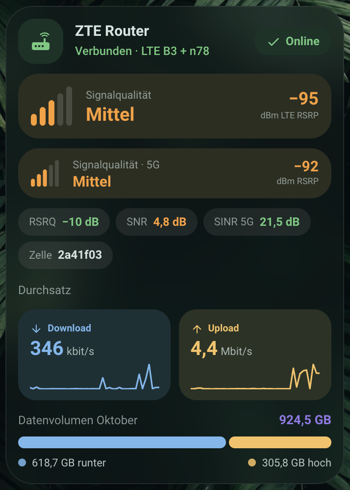

Only the blocks whose entities exist are drawn, so a router that reports
throughput but no radio values gets the header, the rates and the volume bar
without being asked for an RSRP it does not have.

```yaml
type: custom:m3-router-card
entity: binary_sensor.zte_reachable
entity_prefix: zte
```

## It grades the value rather than printing it

−94 dBm means nothing to most people, and a history graph of it means less. The
card sorts every radio reading into one of five steps and says which:

| RSRP (LTE) | Verdict | Bars |
| --- | --- | --- |
| ≥ −80 dBm | Excellent | 5 |
| ≥ −90 dBm | Good | 4 |
| ≥ −100 dBm | Fair | 3 |
| ≥ −110 dBm | Weak | 2 |
| below | Very weak | 1 |

**5G is graded on its own scale**, about 5 dB stricter at every step. That is
not decoration: an NR carrier is wider, so the same transmitted power is spread
over more resource elements and each one measures lower for an equally good
connection — and the bands in use sit higher than LTE B3, where the same path
loss costs more. Judged on the LTE scale, NR reads one step too generous
throughout.

RSRQ, SNR and SINR get their own scales too, because they measure different
things. RSRQ is a ratio and lives between −3 and −20; SNR is a difference and
is perfectly normal at 0, which would be catastrophic as an RSRP. Each has its
own `*_thresholds` key, each is a list of lower bounds, and the first step a
value clears wins:

```yaml
rsrp_thresholds:
  - { min: -75, grade: excellent }
  - { min: -85, grade: good }
  - { min: -95, grade: fair }
  - { min: -105, grade: weak }
```

Some integrations publish RSRP with the sign stripped — `94` rather than `−94`.
The card flips it, because the quantity cannot be positive and grading `94` as
written would call a mediocre signal perfect. SNR is never flipped: it genuinely
can be positive, and usually is.

## Two radios, two rows

On a 5G non-standalone connection the router is on an LTE anchor **and** an NR
carrier at the same time — LTE B3 and n1, in the case this was built against.
Showing one of them is a choice about which half of the truth to print, so the
card shows both: the anchor full size, the NR carrier in a shorter row beneath
it, each graded on its own scale. `show_nr_signal: false` collapses it back to
one.

With only one radio reporting, there is only ever one row, and it is graded
against whichever scale fits what it is.

## Throughput, with a shape

The two rate tiles read their unit off the entity rather than assuming one. The
same reading arrives as `6106 bit/s` from one integration and `0.006 Mbit/s`
from the next, and guessing is wrong by six orders of magnitude. Byte units are
accepted and multiplied by 8, because `MB/s` is the same quantity and nobody
should do that conversion in their head.

Under each number is a sparkline of the last `spark_points` readings (40 by
default), scaled to its own maximum — the question it answers is "what has this
been doing lately", not "how close to the line rate is it". A freshly loaded
dashboard has no past to draw, so the first render asks the recorder once for
the last hour and prefills; two cards wanting the same sensor share the one
round-trip. No recorder, or an excluded entity, simply means no line: a
sparkline is an ornament on a number that is displayed anyway.

`peak_chip: true` adds the highest rate seen since the card loaded.

## Data volume

A two-colour bar split by direction, with the month's total in the accent
colour. Give it `data_limit` and the bar becomes a budget instead: the share of
the allowance used, amber from 80%, red from 95%, with the remainder spelled
out beside it.

## Finding the entities

`entity_prefix` narrows discovery to one router — `zte` for `sensor.zte_*`. Left
out, the card guesses it: the prefix owning the most router-shaped entities
wins.

Discovery matches on the **entity id**, not on the device. That is deliberate.
The sensors this was built against are published by a pyscript app with
`state.set()`, which never touches the entity registry — they have no device, no
unique id and no config entry, and a device-registry lookup finds nothing at
all. An integration that does register its entities is found by the same
patterns, because the id is the one thing every source has.

Every slot can be named outright when the guess is wrong, and a named entity
always beats a discovered one. `auto_discover: false` turns guessing off
entirely and draws only what is configured.

### What is actually verified

**One router.** The card was built against a ZTE MC801A and checked on it. The
patterns for other integrations are written from their published sensor
definitions and covered by unit tests, which is enough to catch a pattern that
stops matching and *not* enough to call them supported. If you have one of
these, the thing worth checking first is that the two throughput tiles show a
rate and not a monthly total.

| Source | Signal | Throughput | Volume |
| --- | --- | --- | --- |
| ZTE (REST/pyscript) | LTE + NR, verified | verified | verified |
| Huawei LTE | RSRP/RSRQ/SINR/RSSI/band/cell | `current_*_rate` | `current_month_*`, in bytes |
| AVM Fritz!Box | none — no radio values | `*_throughput` | `gb_received` / `gb_sent` |
| Fibre / ONT | optical RX, graded as a window | whatever it publishes | if it publishes one |

Two traps the tests exist for, both found by writing them:

- A Huawei publishes `current_month_download` **and** `current_download_rate`,
  and both end in a word a rate pattern wants. Claimed the wrong way round, the
  card showed 580 GB as a live throughput. Volumes are therefore matched before
  rates.
- A Fritzbox publishes `download_throughput` (what is flowing) **and**
  `max_connection_download_rate` (what the line synced at). The second is
  excluded by name, because putting a sync rate in the live tile is a
  plausible-looking lie.

### Fibre lines

A fibre router has no RSRP. What it has is **optical receive power**, and the
card grades that instead whenever no radio value is present at all.

It needs its own scale, because optical power is a **window, not a ramp**. An
ONT is specified from roughly −28 dBm, below which there is nothing left to
detect, up to roughly −8 dBm, above which the receiver saturates and the error
rate climbs again. "More signal is better" is true for RSRP and false here, so a
fibre line graded on the LTE ramp would call a dangerously hot one perfect — and
send whoever reads it looking in the wrong place, since the fix for that is an
attenuator.

```yaml
type: custom:m3-router-card
optical_rx_entity: sensor.ont_rx_power
optical_tx_entity: sensor.ont_tx_power
optical_rx_max: -8
```

The transmit level sits beside it as a chip. Both are discovered from the usual
names — `rx_power`, `optical_rx_power`, `ont_rx_power`, `optical_signal_level`
and their transmit counterparts.

**DSL is not covered.** SNR margin, line attenuation and sync rate are the
equivalent numbers there, and the Fritzbox integration does not expose them
without a custom TR-064 setup. Point `rsrp_entity` and `snr_entity` at whatever
your setup does publish and set `*_thresholds` to that line's own figures; the
grading machinery does not care what produced the number.

### Volumes are read in whatever unit they arrive in

The ZTE app divides into GB, a Fritzbox reports GB, a Huawei reports raw
**bytes**. The card reads the unit off each sensor, so the same configuration
does not show "414,6 GB" for one and "414.600.000.000 GB" for the next. Binary
units are honoured as binary: GiB is 2³⁰, not 10⁹, which is a 7% difference —
more than enough to put a tariff warning on the wrong side of the line.

## Options

| Option | Type | Default | Description |
| --- | --- | --- | --- |
| `entity` | string | discovered | The connection entity — a `binary_sensor` with the `connectivity` class, or a status sensor carrying the modem's own vocabulary. |
| `entity_prefix` | string | guessed | Narrows discovery to one router's entities by their shared id prefix. |
| `auto_discover` | boolean | `true` | Off, only the entities named below are drawn. |
| `name` | string | `<PREFIX> Router` | Header title. The connection sensor's own name is not used: it is named after what it measures, not after the device. |
| `icon` | string | `mdi:router-wireless` | Overrides the header icon. Becomes `router-wireless-off` when the link is down. |
| `rsrp_entity`, `rsrq_entity`, `snr_entity`, `rssi_entity` | string | discovered | The LTE radio. |
| `nr_rsrp_entity`, `nr_snr_entity` | string | discovered | The 5G radio. |
| `optical_rx_entity`, `optical_tx_entity` | string | discovered | A fibre line's optical power, used when there is no radio value at all. |
| `band_entity`, `nr_band_entity`, `cell_id_entity`, `network_type_entity` | string | discovered | What the subtitle and the cell chip read. |
| `download_entity`, `upload_entity` | string | discovered | Throughput. The unit is read off the entity. |
| `data_down_entity`, `data_up_entity`, `data_total_entity` | string | discovered | Monthly volume, in GB. |
| `show_signal` | boolean | `true` | The graded signal block. |
| `show_signal_details` | boolean | `true` | The RSRQ / SNR / cell chip row. |
| `show_nr_signal` | boolean | `true` | The second signal row for the 5G carrier. |
| `show_throughput` | boolean | `true` | The two rate tiles. |
| `show_sparkline` | boolean | `true` | The line under each rate. |
| `show_data` | boolean | `true` | The volume bar. |
| `peak_chip` | boolean | `false` | The highest rate seen since the card loaded. |
| `spark_points` | number | `40` | How many readings the line keeps. |
| `spark_history_minutes` | number | `60` | How far back the first render prefills from the recorder. |
| `rsrp_thresholds`, `nr_rsrp_thresholds`, `snr_thresholds`, `rsrq_thresholds`, `optical_rx_thresholds` | list | see above | Each entry takes `min` and `grade`. |
| `optical_rx_max` | number | `-8` | Above this the optical receiver is overdriven and the reading is graded as a fault, not as a perfect signal. |
| `data_limit` | number | — | A tariff allowance in GB; turns the volume bar into a budget. |
| `value_map` | map | — | Raw state → label, applied before the built-in vocabulary table. |
| `tap_action` | action | `more-info` | What a tap on the header does. |
| `accent_color`, `download_color`, `upload_color`, `online_color`, `offline_color` | string | — | Colour overrides. |
| `text_color`, `secondary_text_color`, `card_background`, `glass_background`, `radius`, `corners`, `card_version` | — | — | The usual shared appearance options. |

## What is deliberately not here

**History graphs.** They are what this card replaces. A 24-hour plot of RSRP is
a band of noise between −88 and −95 that answers no question anyone asks of it;
the verdict and the current number do. Tap any value to get HA's own more-info
dialog, which has the graph.

The companion [M3 Router Diagnostics Card](#m3-router-diagnostics-card) carries
the temperatures, the cell and band detail, the reachability checks and the
restart button.

## M3 Router Diagnostics Card

The other half of the router pair: what the modem is doing to itself, what cell
it is on, whether the internet is actually reachable, and one button to start
the thing again.

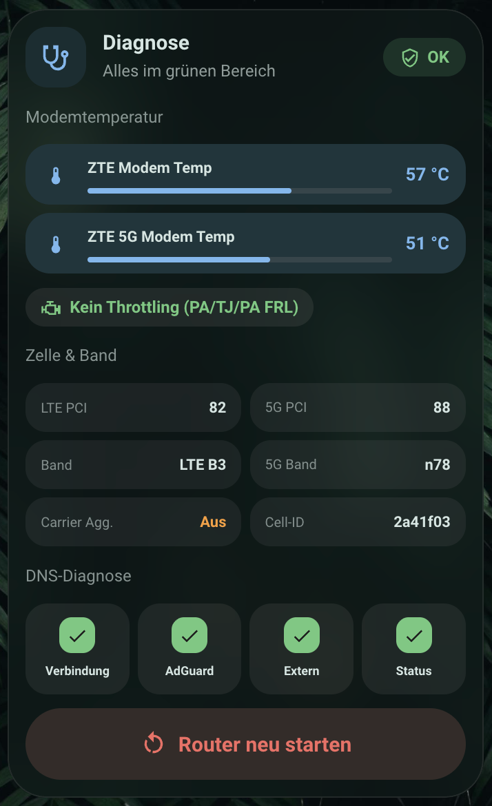

```yaml
type: custom:m3-router-diagnostics-card
entity: binary_sensor.zte_reachable
entity_prefix: zte
```

## A verdict, and what it counts

The header says "Everything in order" or "*n* findings", with a chip to match.
A finding is a temperature over the alarm threshold, active throttling, a
failed reachability check, or a value the config explicitly flagged.

**It is deliberately not everything that is highlighted.** Carrier aggregation
switches itself off whenever the link is idle or the cell is busy, so on a quiet
connection it reads `ca_deactivated` most of the time. That is worth colouring
amber in the grid, and it is not worth reporting as a fault in the header — a
verdict that is always amber has stopped being a verdict. Values from the
built-in vocabulary therefore colour but do not count. Name one in `warn_value`
and it counts, because then someone has said that for *this* router it is a
problem.

## Temperatures

One row per sensor, with a bar against `temp_max` (85 °C by default) and the
value in the grade's colour — blue below `temp_warn`, amber above it, red above
`temp_hot`.

The sensors are found by **unit**, not by name. The obvious filter — an id
containing "temp" — misses the one this was built against: the ZTE publishes
its 5G modem temperature as `sensor.zte_pm_modem_5g`, which carries "Temp" in
its friendly name and nowhere in its id, so a name filter silently drew one of
the two modem temperatures and dropped the other.

The unit is also what keeps the ZTE's `pm_sensor_pa1` out: it reads −40 on a
scale nobody has documented and publishes no unit at all, and drawing it as
40 °C below zero beside a modem at 52 °C is worse than leaving it out.

## Throttling is a chip, never a graph

Thermal throttle sensors read 0 the overwhelming majority of the time. A
24-hour bar chart of a value that is always zero is a picture of nothing, which
is exactly what the dashboard this replaces had.

What is worth drawing is one bit — is anything throttling right now — and if so,
which sensor said so. So the whole set collapses into a single chip: green and
naming the sensors it is watching, or red and naming the one that tripped.

## Cell & band

A two-column grid of label/value cells, each opening more-info on a tap. The
vocabulary is shortened and translated on the way out: `LTE BAND 3` becomes
`LTE B3`, `ca_deactivated` becomes `Aus`. `value_map` overrides any of it and
covers a brand this table has never seen.

Left unconfigured, the grid is built from whatever the PCI, band, carrier
aggregation and cell-id slots discovered.

## Reachability checks

Four tiles per row, each a filled tick or cross. These are the one block with
no discovery behind them, because what counts as "the internet works" is a
local question — a TCP probe, a DNS lookup against your own resolver, the same
lookup against a public one:

```yaml
check_entities:
  - { entity: binary_sensor.dns_tcp_reachable, name: Verbindung }
  - { entity: binary_sensor.dns_local_ok, name: AdGuard }
  - { entity: binary_sensor.dns_external_ok, name: Extern }
  - { entity: sensor.dns_check_status, name: Status, ok_state: OK }
```

`ok_state` names the healthy state for a sensor that is not a binary one.
Without it the usual on/connected vocabulary is accepted. A sensor that is not
reporting goes grey with a question mark rather than red: "no data" and "broken"
are different answers.

## The restart button asks first

A full-width button that takes **two taps**. The first fills it with the alarm
colour, squares off its corners and changes the label to "Really restart?"; the
second fires. Nothing happens on one tap.

If the second tap does not come, the button disarms itself after
`confirm_timeout` (4 seconds). That matters more than it sounds: an armed red
button left on a wall tablet is a trap for the next person who walks past it.

After firing, the card shows "Restarting…" with a turning icon until the
connection entity reports back. Watched rather than timed, because a ZTE is back
in about 50 seconds and a Fritzbox in three minutes and a fixed wait would be
wrong for both. A three-minute backstop ends it if the router never returns.

`reboot_action` takes the usual action grammar. Left out, the card looks for a
`button.*_reboot` or `button.*_restart` on the same prefix. Where the restart is
a service rather than an entity:

```yaml
reboot_action:
  action: perform-action
  perform_action: pyscript.zte_reboot_router
```

`confirm_reboot: false` makes a single tap fire immediately. The editor says
plainly what that means.

## Options

| Option | Type | Default | Description |
| --- | --- | --- | --- |
| `entity` | string | discovered | The connection entity, used to tell when a restart has completed. |
| `entity_prefix` | string | guessed | Narrows discovery to one router's entities. |
| `auto_discover` | boolean | `true` | Off, only what is configured is drawn. |
| `name` | string | "Diagnostics" | Header title. |
| `icon` | string | `mdi:stethoscope` | Header icon. |
| `temperature_entities` | list | discovered | Each entry takes `entity`, `name`, `max`. |
| `throttle_entities` | list | discovered | Collapsed into one chip — see above. |
| `info_entities` | list | discovered | The cell/band grid. Each entry takes `entity`, `label`, `warn_value`. |
| `check_entities` | list | — | The reachability tiles. Each takes `entity`, `name`, `ok_state`. **Required for the block to appear.** |
| `temp_warn` | number | `60` | Amber above this. |
| `temp_hot` | number | `70` | Red above this, and counted as a finding. |
| `temp_max` | number | `85` | Full scale for a bar without its own `max`. |
| `show_temperatures`, `show_throttle`, `show_info`, `show_checks`, `show_reboot` | boolean | `true` | Block switches. |
| `show_uptime`, `show_firmware`, `show_clients` | boolean | `false` | Extra header chips, drawn when the entity exists. |
| `reboot_action` | action | the discovered reboot button | What the second tap does. |
| `confirm_reboot` | boolean | `true` | The two-tap confirmation. |
| `confirm_timeout` | number | `4000` | How long the armed button waits, in milliseconds. |
| `value_map` | map | — | Raw state → label for the cell/band grid. |
| `accent_color`, `ok_color`, `warn_color`, `hot_color` | string | — | Colour overrides. |
| `animation` | string | `auto` | `auto`, `on` or `off`. `off` stills the press shapes and the restart spinner. |
| `text_color`, `secondary_text_color`, `card_background`, `glass_background`, `radius`, `corners`, `card_version` | — | — | The usual shared appearance options. |

Its companion, [M3 Router Card](#m3-router-card), carries the connection, the
signal grading, the throughput and the monthly volume.

## M3 Remote Card

A remote control in the suite's design system. One card with profiles rather
than one card per brand, because these devices differ in what they call each
key, not in the shape of a remote control.

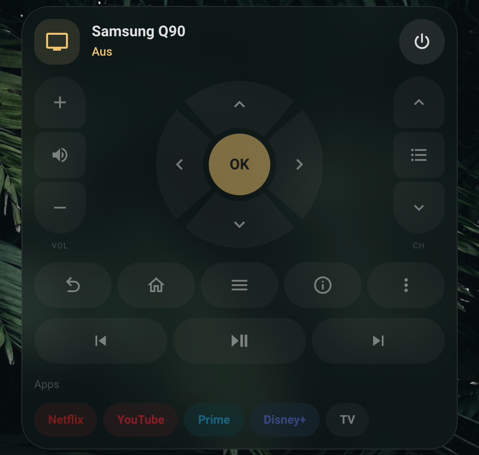

```yaml
type: custom:m3-remote-card
entity: remote.samsung_q90_series_55
```

## Why a ring

The standard remote card draws a 3×3 grid. Two of its nine cells are empty,
and the four that matter do not look like they belong to each other.

A ring says what the control is before it is read: one shape, four ways out of
the middle. The sectors are SVG donut wedges with a gap between them, the OK
button sits inside the hole with a band of background all the way round it —
smaller than the hole, deliberately, because overlapping the ring welds the two
into one blob and loses the thing that makes it readable at a glance.

Pressing a sector fills it in the accent colour. Pressing OK morphs it from a
circle to a squircle and shrinks it slightly; that morph is the card's visual
anchor, and it is also the only acknowledgement these devices give — a TV does
not report that it received a key.

**Holding a direction repeats it.** There is a pause before the first repeat,
which is what separates "one step down the list" from "scroll"; without it
every tap sends two.

**Arrow keys work** when the card has focus, which makes it usable from a
keyboard or a Stream Deck. `keyboard_control: false` turns that off. Tab is
never swallowed, so focus can still leave the card.

`dpad_size` (140–220, default 168) scales the whole control — the hole, the OK
button and the arrows all keep their proportions.

## Profiles

`profile` sets the defaults for key names and which blocks appear. Every one of
them stays overridable. The accent is the theme's primary colour on every
profile; `accent_color` changes it.

| | samsung | google_tv | lg_webos | appletv | kodi | generic |
| --- | --- | --- | --- | --- | --- | --- |
| Directional ring | ✓ | ✓ | ✓ | ✓ | ✓ | — |
| Volume rocker | ✓ | ✓ | ✓ | ✓ | ✓ | if supported |
| Right column | channel | assistant | channel | — | — | — |
| Now playing | — | ✓ | — | ✓ | ✓ | ✓ |
| Transport row | ✓ | — | ✓ | — | ✓ | ✓ |
| Apps | chips | tiles | chips | tiles | chips | chips |
| Text entry | — | ✓ | — | — | — | — |

A TV gets no now-playing bar because the title of what is on a broadcast
channel is not something the integration knows, and a permanently empty row is
worse than none. Google TV gets no separate transport row because its transport
already lives in the now-playing bar, and a second copy underneath is
furniture.

## Commands, per integration

The card never invents a key. Each profile is a table of what that integration
actually accepts:

| Profile | How keys are sent | Example |
| --- | --- | --- |
| samsung | `remote.send_command` with the TV's own websocket codes | `KEY_UP`, `KEY_RETURN`, `KEY_CH_LIST` |
| google_tv | `remote.send_command` with Android keycodes, prefix dropped | `DPAD_UP`, `BACK`, `MEDIA_PLAY_PAUSE` |
| lg_webos | `webostv.button` — **not** `remote.send_command` | `UP`, `BACK`, `CHANNELUP` |
| appletv | `remote.send_command`, lower case | `up`, `select`, `skip_forward` |
| kodi | `kodi.call_method` with a JSON-RPC method | `Input.Up`, `Input.Back` |
| generic | plain `media_player` services only | `media_play_pause`, `volume_up` |

Volume and transport are routed through the `media_player` wherever the
integration supports them, even on a profile that has keycodes for them. Those
are the calls that also move the slider in Home Assistant's own UI; a TV muted
by `KEY_MUTE` never tells the media_player about it.

`key_overrides` replaces a single key without restating the table:

```yaml
key_overrides:
  info: { command: KEY_TOOLS }
```

## Two entities, one device

`androidtv_remote` splits the job: `remote.*` takes the keys, `media_player.*`
knows what is playing. Name either as `entity` and the card looks for the other
on the same object id, so neither has to be written out. `media_entity` names
it explicitly when they do not match.

## It leaves out what the device cannot do

This is the part worth knowing before configuring it. The card asks the
entities what they support and **omits** the controls they do not, rather than
drawing a button whose every press is swallowed:

- No `remote` entity and no own service domain → no ring at all, and a line
  saying so.
- No volume feature → no volume rocker.
- Nothing usable in the function row → no function row.

A **Chromecast** is the case that forced this. `media_player.*` on the `cast`
platform has no `remote` entity, no `send_command`, no volume feature and no
source list; what it does have is play/pause, seek, next/previous and good
metadata. So it gets a now-playing bar and a transport row and nothing else —
which is the honest card for that device.

**A Chromecast with Google TV is not the google_tv profile.** The profile needs
the **Android TV Remote** integration, which is built into Home Assistant and
pairs with a code shown on the television. Without it there are no directional
keys, whatever the box is called.

## Now playing

A 52px bar with artwork, title, app and position. The position counts on from
the last report rather than being drawn raw: `media_position` only updates when
something changes, so a bar drawn from it alone sits frozen at the moment the
track started. The integration also says *when* it last measured, which is what
makes counting on from it correct instead of a guess.

The card only ticks while it is on screen.

## Apps

`apps` is a list of `{ name, icon, color, app_id, action }`. Without `action` a
tap calls `media_player.select_source` with the name. Brand colours for the
common services are filled in automatically; `color` overrides.

Whatever is in front gets an outline and a stronger tint, matched loosely
against `app_name`, `app_id` and `source` — loosely because a player reports
"YouTube Music" for a list entry called "YouTube", and an exact compare would
mark nothing.

Left empty, the card offers the entity's own `source_list`. The editor's
**"take the entity's own sources"** button copies that list into `apps` so it
can then be renamed, coloured and reordered.

### Launching an app on Android TV

`remote.turn_on` takes an `activity`, and **it has to be a URI the app itself
claims**. This was measured against a Google TV box rather than reasoned about,
because three of the four formats people pass look reasonable and do nothing at
all:

| `activity` | Result |
| --- | --- |
| `org.smarttube.stable` (bare package) | nothing happens, silently |
| `market://launch?id=org.smarttube.stable` | nothing happens, silently |
| `android-app://org.smarttube.stable` | nothing happens, silently |
| `https://www.netflix.com/title` | opens Netflix |
| `vnd.youtube://` | opens SmartTube |

A bare package is not a URI, so Android has nothing to resolve and the request
is dropped without an error — which is what makes this worth writing down.

The flip side is that a URI only reaches the app that registered for that
domain. On the device this was tested on, `https://www.youtube.com` opened the
television's **web browser**, because the official YouTube app was not
installed, and `https://www.disneyplus.com` opened **Settings** for the same
reason. A tile that launches the wrong thing is worse than no tile, so it is
worth pressing each one once after configuring it.

A custom scheme counts as a URI, so an app with no web address is not
necessarily out of reach: SmartTube registers `vnd.youtube://` and opens on it
in under a second, despite being sideloaded and despite `android-app://` and
`market://` doing nothing for the same package. The question is never whether
the app has a website — it is which URI the app registered for.

**A scheme with no content in it may still make the app complain.** SmartTube
opens on a bare `vnd.youtube://` and then shows its own toast — *"Can't process
intent"* — because what arrived names no video, channel or playlist. The app is
open and usable; the message is the app's, lasts a few seconds, and there is no
way around it from here. Adding content to the URI silences it but forces that
content on every launch, which is worse. There is no neutral "just open
yourself" URI, and the integration's options page does not provide one either:
it ends at the same call.

The Android TV Remote integration's own options page takes a name and a package
id per app, which then appear in `source_list`. That path ends at the same
`send_launch_app_command`, so it does not rescue a package that no URI reaches.

### How to find the one that works

Launch the app by hand, then read `current_activity` off the remote entity to
learn its package — that much is easy. Going the other way, from a package to a
URI that reaches it, is trial and error, so **watch the television while you
try**, and poll the entity rather than reading it once:

```yaml
# Developer tools → Actions
action: remote.turn_on
target: { entity_id: remote.google_tv }
data: { activity: "vnd.youtube://" }
```

`current_activity` is a laggy witness. A single read a few seconds after the
call reported "nothing happened" for a launch that had plainly succeeded on
screen — which is how `vnd.youtube://` came to be written off here before the
person in front of the television said otherwise.

### Switching inputs on a Samsung

`KEY_HDMI1` … `KEY_HDMI4` appear in every Samsung key list on the internet and
**do nothing** on a 2020 Tizen set. What works is the source bar, and that bar
is a list of *connected devices* — "TV", "Chromecast", "PlayStation 5" — not a
fixed HDMI 1–4, so a card cannot know the positions without being told them
once.

It also opens with the highlight on whatever input is **currently active**,
which means "press right three times" lands somewhere different depending on
where you started. The fix is to walk to the edge first: the row does not wrap,
so more LEFT presses than there are entries always ends on the leftmost one, and
the count from there is exact.

`remote.send_command` takes a list, so the whole thing is one action:

```yaml
apps:
  - name: PlayStation
    action:
      action: perform-action
      perform_action: remote.send_command
      target: { entity_id: remote.samsung_q90 }
      data:
        delay_secs: 0.3
        command:
          - KEY_SOURCE
          - KEY_LEFT   # ×8 — anchor on the leftmost entry
          - KEY_LEFT
          - KEY_LEFT
          - KEY_LEFT
          - KEY_LEFT
          - KEY_LEFT
          - KEY_LEFT
          - KEY_LEFT
          - KEY_RIGHT  # ×n — n is the entry's position, counted from 0
          - KEY_RIGHT
          - KEY_RIGHT
          - KEY_ENTER
```

Count the positions off the bar once, including entries for devices that are
switched off — they stay in the list and still take up a position. `delay_secs`
below about 0.25 starts dropping presses.

**In daily use this did not hold up.** On the author's set the HDMI buttons
built this way moved a few steps from wherever the highlight happened to be and
landed somewhere different each time. What works reliably is the plain
`KEY_HDMI`: it steps to the next HDMI input on every press, so it cannot jump to
a particular one, but it never lands anywhere unexpected. That is what the
author's dashboard uses now.

## Text entry

On Android TV this is the biggest everyday win. The integration types any
command it does not recognise as a keycode, so a search box on a television
becomes a phone keyboard instead of twenty-six presses of a d-pad. The keyboard
button appears only on a profile whose integration accepts it.

## The assistant button

It fills with Google's own four colours and squares off while it listens. That
is a **gesture, not a status**: nothing tells Home Assistant when the microphone
closed, so it runs for `assistant_timeout` (2.2 s) and resets. Configurable for
whoever finds the default out of step with their device.

## Options

| Option | Type | Default | Description |
| --- | --- | --- | --- |
| `entity` | string | — | **Required.** A `remote.*` or `media_player.*` entity. |
| `media_entity` | string | same object id | The second entity, when commands and metadata live apart. |
| `power_entity` | string | — | When power runs through something else, e.g. a smart plug. |
| `profile` | string | from the entity | `generic`, `samsung`, `google_tv`, `lg_webos`, `appletv`, `kodi`. |
| `name`, `icon` | string | from the entity | Header title and icon. |
| `key_overrides` | map | — | Per-key replacements; see above. |
| `dpad_size` | number | `168` | 140–220. Scales the whole ring. |
| `keyboard_control` | boolean | `true` | Arrow keys and Enter drive the card while it has focus. |
| `repeat_interval` | number | `250` | Milliseconds between repeats while a direction is held. |
| `right_column` | string | by profile | `auto`, `channel`, `assistant`, `custom`, `none`. |
| `right_buttons` | list | — | With `right_column: custom`: `{ key, icon, label, action }`. |
| `show_rocker_labels` | boolean | `true` | The small VOL / CH captions. |
| `assistant_timeout` | number | `2200` | How long the assistant animation runs. |
| `function_buttons` | list | by profile | The five-button row; same shape as `right_buttons`. |
| `show_transport` | boolean | by profile | The previous / play-pause / next row. |
| `show_numpad` | boolean | `false` | A 3×4 number pad. |
| `apps` | list | `source_list` | `{ name, icon, color, app_id, action }`. |
| `app_style` | `chips` \| `tiles` | by profile | — |
| `show_apps` | boolean | `true` | — |
| `max_apps` | number | `0` | `0` shows all. |
| `show_now_playing` | boolean | by profile | — |
| `power_toggle` | boolean | `true` | One button that toggles, instead of two. |
| `haptics` | boolean | `true` | Haptic feedback on the companion app. |
| `accent_color`, `text_color`, `secondary_text_color`, `card_background`, `glass_background`, `radius`, `corners`, `animation`, `card_version` | — | — | The usual shared appearance options. |

## States

**Off is not unavailable.** Most of these devices still accept a key press in
standby, and the one that wakes them is on this card, so an off device is
dimmed rather than disabled. Only a genuinely unreachable entity has its
controls blocked, and even then the power button stays live.

Commands are fire-and-forget: there is no optimistic state, because there is
nothing to be optimistic about. Every button instead gives immediate visual
feedback, which is what stands in for the acknowledgement the device never
sends.

## M3 Detail Card

One entity, large. A number gets its value, how far it moved, and where it
has been as a smoothed curve with its lowest and highest reading marked. A
door gets a timeline of when it was open. A lamp gets its own M3 card
with the timeline under it. Below all of these sit the other entities of
the same device, and a tap on one steps the view to it.

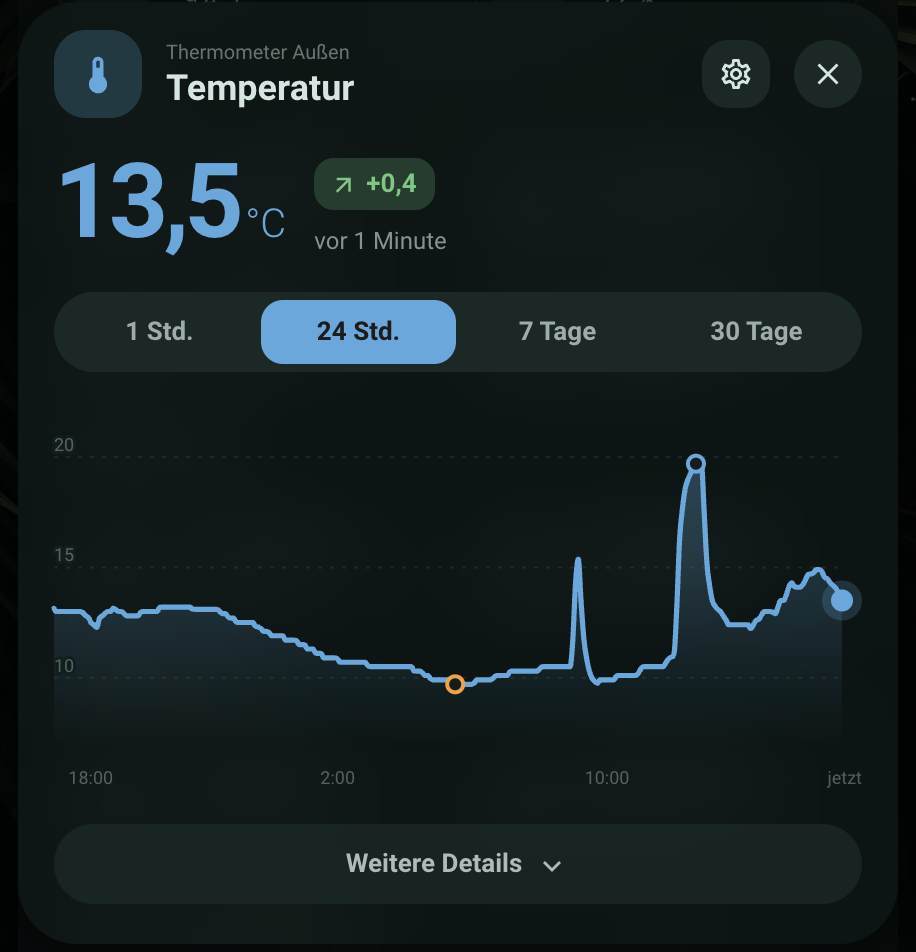

The same view can replace Home Assistant's more-info dialog for the suite's
own cards: set `detail_mode: sheet` on a card, and a tap that would have
opened more-info opens this as a bottom sheet instead. The sheet is frosted
glass like the card it opened from; a card with `glass_background: false`
opens a solid one.

<details>
<summary>Configuration, examples & options</summary>

```yaml
type: custom:m3-detail-card
entity: sensor.living_room_humidity
```

### Three ways to use it

Home Assistant does not let a custom card replace the more-info dialog for
the whole frontend. What there is, in order of how much it reaches:

| Way | Reaches | Needs |
| --- | --- | --- |
| **`detail_mode: sheet`** on any M3 card | Every tap in that card that would open more-info | Nothing |
| **The card itself** in a popup — browser_mod, bubble-card, or the suite's own `popup` with `mode: custom` | Any card that can open such a popup, the suite's or not | The popup's integration |
| **The card on a dashboard** | A view of its own, for one entity | Nothing |

`detail_mode` is in the appearance section of every M3 editor whose card
can open details. It defaults to `more_info`, so nothing changes until it is
set. Entities the view has nothing for keep opening the dialog: an `update`
(its release notes live there), a button, a script or a scene.

Restyling the real more-info dialog is deliberately not covered. It lives
outside every card and can only be reached through card-mod, which this suite
does not use.

**browser_mod** (version 2), from any card's tap action:

```yaml
tap_action:
  action: fire-dom-event
  browser_mod:
    service: browser_mod.popup
    data:
      content:
        type: custom:m3-detail-card
        entity: sensor.living_room_humidity
```

**The suite's own popup**, e.g. on the Lights Overview card, where
`[[entity_id]]` is the tapped light:

```yaml
hold_action:
  action: popup
popup:
  mode: custom
  card:
    type: custom:m3-detail-card
    entity: "[[entity_id]]"
```

### What it shows, by entity

| Layout | For | Shows |
| --- | --- | --- |
| `numeric` | `sensor`, `number`, `input_number`, `counter` with a number | Value with a trend chip, the curve, minimum / average / maximum, plus the total for a meter |
| `binary` | `binary_sensor`, `automation`, `schedule` | A timeline, time in each state, number of changes in the period |
| `states` | Text sensors, `select`, `input_select`, timestamps, anything else | A timeline and how long each state lasted; for a timestamp, when it was set and its last changes |
| `control` | `light`, `switch`, `fan`, `cover`, `climate`, `media_player`, `humidifier`, `vacuum`, `lock`, `input_boolean` | The matching M3 card, then the timeline |
| `info` | `weather`, `person`, `device_tracker`, `sun` | The value and, for weather, temperature, humidity, wind and pressure |

`type_overrides` changes the layout per entity id or per domain; the entity
id wins:

```yaml
type_overrides:
  sensor.washing_machine_power: numeric
  input_boolean: binary
```

Inside a `control` view, the embedded card's own "details" taps stay in the
view: one for an entity the view can show steps to it, and anything else
closes the sheet before Home Assistant's dialog opens, so the two never
stack.

### Where the history comes from

Long-term statistics when the entity has a `state_class`: five-minute
values for a day, hourly ones for a week or a month. They are aggregated on
the server, so thirty days of a chatty sensor stay light. Without
statistics, from the History API.
Either way the curve is thinned to at most 300 points, keeping the spikes
(Largest-Triangle-Three-Buckets), and it breaks where the entity was
unavailable rather than drawing across the gap.

The curve is a monotone cubic, not a Catmull-Rom spline: it rounds the
corners without ever swinging past a reading, so the rings for the minimum
and maximum always sit on the line.

A meter's total is read from its readings — every rise counts, a fall is
taken as a reset — and not from the statistics' `change`. That value takes
any short dip in a `total_increasing` sensor as a meter change and adds the
whole reading again. On a real group of meters one five-minute row carried
2,894.5 kWh for a day in which the meter rose by 13.

The period last picked is remembered per entity on that device.

### Configuration options

| Option | Type | Default | Description |
|---|---|---|---|
| `entity` | string | – | **Required.** The entity to show |
| `name` / `icon` / `color` | string | from the entity | Title, icon and accent. The default colour follows the device class (humidity blue, energy orange); a temperature takes its colour from its value, blue when cold through green to red when hot, on the climate overview's stages |
| `range` | `1h` \| `24h` \| `7d` \| `30d` | `24h` | Period on opening, until the viewer picks another |
| `ranges` | list | all four | The periods offered above the graph, in order |
| `stats` | list of `min` / `mean` / `max` / `sum` | min, mean, max (+ sum for a meter) | The tiles under the curve |
| `trend_inverted` | boolean | `false` | For readings where rising is bad news |
| `show_tooltip` | boolean | `true` | The reading under the pointer on the curve |
| `y_axis` | boolean | `true` | Three or four round values up the side of the curve, with faint guide lines |
| `show_related` / `max_related` | boolean / number | `true` / `5` | The device's other entities, including diagnostic ones such as battery |
| `control_card` | `auto` \| `none` \| card config | `auto` | The card at the top of a `control` view; `[[entity]]` stands for the entity |
| `type_overrides` | map | – | Layout per entity id or domain, see above |
| `details` | `expanded` \| `collapsed` \| `hidden` | `collapsed` | The extras beyond what Home Assistant's own dialog shows — tiles, lists, the device's other entities, and for a controllable device its history: shown, behind one "more details" button, or left out |
| `text_color` / `secondary_text_color` | string | theme default | Text colours |
| `card_background` | string | glass/solid background | Card background |
| `animation` | `auto` \| `on` \| `off` | `auto` | Respects `prefers-reduced-motion` |
| `glass_background` | boolean | `true` | Frosted glass background |
| `radius` / `corners` | number / object | `28` | Corner radius, optional per corner |

And on every other M3 card that can open details:

| Option | Type | Default | Description |
|---|---|---|---|
| `detail_mode` | `more_info` \| `sheet` | `more_info` | What a tap that would open more-info opens |

</details>

## M3 Popup Card

Other cards — M3 ones or any other — in a bottom sheet that slides up over
the dashboard. The sheet is the one the detail view opens in
(`detail_mode: sheet`): the same grip, the same motion, the same close
button, and on a desktop it is centred instead of climbing out of the
bottom edge.

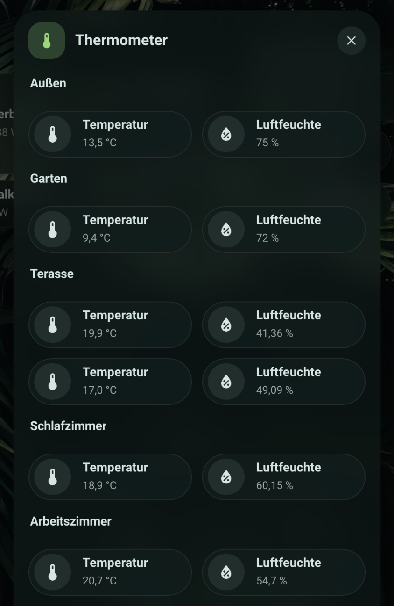

The card is invisible on the dashboard and takes no space there. It opens
when the page's address ends in its hash, so anything that navigates there
opens it:

```yaml
type: custom:m3-button-card
name: Remotes
icon: mdi:remote
tap_action:
  action: navigate
  navigation_path: "#remotes"
```

That is how Bubble Card's pop-ups work, so a dashboard built on them keeps its
buttons as they are: replace the `bubble-card` pop-up with this card under the
same hash and the buttons open it. Back closes it — Android's back gesture
included — and closing it any other way takes the hash back out of the
address. A link to the page with the hash opens the popup straight away.

The sheet is frosted glass by default, as every card in the suite is, and the
cards in it keep their own surface. Home Assistant's own cards (sensor, tile,
entities) get the thin rim the M3 cards draw, so they stay outlined even in a
theme that gives them none.

The cards sit on twelve columns, as in a sections view: a card with
`grid_options: { columns: 6 }` takes half the width, so two share a row. A card
that says nothing takes the full width.

The cards inside are built the first time the popup opens, not with the
dashboard, and kept from then on: ten popups cost nothing until used, and a
card keeps its state between openings.

In edit mode the card shows as a dashed placeholder naming its hash, so it can
be found and edited.

<details>
<summary>Configuration, examples & options</summary>

```yaml
type: custom:m3-popup-card
hash: "#remotes"
title: Remotes
icon: mdi:remote
cards:
  - type: custom:m3-remote-card
    entity: media_player.living_room_tv
  - type: tile
    entity: switch.tv_socket
```

### Configuration options

| Option | Type | Default | Description |
|---|---|---|---|
| `hash` | string | – | **Required.** The hash that opens it. The leading `#` is optional |
| `title` | string | – | Heading beside the close button |
| `icon` | string | – | Icon before the heading, and on the edit-mode placeholder |
| `glass_background` | boolean | `true` | Frosted glass behind the cards, as on every card. `false` makes the sheet the solid card colour |
| `card_background` | string | – | Override the sheet's background colour |
| `text_color` | string | – | Text colour on the sheet — set as the theme's text colour there, so the cards in it follow too |
| `secondary_text_color` | string | – | Secondary text colour on the sheet, for the cards in it as well |
| `animation` | string | `auto` | `auto`, `on` or `off`. `off` opens and closes the sheet in place, without the slide |
| `cards` | list | `[]` | The cards in the sheet, in display order. Any Lovelace card — M3 or otherwise. Each one's `grid_options.columns` (of 12) sets its width |

</details>

## M3 Check-in Card

Check-in and check-out as **one** element that shows whether someone is
checked in and switches it, on a card that tints itself by the state.

Two separate buttons, "check in" and "check out", say nothing about which is
true — and a subtitle "on" under one of them reads as if that button were on.
This card says which, and its control names **states** ("Checked in",
"Checked out"), never verbs, so it cannot be read the other way round.

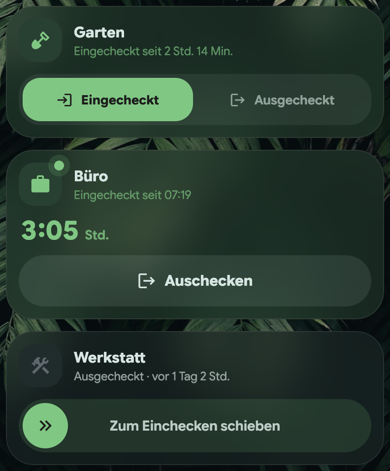

Everything below can be set in the visual editor, whose style panel shows
only the words and icons the chosen style uses.

<details>
<summary>Configuration, examples & options</summary>

### The simple case

```yaml
type: custom:m3-checkin-card
entity: input_boolean.garden_presence
name: Garden
icon: mdi:shovel
icon_off: mdi:shovel-off
```

An `input_boolean` (or a `switch`) is switched with its own turn_on/turn_off.
The card switches *to* a state rather than toggling, so a second tap on
"Checked in" cannot check anyone out.

### With actions of your own

```yaml
type: custom:m3-checkin-card
entity: input_boolean.garden_presence
checkout_action:
  action: perform-action
  perform_action: script.leave_garden   # turns the light and the watering off too
```

`checkin_action` and `checkout_action` take the full Home Assistant action
syntax. A `binary_sensor`, `person` or `device_tracker` without actions is
shown, not switched; a person or tracker is checked in while in `home_state`
(default `home`).

### What it shows

- **The card** takes the state's colour as a tint over the glass: the accent
  (`color`, default green) while checked in, a neutral grey (`color_off`)
  while out, so out never reads as a fault. Its rim is the suite's own.
- **The status line** says how long: "Checked in for 2 h 14 min", "Checked out
  · 6 min ago". It counts from when the state really began: a restart, or a
  mirrored entity reconnecting, writes the same state again with a new
  `last_changed`, so the card asks the recorder (the last 14 days) and skips
  such gaps. Past a day it reads "1 day 3 h", past two "2 days ago"; a state
  older than those 14 days says "for over 14 days" rather than counting from
  the last restart. `since_entity` (an input_datetime or a timestamp sensor)
  takes the place of both; a time in the future is left out.
  `status_in` / `status_out` take `{duration}` and `{time}`.
- **The control** (style `segmented`, the default) is two halves, concentric
  with their track; the active one is filled. A tap moves it at once; if Home
  Assistant has not confirmed within `optimistic_timeout` (default 5000 ms) it
  goes back and says so.
- Unavailable dims the card; below 280px the halves show icons only.

### Style `status`

```yaml
type: custom:m3-checkin-card
entity: input_boolean.garden_presence
style: status
```

Leads with **how long**: the running time large, in tabular figures ("14 min",
"2:05 h", "3 days"), kept current every ten seconds while the card is on
screen. The subtitle says since when ("Checked in since 14:02"), and a dot on
the icon pulses while checked in. Below, **one** button that names the action
— "Check in" filled with the accent, "Check out" tonal and quiet — because
here pressing it does exactly what it says. It squares from a pill to 18px
under the finger. `button_label_in` / `button_label_out` rename it.

### Style `swipe`

```yaml
type: custom:m3-checkin-card
entity: input_boolean.garden_presence
style: swipe
```

For a phone in a pocket or a tablet by the door, where a brush of the hand
should not switch anything: a 54px track with a handle to **slide** — right
to check in, left to check out. Past three quarters of the way it counts;
short of that it springs back. The handle squares to 15px while held, and a
tap on it only nudges it the way it goes. Checking out is a warm orange
(`color_checkout`, default `#e0a05a`) — an act, not a fault. Only the handle
claims the touch, so the page still scrolls over the rest of the card.

With a keyboard it is a switch: Space or Enter does it. Under reduced motion
(or `animation: off`) there is nothing to slide and a tap does it.
`swipe_label_in` / `swipe_label_out` rename the track; `icon_in` / `icon_out`
replace the handle's chevrons.

### Several people on one card

```yaml
type: custom:m3-checkin-card
name: Office
user_entity_map:
  Josef: input_boolean.office_josef
  Anna: input_boolean.office_anna
```

`user_entity_map` maps a Home Assistant user — by name, ignoring case, or by
user id — to that person's entity. Each viewer's control switches their
**own**; a viewer the map does not name falls back to `entity`, which may
then be left out. Above the control, everyone checked in: 30px avatars from
their `person` entity's picture (matched by `user_id` or name), initials
where there is none, "+n" past five, and their names — or a count once there
are more than two. `show_people: false` hides the row.

### Confirmation

`confirm: double_tap` asks "Sure?" on the first tap and switches on a second
within three seconds; `confirm: hold` switches after 600 ms held, a fill
running across the control meanwhile, and says "Press and hold" if let go too
soon. With a keyboard, which cannot hold, Space or Enter confirms as a double
tap does. The swipe style ignores `confirm`: its slide is the confirmation.

### Options

| Option | Default | Description |
| --- | --- | --- |
| `entity` | — | **Required** unless `user_entity_map` names every viewer. input_boolean, switch, binary_sensor, person or device_tracker |
| `user_entity_map` | — | HA user (name or id) → that person's entity |
| `show_people` | `true` with a map | The avatars of everyone checked in |
| `confirm` | `none` | `double_tap` or `hold`; not for `swipe` |
| `style` | `segmented` | The control: `segmented`, `status` or `swipe` |
| `name`, `icon`, `icon_off` | entity name, `mdi:account-check`, `mdi:account-off` | Header |
| `state_on`, `home_state` | `on`, `home` | What counts as checked in |
| `checkin_action`, `checkout_action` | turn_on / turn_off | Any action |
| `since_entity` | — | Where "since" comes from instead of `last_changed` |
| `label_in`, `label_out`, `icon_in`, `icon_out` | "Checked in", "Checked out", `mdi:login`, `mdi:logout` | The halves |
| `button_label_in`, `button_label_out` | "Check in", "Check out" | Style `status`: the button |
| `swipe_label_in`, `swipe_label_out` | "Slide to check in", "Slide to check out" | Style `swipe`: the track |
| `color_checkout` | `#e0a05a` | Style `swipe`: the colour of checking out |
| `status_in`, `status_out` | see above | Status templates with `{duration}`, `{time}` |
| `color`, `color_off` | `#81c784`, `#8b909b` | Checked in / out |
| `optimistic_timeout` | `5000` | Milliseconds to wait for confirmation |
| `tap_action` | `more-info` | A tap on the header |
| `card_background`, `text_color`, `secondary_text_color` | — | The card's own colours; the state's tint goes over `card_background` |
| `animation`, `haptics`, `glass_background`, `radius`, `corners`, `detail_mode` | — | The usual shared options |

</details>

## M3 Openings Card

Windows and doors on one card that changes with them. While something is
open it leads with it: the count beside the header, the open sensors as one
joined group with how long each has been open — longest first — and a red
pill with the outdoor temperature when one has been open too long on a cold
day. Everything closed shrinks it to a single line that names the last one
opened. A sensor that does not answer is shown as such and never counted as
closed.

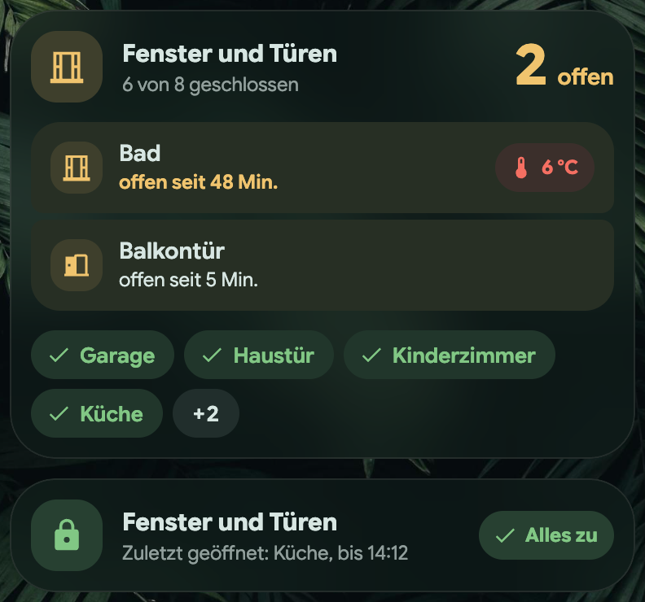

<details>
<summary>Configuration, examples & options</summary>

### Find them yourself

```yaml
type: custom:m3-openings-card
outdoor_temperature: sensor.outdoor_temperature
```

Without `entities` the card finds every `binary_sensor` of class `door`,
`window`, `opening` or `garage_door` on its own, as the battery card finds
batteries. `include_area`, `include_label` and `exclude_entities` narrow it
down; entries under `entities` then only rename or re-icon single sensors.

### Or name them

```yaml
type: custom:m3-openings-card
title: Windows and doors
entities:
  - binary_sensor.bathroom_window          # the bare id works
  - entity: binary_sensor.balcony_door
    name: Balcony door
    icon: mdi:door-sliding
    tap_action:
      action: navigate
      navigation_path: /lovelace/balcony
outdoor_temperature: sensor.outdoor_temperature
warn_after_minutes: 15
cold_below: 10
max_chips: 4
```

A list turns discovery off; `auto_discover: true` turns it back on.

### What it shows

- **Something open:** the header icon in amber, "6 of 8 closed" and the
  count. Each open sensor is a row with a window or door icon (by device
  class) and "open for 48 min" — "2 h 5 min", "1 day 3 h", "2 days" as it
  grows. The start comes from the recorder, so a Home Assistant restart does
  not reset it to "2 min".
- **The warning:** open for `warn_after_minutes` *and* colder outside than
  `cold_below` — the duration turns amber and a red pill shows the outdoor
  temperature. Without `outdoor_temperature` there is no pill, and the
  duration is highlighted on time alone.
- **Closed sensors** are green chips with a check, at most `max_chips`; a
  "+N" chip opens the rest. Unreachable ones come first, neutral with a
  warning icon, and the subtitle counts them.
- **All closed:** one line — a green lock, "Last opened: Kitchen, until
  14:12", and an "All closed" pill.
- A tap on a row or chip opens its details, or runs `tap_action` — the
  entry's own, else the card's.

### Options

| Option | Default | Description |
| --- | --- | --- |
| `entities` | — | binary_sensors, as ids or `{entity, name, icon, tap_action}` |
| `auto_discover` | `true` without `entities` | Find the sensors by device class |
| `include_area`, `include_label`, `exclude_entities` | — | Narrow discovery |
| `title`, `icon` | "Windows and doors", by state | Header |
| `outdoor_temperature` | — | Temperature sensor for the cold warning |
| `warn_after_minutes` | `15` | Minutes open before a row warns |
| `cold_below` | `10` | Outdoor temperature below which it warns |
| `max_chips` | `4` | Chips before "+N" |
| `tap_action` | `more-info` | For every row and chip |
| `color_open`, `color_warn`, `color_closed` | amber, red, green | The three states |
| `card_background`, `text_color`, `secondary_text_color` | — | The card's own colours |
| `animation`, `haptics`, `glass_background`, `radius`, `corners`, `detail_mode` | — | The usual shared options |

</details>

## M3 Vehicle Card

One car on one card. It knows no manufacturer, only meanings — a battery, a
range, whether it is charging, the lock, where it stands — and every one of
them is a slot you fill with an entity or a template. A slot left empty is a
block that is not drawn, so a name and a battery make a whole card.

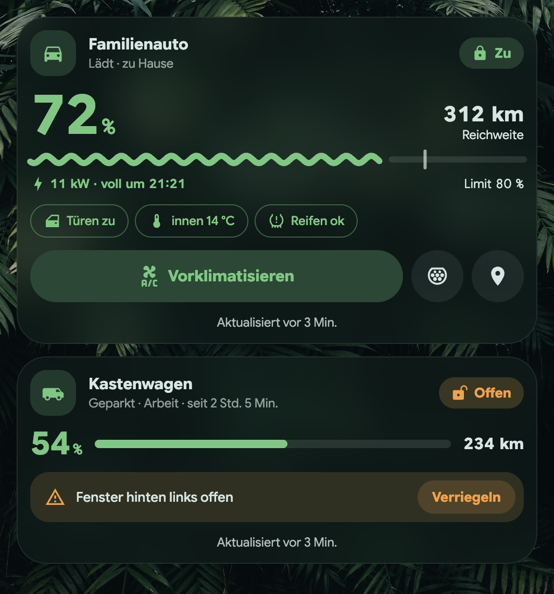

**The charge is the layout.** Parked, the charge is one line: a figure, a bar
and the range. Charging, it becomes the hero — a large figure over the suite's
wave, the charge limit marked on the track, and underneath what it means:
"11 kW · full at 18:40" and "Limit 80 %". The change between the two eases.

<details>
<summary>Configuration, examples & options</summary>

### Minimal

```yaml
type: custom:m3-vehicle-card
name: Family car
energy:
  battery: sensor.car_battery
```

### Electric, everything mapped

```yaml
type: custom:m3-vehicle-card
name: Family car
energy:
  battery: sensor.car_battery
  range: sensor.car_range
  charging: binary_sensor.car_charging
  plugged: binary_sensor.car_plug
  charge_power: sensor.car_charging_power
  charge_limit: number.car_charge_limit
  charge_end: sensor.car_charging_end
  capacity_kwh: 77
lock: lock.car
location: device_tracker.car
stale_after_minutes: 180
chips:
  - entity: binary_sensor.car_doors
    icon: mdi:car-door
  - entity: sensor.car_inside_temperature
    icon: mdi:thermometer
  - entity: sensor.car_tyre_pressure_front_left
    icon: mdi:car-tire-alert
    warn_below: 2.2
actions:
  - name: Pre-condition
    icon: mdi:air-conditioner
    primary: true
    entity: climate.car
    tap_action:
      action: toggle
  - icon: mdi:ev-plug-type2
    entity: switch.car_charging
    tap_action:
      action: toggle
      confirmation:
        text: Stop charging?
    visible:
      entity: binary_sensor.car_charging
  - icon: mdi:map-marker
    entity: device_tracker.car
alerts:
  - when:
      entity: binary_sensor.car_window_rear_left
    text: Rear left window open
    action:
      name: Lock
      entity: lock.car
      tap_action:
        action: perform-action
        perform_action: lock.lock
  - when:
      below: 20
    text: Battery low
```

### Combustion

```yaml
type: custom:m3-vehicle-card
name: Estate
icon: mdi:car-estate
drive: fuel
energy:
  fuel_level: sensor.estate_fuel_level
  fuel_range: sensor.estate_fuel_range
lock: lock.estate
location: device_tracker.estate
```

### Plug-in hybrid

Two slim bars, battery and tank, each with its own range. While the battery
charges, its bar becomes the wave.

```yaml
type: custom:m3-vehicle-card
name: Plug-in
drive: hybrid
energy:
  battery: sensor.phev_battery
  range: sensor.phev_electric_range
  charging: sensor.phev_charging_status
  fuel_level: sensor.phev_fuel_level
  fuel_range: sensor.phev_fuel_range
```

### Templates

Every value slot takes an object as well as an entity id. `template` is
rendered live by Home Assistant and wins over `entity` for the value; `entity`
still supplies the timestamps and the more-info target.

```yaml
energy:
  battery: sensor.car_battery
  range:
    entity: sensor.car_range_miles
    template: "{{ (states('sensor.car_range_miles') | float(0) * 1.609) | round(0) }}"
    unit: km
  charging:
    entity: sensor.car_charging_state
    charging_states: [charging, fast_charging]
location:
  entity: device_tracker.car
  attribute: address
```

A slot object takes `entity`, `template`, `attribute`, `name`, `icon`, `unit`,
`warn_below` and `warn_above`.

### What the card never guesses

- **Unavailable is a dash, not 0 %.** The bar stays empty and grey, no
  threshold matches, no alert fires on it.
- **"Parked" needs a charging or plug sensor that says so.** Without one the
  subtitle names only the place.
- **The charge end** comes from `charge_end`. Without it the card estimates
  `(limit − battery) × capacity_kwh ÷ power` — but only when `capacity_kwh` is
  set, and it then says "full ≈ 18:40". Without either, it shows no time.
- **"Updated 3 min ago"** reads the battery's (or tank's) `last_reported`, which
  moves with every report, not only when the value changes. `last_updated`
  overrides it with a timestamp of your own.

### Alerts

An alert row is drawn only while its condition holds. A condition uses the
suite's rule vocabulary — `value` (one or a list), `regex`, `above`, `below` —
plus `template` and `for_minutes`. A condition with only an `entity` holds
while that entity is on (open, unlocked, plugged in), and a condition with no
entity refers to the battery (the tank on `drive: fuel`). A list under `when`
means every condition must hold.

```yaml
alerts:
  - when:
      - entity: lock.car
        value: unlocked
        for_minutes: 10
      - entity: device_tracker.car
        value: home
    text: Unlocked at home for 10 minutes
    action:
      name: Lock
      entity: lock.car
      tap_action:
        action: perform-action
        perform_action: lock.lock
  - when:
      template: "{{ states('sensor.car_service_days') | int(99) < 14 }}"
    text: Service due soon
    severity: info
```

### Actions

The first action can be `primary: true` — a wide tonal button with its name.
The others are round icon buttons; with no primary they share the row. Every
standard action works (`more-info`, `toggle`, `perform-action`, `navigate`,
`url`), `confirmation` included, and `hold_action` too. `entity` is the target
of a toggle or more-info, and a button whose entity is on (a switch, a climate)
shows it. `visible` takes the same conditions as an alert.

### Folding

`collapsible: true` folds the card to its header and charge. With a lock, the
lock pill is the fold button (with its chevron); without one, the round
chevron is. `collapse_blocks` names what folds (default: chips, actions,
footer); alerts always stay. `default_collapsed`, `collapse_memory` and
`collapse_state_entity` work as on the other folding cards.

### Notifications

The editor can write a Home Assistant automation for up to four reasons:
**charging finished** (a real change, held a minute — not a dropout),
**battery or fuel below** a level, **unlocked for** some minutes, and an
evening **reminder** when the car is low and not plugged in. Only slots mapped
to an entity can be watched; a templated slot has nothing an automation could
trigger on.

### Options

| Option | Default | Description |
|---|---|---|
| `name` / `icon` | "Vehicle" / `mdi:car` | Header |
| `image` | – | A cut-out picture in the icon well instead of the icon |
| `drive` | `ev` | `ev`, `fuel` or `hybrid` — which energy slots the card expects |
| `energy.battery` / `energy.range` | – | Charge in %, electric range |
| `energy.charging` | – | A binary_sensor, or a sensor with `charging_states` (default `charging`, `on`, `true`) |
| `energy.plugged` | – | Tells "plugged in" from "parked" when not charging |
| `energy.charge_power` | – | kW; a sensor in W is converted |
| `energy.charge_limit` | – | The marker on the track and "Limit 80 %" |
| `energy.charge_end` | – | Timestamp; preferred over any estimate |
| `energy.capacity_kwh` | – | Enables the charge-end estimate |
| `energy.fuel_level` / `energy.fuel_range` | – | Tank in %, fuel range |
| `lock` | – | A lock, or a binary_sensor of class lock (on = unlocked) |
| `location` | – | device_tracker, person or a sensor naming the place |
| `last_updated` | battery's last report | A timestamp of your own for the footer |
| `stale_after_minutes` | `0` (never) | After this long without a report the footer warns |
| `chips` | – | The suite's chips, plus `warn_below` / `warn_above` per chip |
| `chip_style` | `pill` | `pill` or `tile` |
| `actions` | – | Buttons — see above |
| `alerts` | – | Conditional rows — see above |
| `layout` | `[energy, alerts, chips, actions, footer]` | Order and visibility of the blocks |
| `tap_action` | more-info of the battery | Header tap |
| `collapsible`, `collapse_blocks`, `default_collapsed`, `collapse_memory`, `collapse_state_entity` | – | Folding |
| `accent_color`, `accent_opacity`, `text_color`, `secondary_text_color`, `card_background`, `glass_background`, `radius`, `corners`, `animation` | — | The usual shared appearance options |

Integration presets — one line that maps every slot for a given brand — are
not built yet. The slots are read in one place (`resolveVehicle`), so a preset
will be a function that fills the config before it gets there.

</details>

## M3 Multi Graph Card

Several sensors of the same kind on one card: every room's temperature, its
humidity, CO₂, power — any sensor device class. Each sensor is a curve on a
shared scale; the one in focus is drawn thick with an area beneath it and a
dot at now, the others thinner behind it. The chips are the legend — colour,
name, current value — and a tap on one brings its curve to the front. A
finger on the graph reads every curve at that moment: a line and a pill with
the time and the focused sensor's value, while the chips show what each one
read then.

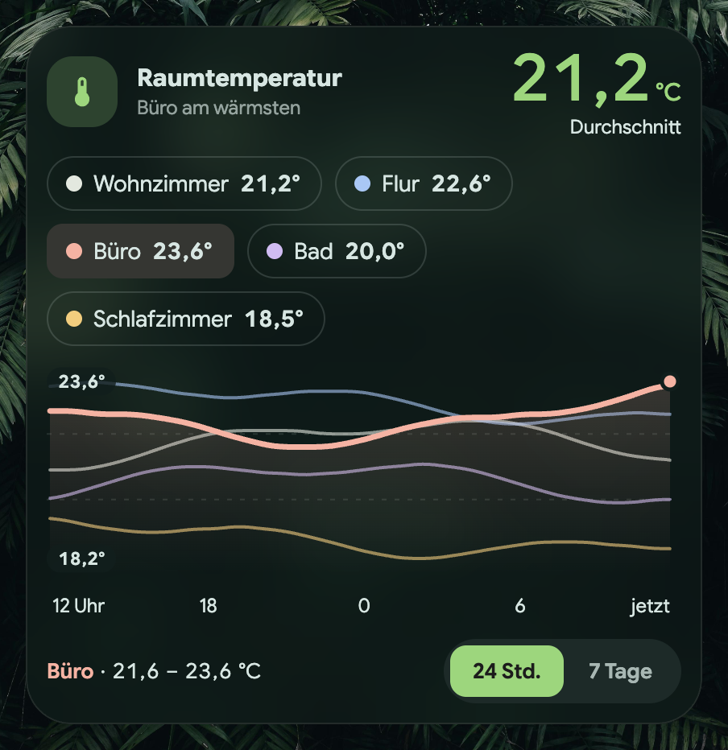

<details>
<summary>Configuration, examples & options</summary>

### Find the rooms yourself

```yaml
type: custom:m3-multi-graph-card
```

Without a list the card finds one sensor of its `device_class` per area —
temperature unless set otherwise — named after the area. Temperature and
humidity are found exactly as on the climate overview card, with the same
filters: `include_area` / `exclude_area`, `include_labels` /
`exclude_labels`, `include_entities` / `exclude_entities`, `include_state` /
`exclude_state`. Unlike the overview, a sensor without an area is left out:
there it becomes a room of its own, and on a real install that means the
system monitor, the router and every thermostat's built-in sensor as curves.
Name it in `include_entities` to draw it anyway. In the editor, "Turn into a
fixed list" copies what was found into `entities`, to reorder, rename and
colour.

### Other kinds of sensor

`device_class` says what is compared. Discovery looks for it, and the header
text, icon, unit and decimals follow it:

```yaml
type: custom:m3-multi-graph-card
device_class: humidity          # "Humidity", "Bathroom most humid", values in %
```

```yaml
type: custom:m3-multi-graph-card
device_class: carbon_dioxide    # "CO₂", values in ppm
summary: median
```

Power shows the total of its sensors as the large value, every other class
the average. Classes with their own header text: `temperature`, `humidity`,
`carbon_dioxide`, `power`, `illuminance`, `pm25`, `pressure`. Any other
device class works too, with "History" as the title and "<name> highest" as
the subtitle. The card suits measurements (`state_class: measurement`);
beyond 48 hours it reads the hourly mean, which a meter does not have, so a
meter's curve then comes from its raw history.

### Or list them

`entities` takes any sensors, of any class, and wins over discovery:

```yaml
type: custom:m3-multi-graph-card
device_class: power
name: Power by circuit
entities:
  - sensor.kitchen_power                 # the bare id works
  - entity: sensor.office_power
    name: Office
    color: "#f5b3a3"
  - sensor.living_room_power             # the header shows their total
```

A room list from the climate overview card can be copied in as `rooms`; the
card draws its `temperature_entity`, or its `humidity_entity` with
`device_class: humidity`, and the editor writes it back as `entities` once
it is changed.

```yaml
type: custom:m3-multi-graph-card
rooms:
  - name: Living room
    temperature_entity: sensor.living_room_temperature
    humidity_entity: sensor.living_room_humidity
  - name: Bathroom
    temperature_entity: sensor.bathroom_temperature
    humidity_entity: sensor.bathroom_humidity
sort: value_desc         # area | value_desc | value_asc | name
ranges: [24h, 7d, 30d]
default_focus: sensor.bathroom_temperature
```

### Just the graph

Every extra can be switched off, down to a header over the curves:

```yaml
type: custom:m3-multi-graph-card
show_chips: false        # the focus stays on default_focus; a finger on the graph lists every sensor
show_extremes: false
show_axis: false
show_focus_range: false
show_ranges: false
height: 90
```

### Grid lines and "now"

The other way, towards a chart with a scale: horizontal lines at round values
with their value at the left edge, vertical lines at the time marks, and a
dashed line where the readings end.

```yaml
type: custom:m3-multi-graph-card
grid_lines: both         # horizontal (default), vertical, both or none
y_ticks: 5               # about how many horizontal lines
show_y_labels: true
show_now_marker: true
```

A value that would sit on the high or low pill is left out; with
`show_extremes: false` every line carries one.

### What it shows

- **Header:** the sensor reading highest right now ("Office warmest",
  "Bathroom most humid", "Kitchen highest") and, on the right, the average
  of all sensors — or the median, the total, or one sensor of your choice
  with `summary: entity`.
- **Chips:** one per sensor, wrapping onto more lines as needed. The focused
  one squares off and takes a tint of its colour. A sensor with no reading
  and no history is dimmed and shows "–".
- **Graph:** dashed guide lines, the lowest and highest value as pills at
  the left edge, and a few time labels — "0, 6, 12, 18, now" for a day,
  weekdays for a week, Mondays for a month.
- **Scrubbing:** tap or drag across the graph. A drag up or down still
  scrolls the page; a tap shows the reading for two seconds. With the graph
  focused, the arrow keys move along it. With `show_chips: false`, which
  leaves nothing on the card naming the sensors, the pill becomes a list of
  every sensor with its colour and reading at that moment, highest first.
- **Footer:** the focused sensor's lowest and highest reading in the range,
  and the ranges to choose from.
- **Gaps:** where a sensor was `unavailable` or `unknown` its curve breaks
  instead of bridging the gap.

### Where the data comes from

Up to 48 hours the card reads the recorder's history — one request for all
sensors — so the curves are drawn from every reading. Longer ranges read
the hourly long-term statistics, which exist for sensors with a
`state_class`; a sensor without them falls back to its history for that
range. A range that has been loaded is kept, new readings are added to it
as they arrive, and it is read again after ten minutes. Switching the focus
loads nothing.

Each curve is reduced to about one point per 4 px of width, every point
the time-weighted mean of what the sensor read in that slice of time, and
the line is drawn smoothed. The values shown while scrubbing are those
means, unsmoothed.

The unit is the first sensor's `unit_of_measurement`. A sensor in another
unit keeps its chip but is left out of the graph and the summary; the
editor warns about it. Decimals follow the first sensor's display precision
in Home Assistant, else the device class (none for %, ppm, lx, W).

### Options

| Option | Default | Description |
| --- | --- | --- |
| `device_class` | `temperature` | What is compared: any sensor device class |
| `entities` | — | Any sensors, as ids or `{entity, name, color}`; wins over `rooms` and discovery |
| `rooms` | — | Room list in the climate overview card's format (`name`, `temperature_entity`, `humidity_entity`, `color`) |
| `auto_discover` | `true` without a list | Find one sensor of `device_class` per area |
| `include_area` / `exclude_area` | — | Area filter for discovery |
| `include_labels` / `exclude_labels` | — | Label filter for discovery |
| `include_entities` / `exclude_entities` | — | Entity filter for discovery; a sensor without an area is drawn only when named here |
| `include_state` / `exclude_state` | — | State filter (`unavailable`/`unknown`, or a custom value) |
| `name_strip` | the climate overview card's, plus humidity suffixes | Patterns removed from names found by discovery |
| `name` / `icon` | by device class | Header |
| `show_header` | `true` | Card header |
| `sort` | `area` | Chip and curve order: `area`, `value_desc`, `value_asc`, `name` (`temp_desc` / `temp_asc` are read too) |
| `ranges` | `[24h, 7d]` | Ranges offered: `6h`, `12h`, `24h`, `48h`, `7d`, `30d` |
| `default_range` | first of `ranges` | Range shown when the card opens |
| `summary` | `mean` (`sum` for power) | The large value: `mean`, `median`, `sum` or `entity` |
| `summary_entity` | — | The sensor shown large with `summary: entity` |
| `default_focus` | first sensor | Curve in focus at first: its sensor, or its position |
| `decimals` | display precision, else by class | Decimal places |
| `show_chips` | `true` | Chips (legend and focus picker) |
| `show_extremes` | `true` | Lowest and highest value as pills at the left edge |
| `show_axis` | `true` | Time labels below the graph |
| `grid_lines` | `horizontal` | `horizontal`, `vertical` (at the time marks), `both` or `none` |
| `y_ticks` | `3` | About how many horizontal lines (1–10) |
| `show_y_labels` | `false` | The value on each horizontal line, at the left edge |
| `show_now_marker` | `false` | A dashed line at now, where the readings end |
| `show_focus_range` | `true` | The focused sensor's lowest and highest reading in the footer |
| `show_ranges` | `true` | Range picker in the footer (hidden anyway with a single range) |
| `height` | `130` | Height of the graph in px |
| `accent_color` | theme primary | Header icon, the large value and the active range |
| `text_color` / `secondary_text_color` | theme default | Title / subtitle and labels |
| `card_background` | glass/solid background | Card background |
| `animation` | `auto` | `auto`/`on`/`off`; `auto` and `on` respect `prefers-reduced-motion` |
| `glass_background` | `true` | Frosted glass background |
| `radius` / `corners` | `28` | Corner radius, optional per corner |

Each curve's colour comes from a tonal palette that is lifted for dark cards
and darkened on light ones until it holds 3:1; `color` on an entry
overrides it. A curve keeps its colour when `sort` reorders the chips.

</details>

## M3 Alarm Card

An `alarm_control_panel` — Alarmo, the `manual` platform or any other
integration — in the suite's frame. The header says the state in the theme's
own colours: neutral while disarmed, the accent while armed, the warning
colour while arming or counting down an entry delay, and the whole card in
the error colour once triggered. The mode buttons below switch it, asking for
a code only when the panel wants one. Every colour comes from the theme, so
light and dark both come out right without UIX or card-mod.

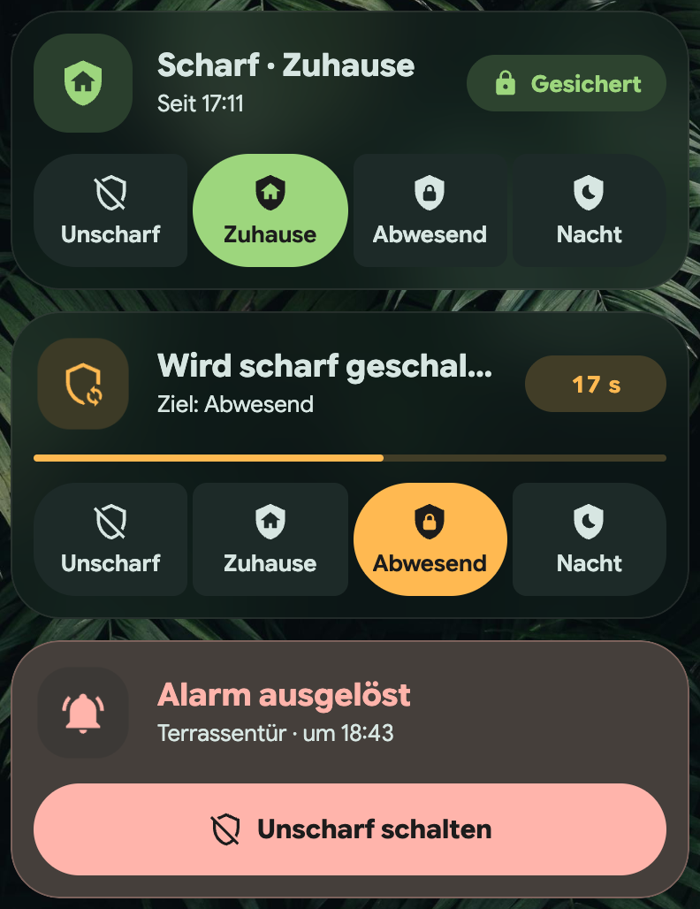 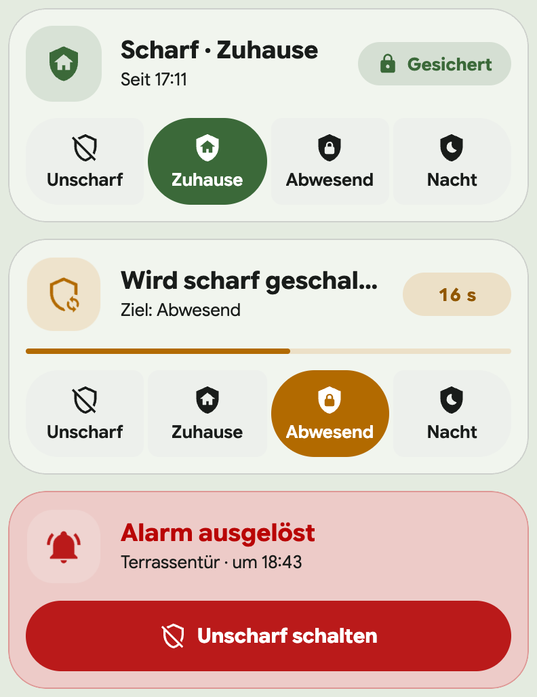

<details>
<summary>Configuration, examples & options</summary>

```yaml
type: custom:m3-alarm-card
entity: alarm_control_panel.home
```

### With Alarmo

Alarmo lists the sensors that kept it from arming (`open_sensors`) and how
long a delay runs (`delay`); the card shows both — the open sensors as chips,
the delay as a countdown with a shrinking bar. Other integrations that do not
say how long get a running bar without a number rather than a guessed one.

```yaml
type: custom:m3-alarm-card
entity: alarm_control_panel.alarmo
name: House
modes:
  - disarmed
  - armed_home
  - mode: armed_away
    name: Out
  - mode: armed_night
    icon: mdi:weather-night
```

### What it shows

| State | Header | Below |
| --- | --- | --- |
| Disarmed | Neutral, "Disarmed · since 18:29" | The mode buttons; open sensors as chips, plus "3 sensors ok" |
| Arming | Warning colour, pulsing, "To: Away" | A countdown pill and bar when the delay is known; the target mode in the warning colour |
| Armed | Accent, "Armed · Home", a "Secured" pill | The mode buttons, the active one a full pill — switch between armed modes directly |
| Entry delay | Warning colour, countdown | The code entry opens by itself |
| Triggered | The whole card in the error colour, who or what triggered it and when | One wide "Disarm" button that opens the code entry |
| Unavailable | Neutral | The buttons, disabled |

### Codes

The card asks for a code only when the panel has a `code_format`: always to
disarm, and to arm only when the panel also says `code_arm_required`. A
number code gets a keypad, a text code a field. Nothing is submitted by
itself after some number of digits — codes differ in length — so there is a
confirm button, and Enter. Confirming with nothing typed sends the command
without a code, for panels that allow cancelling an arming without one. A
rejected code shakes the dots and says so. The code is cleared after every
attempt and is never logged or stored.

### Sensors

Alarmo's `open_sensors` wins when it lists anything. For other integrations,
`sensors` takes a list of `binary_sensor`s: open ones show as chips in the
warning colour (a tap opens them), the closed ones are counted.

### Compact

`compact: true` is one row: the header and its pill. A tap on it opens the
buttons; an entry delay or a triggered alarm opens them by itself.

### Configuration options

| Option | Type | Default | Description |
| --- | --- | --- | --- |
| `entity` | string | – | An `alarm_control_panel` entity. Required |
| `name` | string | friendly name | Shown where the state does not take the header |
| `modes` | list | supported modes, max. 4 | The buttons, in order. Each a mode (`disarmed`, `armed_home`, `armed_away`, `armed_night`, `armed_vacation`, `armed_custom_bypass`) or `{ mode, name, icon }` |
| `sensors` | list | – | `binary_sensor`s for the status line, when the integration does not list open sensors itself |
| `show_sensors` | boolean | `true` | The open / ok sensor chips |
| `compact` | boolean | `false` | One row; a tap opens the buttons |
| `accent_color` | string | `primary` | The armed colour |
| `text_color` / `secondary_text_color` / `card_background` | string | theme | As on every card |
| `glass_background` | boolean | `true` | Frosted glass background |
| `radius` / `corners` | number / object | `28` | Corner radius, as on every card |
| `animation` | `auto` \| `on` \| `off` | `auto` | Pulse, morphs and the fold; `auto` respects `prefers-reduced-motion` |

</details>

## M3 Solar Battery Card

A balcony solar battery with an inverter of its own — EcoFlow STREAM, Anker
SOLIX, Zendure and the like — in the suite's frame. How full it is and how
much that is in kWh, whether it is charging or supplying the house and until
when, where the power goes (solar → battery → house) and what each solar
input brings. Nothing is assumed about the integration: every value is mapped
in the config. Grid import is left out on purpose — the power summary card
shows that.

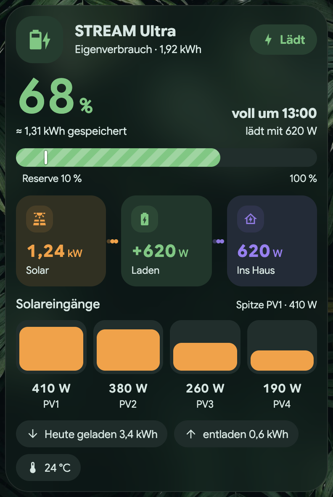 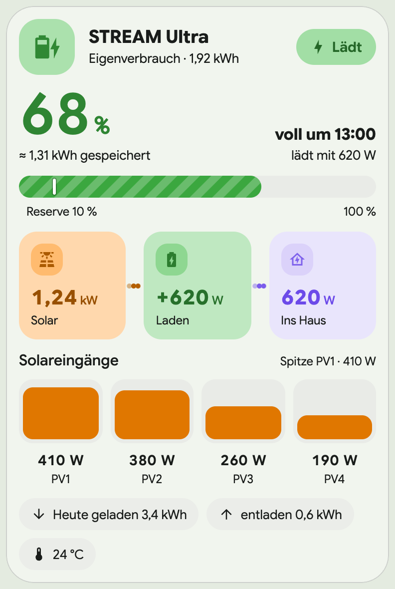

<details>
<summary>Configuration, examples & options</summary>

```yaml
type: custom:m3-solar-battery-card
name: Battery
soc: sensor.battery_level
battery_power: sensor.battery_power
```

### EcoFlow STREAM Ultra

With the EcoFlow Cloud integration (`ecoflow_cloud`). Its `power_battery`
is positive while charging, so no `invert`; reserve and charge limit are not
reported through every API, so they are fixed numbers here.

```yaml
type: custom:m3-solar-battery-card
name: STREAM Ultra
capacity_kwh: 1.92
soc: sensor.stream_ultra_battery_level
reserve: 10
battery_power: sensor.stream_ultra_power_battery
output_power: sensor.stream_ultra_power_ac
solar_power: sensor.stream_ultra_power_pv_sum
mppt:
  - entity: sensor.stream_ultra_power_pv_1
  - entity: sensor.stream_ultra_power_pv_2
  - entity: sensor.stream_ultra_power_pv_3
  - entity: sensor.stream_ultra_power_pv_4
chips:
  - entity: sensor.stream_ultra_battery_temperature
    icon: mdi:thermometer
  - entity: sensor.stream_ultra_cycles
    name: Cycles
    icon: mdi:sync
```

### With an expansion battery

The SoC in the hero and the forecast then use the total capacity and a
capacity-weighted state of charge; each extra battery gets a row of its own.
Separate charge and discharge sensors work in place of one signed sensor.

```yaml
type: custom:m3-solar-battery-card
name: Storage
capacity_kwh: 1.92
soc: sensor.main_soc
charge_power: sensor.main_charge_power
discharge_power: sensor.main_discharge_power
batteries:
  - soc: sensor.expansion_soc
    capacity_kwh: 1.92
    name: Expansion
```

### What it shows

| Part | Shows |
| --- | --- |
| Header | The battery icon (with a bolt while charging), the name, the mode or `subtitle` and the capacity; a pill: **Charging**, **Supplying** (discharging), **Ready** (below `idle_threshold_w`) or **Full** (at the charge limit) |
| Hero | The state of charge, "≈ X kWh stored"; while it moves, "full at HH:MM" or "lasts until about HH:MM" and the power |
| Bar | The charge, striped while charging; a marker at the reserve and, below 100 %, at the charge limit |
| Flow | Solar → Battery → House, dots running the way the power goes, a short dash where nothing flows. A battery that charges from the grid through its AC side runs the house link backwards. Solar is dimmed without sun |
| Solar inputs | A column per MPPT, scaled to its `max_watts`, and the peak |
| More batteries | A row per expansion battery |
| Chips | Free chips at the bottom |

The forecast is `(charge_limit − soc) / 100 × capacity / power` while
charging and `(soc − reserve) / 100 × capacity / power` while discharging,
rounded to five minutes and "over 24 h" beyond a day. It needs
`capacity_kwh` and disappears while idle.

A value that cannot be read — `unavailable`, `unknown` — shows as "–", never
as 0, and the forecast is left out. A value that is not configured leaves no
gap: a flow tile and its link are dropped, the rest share the width.

### Configuration options

| Option | Type | Default | Description |
| --- | --- | --- | --- |
| `soc` | string | – | State of charge in %. Required |
| `name` / `icon` | string | "Solar battery" / by charge | |
| `mode` | string | – | An entity whose state (an operating mode) leads the subtitle |
| `subtitle` | string | – | Fixed text or a template, when there is no `mode` |
| `capacity_kwh` | number | – | Needed for "kWh stored" and the forecast |
| `reserve` | entity / number | `0` | The discharge floor: a marker on the bar, the end of the forecast |
| `charge_limit` | entity / number | `100` | Where "full" is |
| `battery_power` | string | – | One signed sensor, positive while charging |
| `invert` | boolean | `false` | For a sensor that is positive while discharging |
| `charge_power` / `discharge_power` | string | – | Two plain sensors instead of `battery_power` |
| `solar_power` | string | sum of `mppt` | Total solar power |
| `mppt` | list | – | `{ entity, name, max_watts, tap_action }`; `max_watts` (default 500) fills the column |
| `output_power` | string | – | What the inverter feeds into the house |
| `batteries` | list | – | `{ soc, capacity_kwh, name, tap_action }` |
| `chips` | list | – | `{ entity \| template, name, icon, unit, color, tap_action }` |
| `hide_mppt_without_sun` | boolean | `false` | Hides the inputs while all read 0 W |
| `idle_threshold_w` | number | `10` | Below this nothing flows |
| `kw_threshold` | number | `1000` | From here values read in kW |
| `show_bar` / `show_flow` / `show_mppt` / `show_forecast` | boolean | `true` | |
| `tap_action` | action | more-info on `soc` | The header icon |
| `solar_tap_action` / `battery_tap_action` / `output_tap_action` | action | more-info | The flow tiles |
| `solar_color` / `battery_color` / `house_color` | string | solar orange / green / violet | The colours of the power summary and energy flow cards |
| `flow_tint_opacity` | number | `14` | How strongly the tiles are tinted |
| `text_color` / `secondary_text_color` / `card_background` | string | theme | As on every card |
| `glass_background` | boolean | `true` | Frosted glass background |
| `radius` / `corners` | number / object | `28` | Corner radius, as on every card |
| `animation` | `auto` \| `on` \| `off` | `auto` | Dots, stripes and bars; `auto` respects `prefers-reduced-motion` |

</details>

## Development

```bash
npm install
npm run dev     # watch build to dist/m3-cards.js
npm run build    # production build
npm run lint     # typecheck
```

For local testing, copy `dist/m3-cards.js` to `config/www/` and add
it as a Lovelace resource (`/local/m3-cards.js`, type "JavaScript
module").

## Credits

**M3 Lights Overview**, **M3 Chip Buttons** and **M3 Group Card** were built by
Fabian Wendel ([UHaFnir](https://github.com/UHaFnir/m3-cards)) in a fork of
this project, along with the weather card's independent header/chart toggles
and its configurable hourly strip. Two performance faults in code that was
already here were his finds as well: every auto-discovering card refetched the
whole entity registry instead of reading the copy the frontend already holds,
and opening Home Assistant's card picker ran a full-house scan nine times over.

The card and editor sections above for those three cards are largely his prose,
lightly adapted.

## License

MIT
