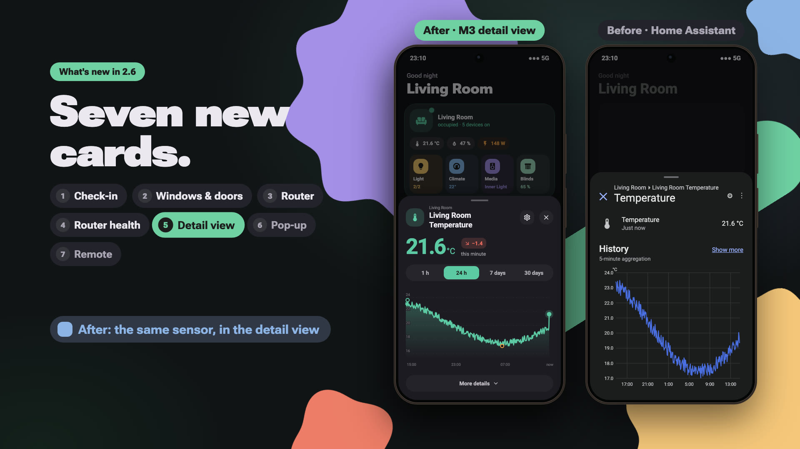
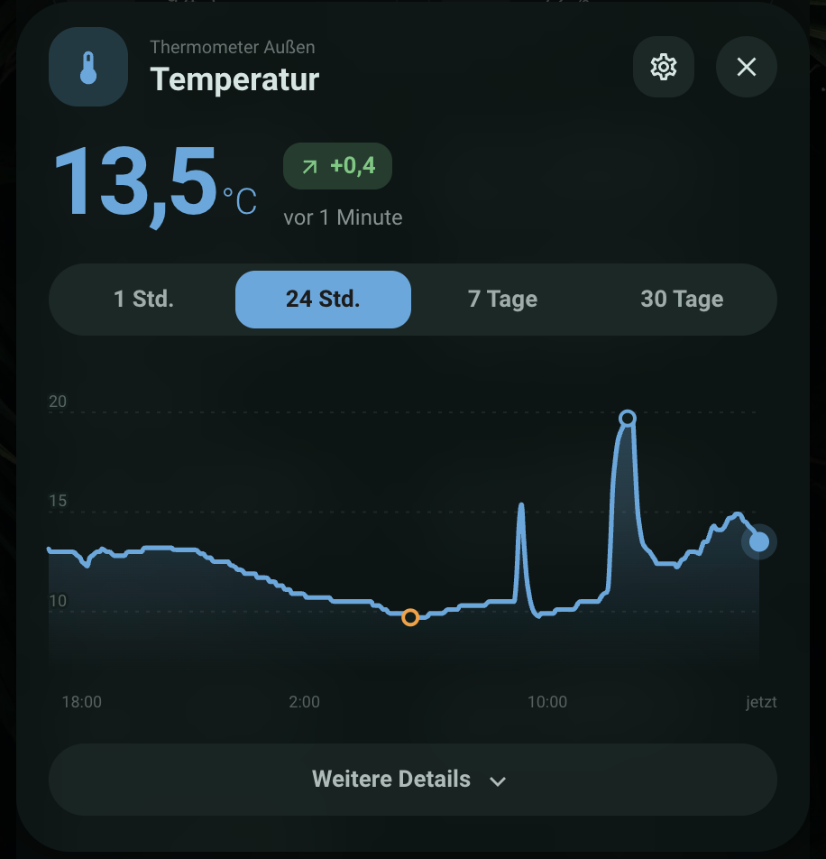
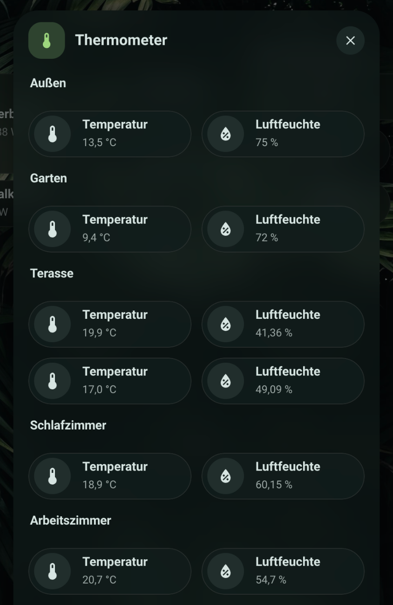
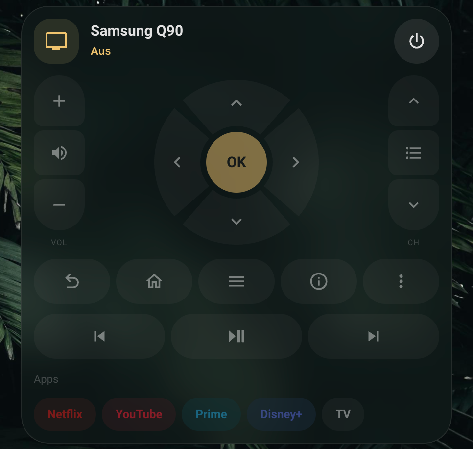
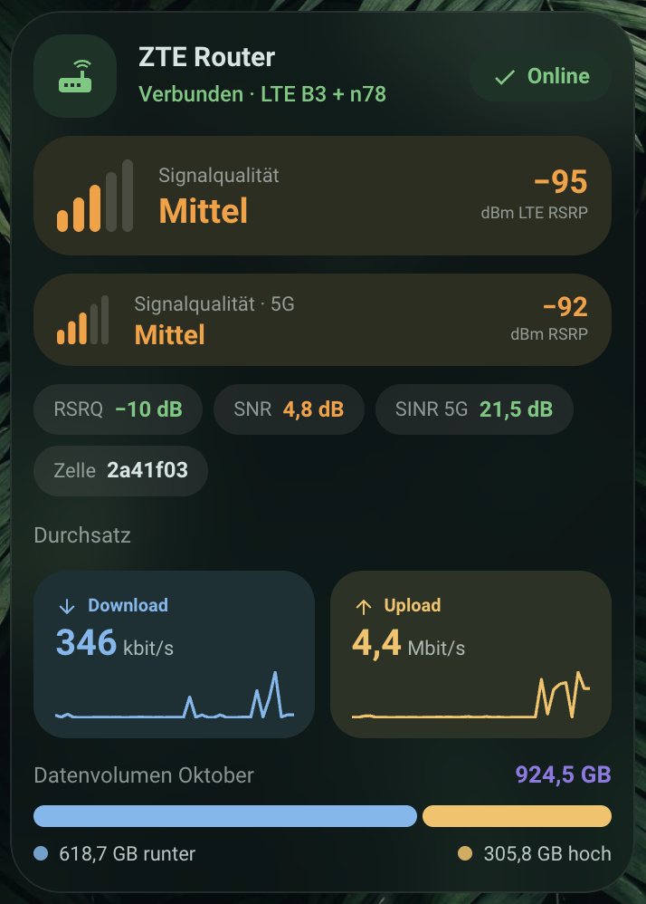
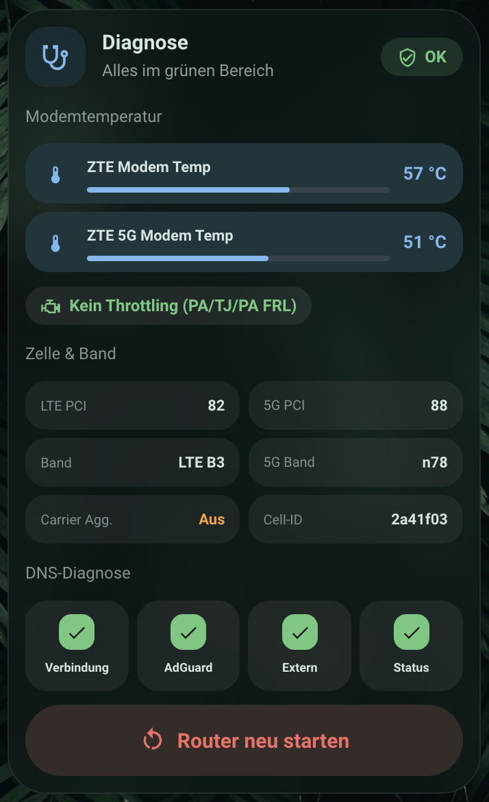
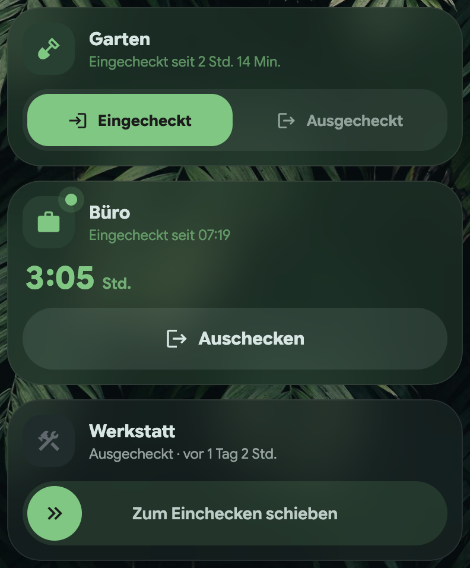
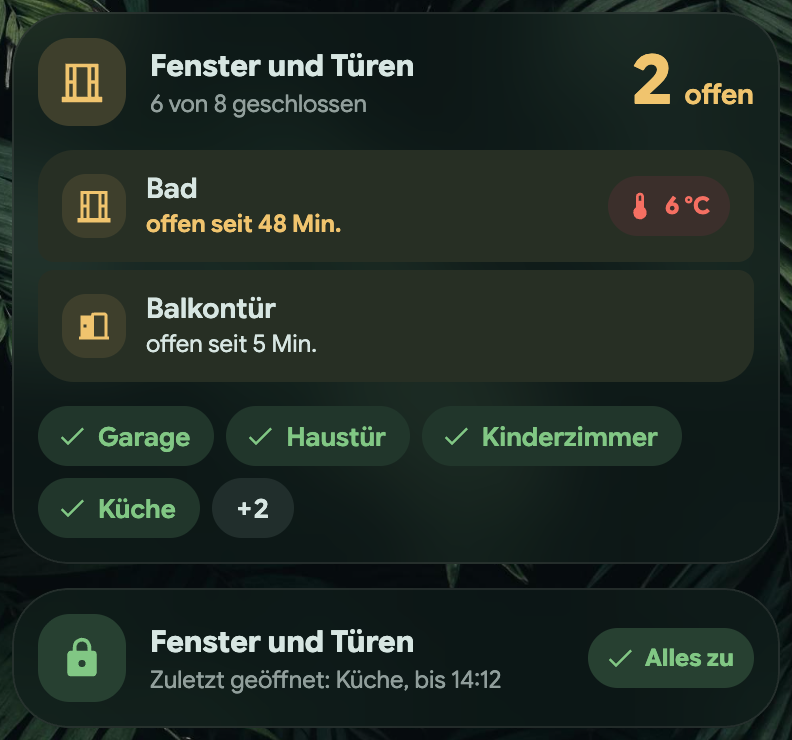

# M3 Cards 2.6.0

<p align="center"><a href="https://github.com/j0sp0r/m3-cards/releases/download/v2.6.0/m3-cards-2.6.mp4"></a></p>

<p align="center"><sub>What's new in 2.6, in 38 seconds with sound, is attached below: <code>m3-cards-2.6.mp4</code> (landscape) and <code>m3-cards-2.6-phone.mp4</code> (portrait).</sub></p>

**Upgrading:** no option was removed, so existing configs load unchanged; the
one renamed key (the waste card's `max_rows`, now `max_visible`) is still read.
Some things look or behave differently without having been asked for, and the
first is a reversal rather than an addition:

- **The heading card takes the theme's primary colour** when it has no `color`
  of its own. It used the suite's house blue (`#85b7eb`), which put a blue icon
  between the green ones of the button and nav cards on any theme whose primary
  is not blue. `color: "#85b7eb"` keeps the old look.
- **Cards vibrate on tap in the companion app**, as Home Assistant's own
  toggles do. `haptics: false` on a card, or Home Assistant's "Vibrate"
  profile setting, turns it off.
- **Every card has exactly one rim.** On a theme that leaves Home Assistant's
  own card border switched on — the default theme does — an M3 card drew its
  frame *and* that border, a double rim. It is one rim now, whatever the theme.
- **The NAS card's sync notification changed shape** (one message per error,
  naming the failed items). An automation the card created earlier keeps the
  old shape until notifications are switched off and on again in its editor.
- **The appliance card's chips keep one colour.** They took the colour of the
  current state rule, so a grey "Ready" rule turned every reading grey. They
  now use their own `color`, else the card's accent colour; the state still
  colours the icon, the status line and the bar. An idle machine also no
  longer shows a progress bar at 0 %, and a finished one no longer shows
  "0 min left".
- **Cards change height by a few pixels.** Every content card now has the same
  frame — 12px padding, 12px between blocks, a 44px header — where they used
  to pad 12 or 14px and space their blocks anywhere from 10 to 16. Cards side
  by side stand equally tall; a card that is folded to its header is 70px
  wherever it sits.
- **`wave_style: flat` is flat on the progress and light cards** whatever the
  animation setting. It used to apply only with `animation: off`, so a card
  set to flat and left at auto kept its wave.
- **The weather card's daily bars are coloured by the temperature.** They ran
  from blue to red across the week's own range, so the warmest day of a cold
  week was red at 10 °C. Each bar is now a gradient on a fixed outdoor scale:
  blue to 0 °C, green around 17, red from 30.
- **The printer and vacuum cards no longer print a version number** at their
  foot. It appeared whenever the visual editor had saved the card.

A card added from the card picker now starts in the theme's primary colour:
the appliance, progress, counter, status, clock, time, energy, cost,
power-list, top-consumers, weather, media, to-do, aquarium, occupancy, cover,
leak and supply cards arrive with `accent_color: primary` in their config.
The cards already on a dashboard have no such line and keep the colour they
had.

This release is about the parts of a dashboard that are not a card on a grid:
the details behind a tap, the pop-up behind a button, the remote on the sofa
and the router in the hallway cupboard. Five new cards, and the existing ones
learned to open the first of them. Two more say who is in and what is open:
a check-in card that is one element instead of two buttons, and a card for
windows and doors that warns when one is left open on a cold day. And the
machines in the utility room: the
appliance and printer cards learned to fold, to draw their readings as tiles
and to say when a run has started and when it is done. Last, the suite was
gone over as a whole — one frame for every card, one name for every setting.

The suite registers 51 cards.

## A detail view of its own

<p align="center"></p>

`m3-detail-card` is one entity, large. A number gets its value, a trend chip
against the start of the period, a smoothed curve on a quiet scale and its
minimum, average and maximum. A door gets a timeline. A lamp gets its own M3
card with the timeline under it. Below all of these sit the other entities of
the same device, and a tap steps the view sideways to one.

Home Assistant has no way for a card to replace the more-info dialog for the
whole frontend, so there are two ways in. **`detail_mode: sheet`**, in the
appearance section of every editor whose card can open details, makes those
taps open the view as a bottom sheet, frosted like the card it came from. The
default stays `more_info`. The card itself also works anywhere a card can go —
on a dashboard, in a browser_mod or bubble-card popup, or in the suite's own
popup.

History comes from long-term statistics where they exist and from the History
API where they do not, thinned to 300 points without losing the spikes. The
curve is a monotone cubic, so it never swings past a reading. A meter's total is
read from its readings rather than from the statistics' `change`, which on one
real group of meters carried 2,894.5 kWh for a day the meter rose by 13.

Under the hood every card now opens details through one function. Forty call
sites used to fire `hass-more-info` themselves; a test now fails if one goes
back to doing so.

## Pop-ups without a second card library

<p align="center"></p>

`m3-popup-card` holds other cards — M3 or any other — in a bottom sheet that a
URL hash opens. A button that navigates to `#remotes` opens the popup whose
`hash` is `#remotes`, which is how Bubble Card's pop-ups work, so a dashboard
built on them keeps its buttons and swaps only the pop-up card. The sheet is
the detail view's: same grip, same motion, same close button. Back closes it.

Cards sit on twelve columns as in a sections view, so two cards at
`columns: 6` share a row. Home Assistant's own cards get the M3 rim. A popup
can carry its own background and text colours — set as the theme's text colours
on the sheet, so every card on a light sheet follows — and `animation: off`
opens it in place.

## A remote with a ring

<p align="center"></p>

`m3-remote-card` is one card with per-brand profiles rather than one card per
brand: these devices differ in what they call each key, not in the shape of a
remote control. Profiles ship for `samsung`, `google_tv`, `lg_webos`,
`appletv`, `kodi` and a `generic` fallback, and the profile is read from the
entity registry instead of being guessed from the entity id.

The directional pad is a ring, not a 3×3 grid with two cells spent on nothing.
A press fills its sector and OK morphs from circle to squircle — not as
decoration: a television never reports that it received a key, so the
animation is the only acknowledgement there is. On Android TV the card can
type, which turns a search on the television from twenty-six d-pad presses into
a phone keyboard. What a device cannot do is left out rather than drawn as dead
buttons, and power always goes through the remote entity when there is one.

## A router, graded rather than printed

<p align="center"> </p>

`m3-router-card` and `m3-router-diagnostics-card` were built against a ZTE
MC801A and work with a Fritzbox, a Huawei or a GL.iNet; every block appears
only when its entities exist.

−94 dBm means nothing to most people, so the connection card sorts each radio
reading into one of five steps and says which. RSRP, RSRQ and SNR get scales of
their own, and 5G is graded about 5 dB stricter than LTE because an NR carrier
spreads the same power over more resource elements. A fibre line is graded as a
window rather than a ramp: an ONT receiving too much light is as unhappy as one
receiving too little. Throughput reads its unit off the entity and starts with a
sparkline from the recorder, and monthly volume honours binary units.

The diagnostics card carries modem temperatures, cell and band, reachability
checks and a restart button that takes two taps and disarms itself after four
seconds — an armed red button on a wall tablet is a trap for whoever walks past.

## Checked in or out, in one element

<p align="center"></p>

Two buttons, "check in" and "check out", say nothing about which is true —
and "on" under one of them reads as if that button were on. `m3-checkin-card`
is one element that shows the state and switches it. The whole card takes the
state's colour: the accent while checked in, a neutral grey while out, so out
never reads as a fault.

It comes in three styles. `segmented` puts the two states side by side and
names them as states — "Checked in", "Checked out" — never as verbs. `status`
leads with how long, the running time large in tabular figures, a dot pulsing
on the icon while checked in, and one full-width button that names the action,
the one place a verb is right. `swipe` asks for a deliberate slide, for a phone
in a pocket or a tablet by the door: past three quarters it counts, short of
that the handle springs back, and a tap only nudges it the way it goes. With a
keyboard it is a switch; under reduced motion a tap does it.

A tap moves the control at once. If Home Assistant has not confirmed within
`optimistic_timeout`, it goes back and says so, rather than jumping silently.
"Checked in for 2 h" counts from the real change: a restart, or a mirrored
entity reconnecting, writes the same state again with a new `last_changed`,
and the card looks past that in the recorder. Past a day it says "1 day 3 h",
past two "2 days".

`user_entity_map` puts several people on one card: each Home Assistant user
switches their own entity, and everyone checked in shows as avatars. `confirm`
asks first — "Sure?" on a first tap, or a 600 ms hold — for a card where a
slip would matter.

## Windows and doors

<p align="center"></p>

`m3-openings-card` changes with the house. While something is open it leads
with it: the count beside the header, and the open sensors as one joined group,
longest open first, each with how long it has been open. Open longer than
`warn_after_minutes` while it is colder outside than `cold_below`, a row turns
its duration amber and shows a red pill with the outdoor temperature — an open
window on a warm evening is no news. The closed ones are green chips, with a
"+N" for the rest. Everything closed shrinks the card to one line: a green
lock, "Last opened: Kitchen, until 14:12".

A sensor that does not answer is shown as one, and never counted as closed.
The durations come from the recorder, so a restart does not reset a window
that has been open all afternoon to "2 min". Without a list the card finds
every door, window, opening and garage-door sensor itself, as the battery card
finds batteries, with the same area, label and exclusion filters.

## The utility room

A washer and a dryer side by side are two cards that are mostly read: what is
running, how long is left, what it used. The appliance card now serves that
page as well as the one with the buttons.

**`chip_style: tile`** draws the readings as tiles, two to a row on a phone,
instead of a row of small pills. A tile is drawn the way a button card draws
itself — the same height, rim, corner and round icon well, the name bold with
the reading under it — so it sits beside a room's buttons as one design. A
switch's well is grey while off; on, the well and the tile square their
corners, as a button card with `shape_by_state` does. Binary sensors — a door, a
child lock, a leak — show on and off the same way. **`tile_appearance:
active`** draws every reading squared and filled too, so a card of figures
looks like a room of switched-on buttons, while switches and sensors keep
following their state; a tile's own `appearance` overrides it. An entry with a
`heading` and no `entity` is a divider across the full width, for a list that
gathers readings from more than one device. The editor edits all of it:
pill or tile, dividers, and arrows to reorder.

**`collapsible: true`** folds everything but the header, the way the vacuum and
printer cards fold. The editor asks the question the right way round — **Stays
visible when folded** — so keeping the progress bar in view while the rest
folds is one tick; it used to list what folds away, and an empty list meant
everything. The chevron is left out while there is nothing to fold: a dryer
that is off reports its door and child lock as unavailable, and an arrow
toggling an empty card reads as a broken one.

The card now tells idle, running and done apart without rules for each. An
idle machine — SmartThings' `none`, Home Connect's `ready` and `inactive` —
shows no bar. A run at 100 % with under a minute left is done even while the
state still says `run`, which is how a Bosch dryer reports the anti-crease
phase that follows the drying. Only an unavailable entity greys the card out;
it used to take a Samsung's idle `none` for one.

### Running, done, idle

Each state draws its own card. **Running**: the time left, large, in the top
right, with "done at 15:18" under it, and the bar with its percentage on one
line. **Done**: a "✓ Done" pill where the time was, "Done 12 min ago" as the
status, no bar — and, with `finish_action`, a full-width **Emptied** button
in the supply card's style, for a status that does not clear itself. **Idle**:
the state in a pill in its own colour, the same pill as "Done" and the
vacuum's battery, with how long it has been idle under the name. The height eases from one to the next, and
the pill folds the card: "Ready ⌄", "✓ Done ⌄", the vacuum's "100 % ⌄", and on
the room card a new "4 on ⌄" — one tint, size and type for every status pill.

### Done, and started

The editor's **Notification** section sets up the automation that says the
laundry is ready. It listens for the two ways a machine says so — the state
turning to a finished value, and the progress reaching 100 % — and sends one
message per run, whichever arrives first, however far apart they are. A change
counts only when the reading it left had stood for a minute, so a dryer
dropping off Wi-Fi in its anti-crease phase, or template entities being
reloaded, is not announced as a run finishing.

**Also on start** adds a message when a run begins, with its expected end:

> Washing machine has started. Done around 18:02.

It waits 90 seconds, because most machines know their completion time only
once they have weighed the load. Both texts come prefilled in the editor, to
edit rather than to write from nothing, with `{geraet}` for the card's name and
`{ende}` for the expected end.

Every card that sets up a notification — appliance, progress, NAS, updates,
waste and the rest — now lets you file the automation under a category from
Home Assistant's own list. The choice is stored where Home Assistant keeps it,
so a category changed there shows in the card too.

A machine with no integration at all — a dishwasher on a plug that measures
power — gets the same card. The appliance card's documentation now carries the
three template sensors that turn a plug's power draw into a status, a
progress and the minutes left, with a table of what to read off your own
machine's history first. One thing it learned the hard way: a dishwasher dries
silently, at exactly its standby draw, for half an hour after its last pump —
"quiet for ten minutes" called it done while its own display still counted
down. The end is the machine switching itself off, and that is what the
example listens for.

**`cards`** puts other cards inside the appliance card, under its readings
and folding with them — the tablet supply inside the dishwasher it feeds.

### The printer joins in

The printer card takes the same **`chips`**, tiles and dividers: the enclosure,
the AMS, a filament dryer, the sockets, at the foot of the card in place of the
details block if you like. It has the same **Notification** section — a print
finished, a print failed, and optionally a print started with its expected
end — listening for every status the card reads as finished, error or
printing. It takes **`wave_style`**, its fold chevron appears only when there
is something to fold, and while the printer is switched off the camera — which
could only show the last frame from before — is left out.

The progress card reads a remaining time the way the appliance card does:
minutes, seconds, a clock string or a completion timestamp. Home Connect
reports the last of these, which the card used to show as "2026 min
remaining".

## A tap you can feel

In the companion app, every card now gives the short vibration Home
Assistant's own toggles give when one of its controls is used — a button, a
switch, a slider, a chip that does something. A tap on the card's empty
surface stays silent. "Vibrate on tap" in a card's appearance section, or
`haptics: false`, turns it off for that card, and Home Assistant's "Vibrate"
profile setting for the whole device.

## A button for the sidebar

A navbar usually takes the place of Home Assistant's header, and with it the
button that opens the sidebar. **`action: sidebar`** brings it back — as a
navbar entry, in a submenu or the action button's menu, or as any M3 card's
`tap_action`. On a phone the drawer slides in; on a wide screen the docked
sidebar expands or collapses.

```yaml
action_button:
  menu:
    - name: Sidebar
      icon: mdi:menu
      tap_action:
        action: sidebar
```

## One frame, one name

A dashboard is read as a whole, so the cards were gone over as one. Every
content card now has the same frame: 12px padding (following a group card's
setting), 12px between blocks, a 44px header with a 44px icon. Two cards in a
row stand equally tall, and a block with nothing to show takes no space —
the printer card used to draw an empty controls row that still took its gap. Folding eases now: the appliance, printer and vacuum cards grow or
shrink into their new height instead of jumping, as the room card already did,
and the vacuum card can fold its main buttons too (`controls`), so a folded
vacuum is one line like every other folded card.
The hero cards (room, aquarium, weather, cost, supply, waste) keep their
larger header by design.

And every setting now has one name. An audit read the labels out of all 49
running editors: "Tap-Aktion", "Tippen" and "Tap action" were one setting,
"Ausklappbar", "Raum aufklappbar" and "Faltung merken" were the fold, and
auto-discovery had nine wordings. The actions, the fold, haptics, recipients,
"when to notify", discovery, area and label filters, exclusions, forecast,
comparison, self-sufficiency, data source and "show state" now read the same
on every card, in English and German. The printer editor, which showed thirty
raw keys such as `stage_entity`, names them all, and a few editors gained
fields their cards already read: the router's and the vacuum maintenance
card's tap action, and the fold's helper and memory on the vacuum cards.

## Also new

- **The aquarium card knows whether the fish were fed.** Point
  `feeding_entity` at a date-and-time helper: a Feed tile logs the feeding and
  stays lit for the rest of the day, and a chip says when — or warns once the
  day passes `feeding_due_time` (19:00 by default). As with cleaning, the
  editor creates the reminder, and its notification has a **Fed ✓** button
  that logs the feeding from the phone.

## Also fixed

- **The time card follows a change made elsewhere.** An untouched card took
  every outside change for a conflict, kept the old time and said "Value was
  changed elsewhere". Its own Apply no longer counts as an outside change
  either, however the new state arrives.
- **The updates card no longer asks for the entity registry in a loop** when
  no `update` entity is registered or the request fails.
- **The remote card is round in a wide column** rather than a square box
  inside a round, empty card.
- **The NAS card's notification no longer arrives twice** and names the failed
  items instead of the folder's momentary state.
- **Scrolling over Home Assistant's own cards in a sheet** no longer opens the
  row under the thumb.
- **The weather editor showed hour labels as off** while the card drew them.
- **The supply card's range ignores corrections made by hand.** Setting a
  counter from 46 to 25 read as 21 used at once; only drops of one or two
  count as use now.
